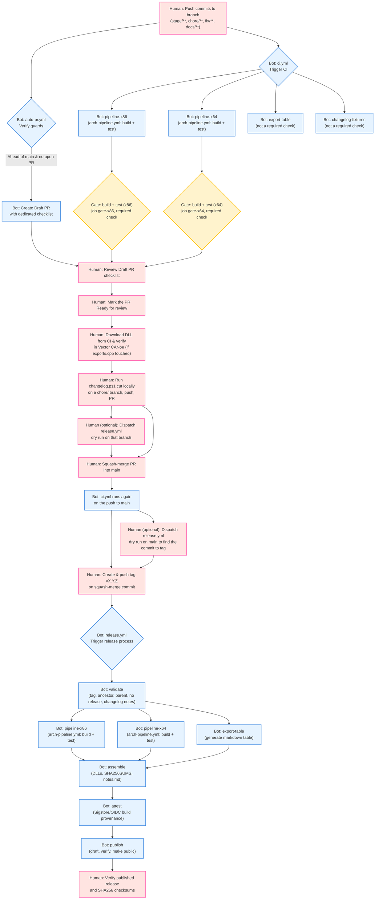
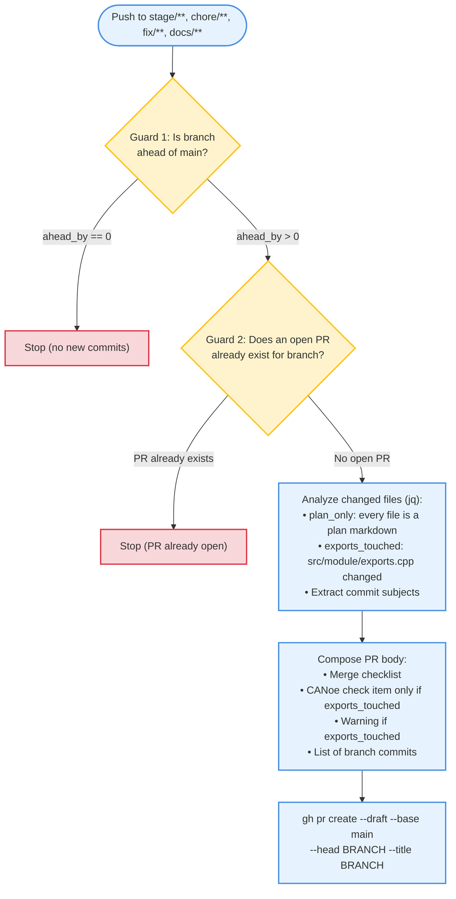
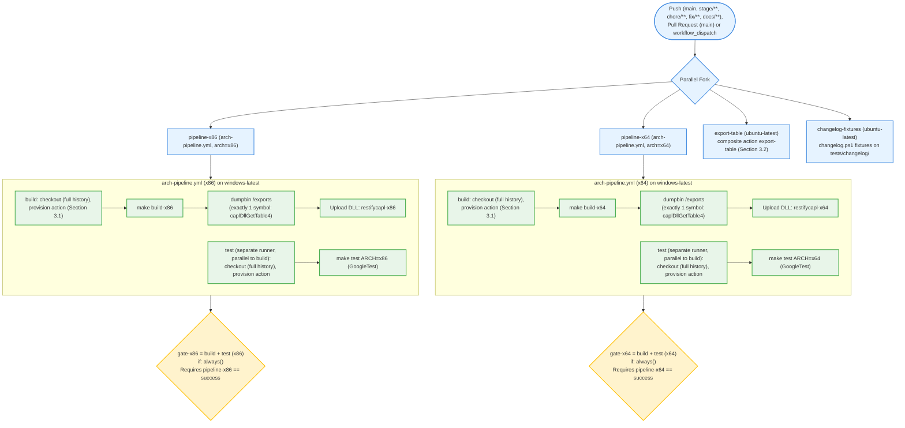
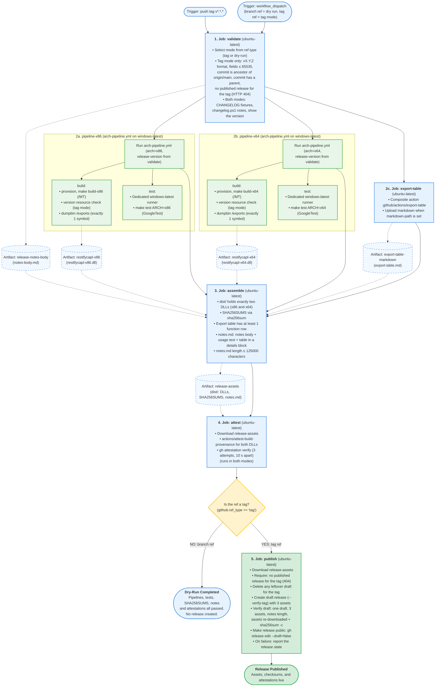

# CAPL REST DLL – GitHub Actions Current Flow & Human Gates

Documentation and mapping of the CI/CD flow and Human Gates for the `restifycapl` project, as implemented on `main`.

This document maps who does what (a human or a workflow). The reasons behind individual design decisions live elsewhere and are not repeated here: see [docs/ci-pipeline.md](ci-pipeline.md) for CI and cache rationale and [docs/release-process.md](release-process.md) for the release procedure, its safeguards and recovery steps.

Items marked **(repo setting)** are configured in the GitHub repository settings, not in code in this repository, so this document cannot confirm them from the workflows themselves (see Section 6).

---

## 1. End-to-End Overview

The diagram below illustrates the complete lifecycle of code: from pushing commits on a working branch, through automated Draft PR creation, CI pipeline execution, human decision points (CANoe verification, CHANGELOG cut), up to tagging and release publication with cryptographic build provenance.

The release cut itself travels through the same path as any other change: the `chore/` branch carrying the cut is pushed, `auto-pr.yml` opens its Draft PR, `ci.yml` runs, and the human squash-merges it (the diagram shows the cut as the last step before the merge for readability). The squash-merge is itself a push to `main`, so `ci.yml` runs once more on `main`; by convention the maintainer waits for that run to be green before starting a cut (see [docs/release-process.md](release-process.md)). Pushing a tag does not start `ci.yml` or `auto-pr.yml`; it starts only `release.yml`.

---

## 2. Detailed Flow: `auto-pr.yml`

Workflow executed on every push to the working branches `stage/**`, `chore/**`, `fix/**` and `docs/**` (permissions: `contents: read`, `pull-requests: write`; it authenticates with the workflow's `GITHUB_TOKEN`). Safely creates a Draft PR with a checklist tailored to the touched files. Creating the PR requires the repository setting "Allow GitHub Actions to create and approve pull requests" **(repo setting)**; if it is off, the `Create draft PR` step fails visibly.

Details:

- **Guard 1** reads `ahead_by` from the GitHub compare API (`main...BRANCH`); with 0 the run stops, because `gh pr create` would fail on a branch with no commits.
- **Guard 2** looks for an open PR with the branch as head; if one exists the run stops, so a PR is created on a push only while no open PR exists for the branch (after a PR is closed or merged, the next push with commits ahead of `main` creates a new one).
- **Classes**: `plan_only` is true when every changed file is a markdown file under a `docs/work/<slug>/plans/` directory; `exports_touched` is true when `src/module/exports.cpp` is among the changed files. There are exactly these two classes.
- **Checklist** (always): CI green on both legs (`build + test (x86)`, `build + test (x64)`), `code-reviewer` clean, human gate passed against the PR CI artifact if the branch has one, `CHANGELOG.md` `[Unreleased]` entry present, branch up to date with `main`, plan folded into `plan.md`. A `plan_only` branch gets a note that the reviewer, human-gate and changelog items do not apply.
- **CANoe check item**: added to the checklist only when `exports_touched` (the CAPL nodes in `capl/` must compile in CANoe against the DLL from the PR's CI artifact).
- **`exports.cpp` warning**: when `exports_touched`, the body warns never to have two open PRs touching this file, and to check the `export-table` result, which is not a required check, so a red result does not block the merge.
- **TODO line**: its wording depends on the branch prefix (`stage/` and `chore/` derive identifiers from the branch name; `fix/` and `docs/` get a generic line).
- The body is composed once, at PR creation; later pushes do not update it.
- The PR is created as a draft. Because it is created with `GITHUB_TOKEN`, GitHub does not start new workflow runs for the PR-creation event itself; the checks on the PR come from the `ci.yml` run triggered by the branch push on the same head commit **(platform behavior, not verifiable from code)**.

---

## 3. Detailed Flow: `ci.yml` and `arch-pipeline.yml`

`ci.yml` triggers on:

- `push` to `main`, `stage/**`, `chore/**`, `fix/**`, `docs/**` (tag pushes are deliberately not covered, so CI does not race `release.yml`);
- `pull_request` targeting `main`;
- `workflow_dispatch` (no inputs): runs the same jobs on any ref, so the required checks can be produced for a branch no push filter covers.

Workflow permissions are `contents: read`.

CI continuously enforces architecture parity (x86 and x64) as well as compliance with the Vector CANoe export contract. In `arch-pipeline.yml` the `build` and `test` jobs have no `needs` relation: they are **separated and executed in parallel** on dedicated `windows-latest` runners. The `export-table` and `changelog-fixtures` jobs run on `ubuntu-latest`; neither is a gate or a required check.

The two jobs named `build + test (x86)` and `build + test (x64)` are the gates (job ids `gate-x86` and `gate-x64`). They are the required status checks **(repo setting, confirmed by the repository owner)**. Each gate runs on `ubuntu-latest` with `if: always()`, needs its pipeline job, and fails with exit 1 unless the pipeline result is exactly `success`; this way a skipped or failed pipeline can never be read as a pass.

### 3.0. `arch-pipeline.yml` in detail

Reusable workflow (`workflow_call`) with inputs `arch` (`x86` or `x64`, required) and `release-version` (optional, default empty: a development build). `ci.yml` never passes `release-version`; `release.yml` does (Section 4).

| Job | Steps |
|---|---|
| `build` (`windows-latest`) | <ol><li>Checkout with `fetch-depth: 0` (the Makefile runs `git describe` and `git rev-list`).</li><li>Provision action (Section 3.1).</li><li>`make build-<arch>`. When `release-version` is non-empty it is first validated as `X.Y.Z` with no leading zeros and with every field at most 5 characters and at most 65535, and is passed to make as `VER_MAJOR`, `VER_MINOR`, `VER_BUILD` and `VER_REV=0` (consumed by `src/module/version.rc`). Otherwise make runs without version arguments.</li><li>Only when `release-version` is non-empty: read the built DLL's version resource (`FileVersionInfo`) and require the numeric version `X.Y.Z.0` and both `FileVersion` and `ProductVersion` equal to `vX.Y.Z`.</li><li>`dumpbin /exports` on `build/<arch>/restifycapl-<arch>.dll`: exactly one exported function, named `caplDllGetTable4`; the dumpbin output is also written to the job summary.</li><li>Upload the DLL as artifact `restifycapl-<arch>`.</li></ol> |
| `test` (`windows-latest`) | <ol><li>Checkout with `fetch-depth: 0`.</li><li>Provision action (Section 3.1).</li><li>`make test ARCH=<arch>` (GoogleTest suite, run outside CANoe). Runs on every pipeline call, once per architecture. No `needs`: it runs in parallel with `build`.</li></ol> |

### 3.1. Composite action `provision` (`.github/actions/provision`)

Used by both `build` and `test`, once per job. Input: `arch`. Steps in order:

1. Validate that `arch` is exactly `x86` or `x64`.
2. Activate the MSVC developer environment for that architecture (`ilammy/msvc-dev-cmd`). This is the CI equivalent of a Native Tools prompt; CI never calls `scripts/setup-dev-env.ps1`.
3. Re-pin `VCPKG_ROOT` to a CI-only per-runner path (the previous step overwrites it), and set `VCPKG_PINNED_TAG` and `VCPKG_INSTALL_ROOT` (a per-architecture install root in the workspace).
4. Expose the runner image version for cache keys.
5. Install `make` with Chocolatey, only when `make` is not already on `PATH`.
6. Restore the vcpkg tool checkout cache (shared by all jobs and both architectures).
7. Bootstrap vcpkg (full clone, checkout of the pinned tag, `bootstrap-vcpkg.bat`) only when the tool cache was not hit.
8. Verify that the pinned vcpkg tool commit equals `builtin-baseline` in `vcpkg.json`.
9. Restore the vcpkg install-root cache (keyed per triplet, `vcpkg.json` hash and image version).
10. `vcpkg install` for the `<arch>-windows-static` triplet, always run (also on a cache hit), and require that the triplet's `lib` directory exists.
11. Place the libraries where the Makefile expects them: `libcurl.lib` and `zs.lib` into `lib/<arch>/`, `gtest.lib` and `gtest_main.lib` into `lib/gtest/<arch>/`, and the curl and gtest headers into `include/vendor/curl/` and `include/vendor/gtest/`.
12. Verify `/MT` provenance with `dumpbin /directives` on those four libraries: each must declare `/DEFAULTLIB:LIBCMT` (and not `LIBCMTD`) and must not declare `/DEFAULTLIB:MSVCRT`.

Rationale for the pins, the caches and the `VCPKG_ROOT` handling: [docs/ci-pipeline.md](ci-pipeline.md) and [docs/development-environment.md](development-environment.md).

### 3.2. Composite action `export-table` (`.github/actions/export-table`)

Used by the `export-table` job in `ci.yml` and in `release.yml`. Steps:

1. Run the fixtures: `scripts/list-export-table.ps1 -FixtureDir tests/export-table`.
2. (`if: always()`) Parse `src/module/exports.cpp` with `scripts/list-export-table.ps1`, writing the markdown table to a file under the runner temp directory. Only when that file exists after the run, the action output `markdown-path` is set; otherwise it stays empty.
3. (`if: always()`) Write the job summary: a pass line (function and category counts), a failure line, or a "no result" line, preceded by a note if the fixtures did not succeed, followed by the markdown table when it exists.

In `ci.yml` this job is informational (not a required check). In `release.yml` it is a dependency of `assemble` and `publish`, so a failing export table blocks a release.

### 3.3. `changelog-fixtures` job

Runs `scripts/ci/changelog.ps1 fixtures -FixtureDir tests/changelog` on `ubuntu-latest` (via `pwsh`). Not a required check.

---

## 4. Detailed Flow: `release.yml`

The `release.yml` workflow provides deterministic, secure, and atomic releases of `restifycapl-x86.dll` and `restifycapl-x64.dll`. It triggers on a push of a tag matching `v*.*.*` and on `workflow_dispatch`. Workflow permissions are `contents: read`; each job narrows or raises them as listed in 4.2. Runs are grouped by `release-${{ github.ref }}` with `cancel-in-progress: false`, so a second run for the same ref queues instead of cancelling the first.

**The mode follows the ref type**, decided in the `Select mode` step of `validate` from `GITHUB_REF_TYPE`:

1. **Tag mode (the ref is a tag)**: reached by pushing a `v*.*.*` tag, and also by dispatching the workflow manually with a tag selected as the ref. The tag is validated, the version from the tag is built into the DLLs' Windows version resource, the full pipeline runs, and the `publish` job runs.
2. **Dry-run mode (the ref is a branch)**: reached by dispatching the workflow manually on a branch. The tag validation is skipped, the DLLs are built as development builds (`release-version` is empty), and everything up to and including `attest` runs. **The `publish` job is skipped** (`if: github.ref_type == 'tag'`), so nothing is published.

The `publish` condition checks only the ref type, not the event name: a manual dispatch with a tag as the ref therefore also publishes.

### 4.1. Architecture and Artifact Flow Diagram: `release.yml`

The diagram below reflects the actual GitHub Actions DAG structure. Jobs `pipeline-x86`, `pipeline-x64`, and `export-table` declare `needs: validate`, meaning they fan out **concurrently and independently** upon completion of validation.

### 4.2. Detailed `release.yml` Job Breakdown

| Job | Environment (`runs-on`) | Permissions (`permissions`) | Key Tasks & Assertions | Generated / Consumed Artifacts |
|---|---|---|---|---|
| `validate` | `ubuntu-latest` | `contents: read` | <ul><li>Full repository checkout (`fetch-depth: 0`, needed for the `origin/main` ancestor check).</li><li>`Select mode`: `tag` when `GITHUB_REF_TYPE` is `tag`, otherwise `dry-run`.</li><li>**Tag mode only** (`Validate the tag`): tag matches `vX.Y.Z` with no leading zeros; each field has at most 5 characters and is at most 65535; `git merge-base --is-ancestor $GITHUB_SHA origin/main` holds; the tagged commit has at least one parent; no published release exists for the tag (`gh api .../releases/tags/$TAG` must return HTTP 404; any other error fails the step). Sets outputs `tag` and `version`.</li><li>**Both modes**: run the fixtures in `tests/changelog/` (`changelog.ps1 fixtures`), then `changelog.ps1 notes -Mode <mode> -Sha $GITHUB_SHA` writes the notes body (Section 4.4).</li><li>**Both modes** (`Show the version`, never fails the job): tag mode writes the version from the tag to the job summary; dry-run mode runs `changelog.ps1 next-version` and writes the computed next version (exit 0), the reason no version can be computed (exit 1), or a warning about the exit code (anything else) to the job summary.</li></ul> | **Produces:** `release-notes-body` (`notes-body.md`). **Outputs:** `tag`, `version` (both empty in dry-run mode). |
| `pipeline-x86` | Reusable workflow: `arch-pipeline.yml` (`windows-latest`) | `contents: read` | <ul><li>`needs: validate`; called with `arch: x86` and `release-version` = the `version` output of `validate` (empty in dry-run mode).</li><li>Runs the `build` and `test` jobs of Section 3.0 in parallel on independent Windows runners; the version-resource check runs only when `release-version` is non-empty.</li></ul> | **Produces:** `restifycapl-x86` (`restifycapl-x86.dll`). |
| `pipeline-x64` | Reusable workflow: `arch-pipeline.yml` (`windows-latest`) | `contents: read` | <ul><li>Identical to x86, called with `arch: x64`.</li><li>Guarantees the same build and test steps for both architectures.</li></ul> | **Produces:** `restifycapl-x64` (`restifycapl-x64.dll`). |
| `export-table` | `ubuntu-latest` | `contents: read` | <ul><li>`needs: validate`; runs composite action `.github/actions/export-table` (Section 3.2) on `src/module/exports.cpp` and the `tests/export-table/` fixtures.</li><li>Uploads the markdown table when the action's `markdown-path` output is non-empty and the run was not cancelled.</li></ul> | **Produces:** `export-table-markdown` (`export-table.md`). |
| `assemble` | `ubuntu-latest` | `contents: read` | <ul><li>`needs: validate, pipeline-x86, pipeline-x64, export-table`.</li><li>Downloads both DLLs, the notes body and the export table markdown.</li><li>Asserts that `dist/` contains exactly `restifycapl-x64.dll` and `restifycapl-x86.dll`.</li><li>Writes `dist/SHA256SUMS` with `sha256sum restifycapl-x86.dll restifycapl-x64.dll`.</li><li>Counts export table rows with a `grep` for lines of the form `\| <number> \| `; fewer than 1 fails.</li><li>Assembles `dist/notes.md`: notes body, a `### Using this release` block, and an `### Export table` block with the table in a collapsible `
` element.</li><li>Fails if `notes.md` exceeds 125000 characters.</li><li>Appends `SHA256SUMS` and `notes.md` to the job summary.</li></ul> | **Produces:** `release-assets` (`dist/`: both DLLs, `SHA256SUMS`, `notes.md`). |
| `attest` | `ubuntu-latest` | `id-token: write` `attestations: write` `contents: read` | <ul><li>`needs: assemble`; downloads the `release-assets` bundle.</li><li>Generates build provenance attestations for `restifycapl-x86.dll` and `restifycapl-x64.dll` (`actions/attest-build-provenance`).</li><li>Verifies each with `gh attestation verify` (repository and signer workflow `release.yml`), up to 3 attempts 10 seconds apart.</li><li>Runs in both tag and dry-run mode.</li></ul> | Attestations for the two DLLs. |
| `publish` | `ubuntu-latest` | `contents: write` | <ul><li>`needs: validate, export-table, assemble, attest`; runs only when `github.ref_type == 'tag'`.</li><li>Steps are listed in Section 4.3.</li></ul> | **Publishes:** GitHub Release with 3 assets (`restifycapl-x86.dll`, `restifycapl-x64.dll`, `SHA256SUMS`). |

### 4.3. Steps of the `publish` Job

The job runs these steps in order (rationale and recovery: [docs/release-process.md](release-process.md)):

1. **Download** the `release-assets` artifact into `dist/`.
2. **Require that no published release exists for the tag**: `gh api repos/.../releases/tags/$TAG` must return HTTP 404; success (a release exists) or any other error fails the step. This repeats the check from `validate`, immediately before the repository is changed. A draft is not returned by this endpoint.
3. **Delete a leftover draft for the tag**: any draft release for the same tag from an earlier run is deleted, so a re-run starts clean.
4. **Create the draft release and upload the assets**: `gh release create "$TAG" --draft --verify-tag` with `dist/notes.md` as the notes and the three assets attached. `--verify-tag` makes the command fail if the tag does not exist on the remote.
5. **Verify the draft**: exactly one draft exists for the tag; its assets are exactly `SHA256SUMS`, `restifycapl-x64.dll` and `restifycapl-x86.dll`; its notes are at most 125000 characters; the assets are downloaded back from GitHub into `verify/` and `sha256sum -c SHA256SUMS` passes there.
6. **Make the release public**: `gh release edit "$TAG" --draft=false`.
7. **Say what state the release is in** (`if: failure()`): checks whether a published release exists for the tag and writes one of two messages, both to the job summary and as an `::error::` annotation: that the release for the tag is public (never move the tag, fix forward with a new version and mark the release as withdrawn), or that nothing is public (re-run the failed jobs for a transient failure, or delete the draft and the tag, fix, and tag again). The exact wording is in `release.yml`.

### 4.4. `scripts/ci/changelog.ps1` and what runs it

The script has five subcommands. Which of them the workflows call:

| Subcommand | Purpose | Called by CI | Run by |
|---|---|---|---|
| `fixtures` | Runs every case in `tests/changelog/` against a simulated git history. | `ci.yml` job `changelog-fixtures`; `release.yml` job `validate`. | Automatic. |
| `notes` | Selects the CHANGELOG section for the release, validates it, writes the notes body and a "taken from" line to the job summary. | `release.yml` job `validate`, in both modes. | Automatic. |
| `next-version` | Prints the next version as `X.Y.Z` computed from `## [Unreleased]` and the existing version tags. | `release.yml` job `validate`, dry-run mode only (`Show the version`). | Automatic in CI; may also be run by hand. |
| `check` | The same selection and validation as `notes`, without writing a notes file. | Not called by any workflow. | Optional, by hand. |
| `cut` | Turns `## [Unreleased]` into `## [<first 12 characters of the base commit hash>] - <date>` under a fresh empty `## [Unreleased]` and adds the heading's link definition. The base defaults to `git rev-parse origin/main`, so the hash is not typed by hand. | Not called by any workflow. | Human, locally, on the `chore/` branch that carries the cut (HG-4). |

How `notes` selects the section:

- **Tag mode**: the section whose heading is `## [<12 hex characters>] - YYYY-MM-DD` and whose hash is a prefix of the tagged commit's parent (`$GITHUB_SHA^`). There must be exactly one such heading, and the section must still have content once its `### Development` block is removed. The `### Development` block is excluded from the notes body.
- **Dry-run mode**: the first `## [` section that has release notes once `### Development` is removed. If that heading is `## [Unreleased]`, no git check is run. If it is a hash heading, it is also checked against git (`Test-Cut`):
  - The hash must name a commit in the run's history; otherwise the run fails.
  - If the first-parent child of that base commit on `origin/main` carries the heading in its `CHANGELOG.md` (the cut is already merged), the run passes early with a `notice` naming the commit to tag, or with a `warning` when that commit already has a `v*.*.*` tag. The tip-equality and contains-tip checks below do not apply in this case.
  - Otherwise the hash must equal the `origin/main` tip, and the dispatched branch must contain that tip. If not, the run fails with a message telling how to fix it (for example, merge `main` into the branch and rewrite the heading hash).

Details of every option and exit code: the comment-based help at the top of `scripts/ci/changelog.ps1`.

---

## 5. Human Gates Table

| Gate ID | Timing | Human Action | Why Not Automated Today |
|---|---|---|---|
| **HG-1** | Start of work | Creates branch (`stage/**`, `chore/**`, `fix/**`, `docs/**`) and pushes initial commit. Pushing a commit is what starts `auto-pr.yml` and `ci.yml`; a branch outside these prefixes starts neither push workflow, but `ci.yml` can be dispatched on it by hand. | Architectural decision to initiate a new task. |
| **HG-2** | After Draft PR creation | Reviews PR checklist and marks the draft PR "Ready for review" (the checklist items refer to that step): verifies the required checks `build + test (x86)` and `build + test (x64)` are green, reviews clean, plan executed, `CHANGELOG.md` `[Unreleased]` entry present. Checks the `export-table` and `changelog-fixtures` results by eye: they are not required checks, so a red result does not block the merge. | Formal quality and policy approval requirement prior to merge. |
| **HG-3** | Before merging changes to `exports.cpp` | Downloads compiled DLLs from the PR's CI artifacts, opens CANoe on a workstation (Windows VM / hardware), and verifies that the CAPL nodes in `capl/` compile against the DLL. The PR checklist carries this item only when `exports.cpp` is touched. | **CANoe is not available on GitHub-hosted runners.** |
| **HG-4** | Release preparation | On a `chore/` branch, runs `scripts/ci/changelog.ps1 cut` locally (the base hash is read from `origin/main`, not typed), reviews the rewritten `CHANGELOG.md`, pushes the branch and lets the Draft PR and CI run. Optionally dispatches `release.yml` on that branch as a dry run to preview the notes and the next version before merging. By convention (not enforced), a cut starts only when `ci.yml` on `main` is green ([docs/release-process.md](release-process.md)). | Strict project convention: product version cannot be hardcoded in files; the changelog section is explicitly anchored to the base commit hash. Nothing runs `cut` for the maintainer. |
| **HG-5** | After changelog approval | Performs Squash-Merge of the PR into `main`. Merging is allowed only when the required checks pass **(repo setting)**. | Human maintainer decision on when to integrate the release into `main`. |
| **HG-6** | After squash-merge | Optionally dispatches `release.yml` as a dry run on `main` after the merge, to find the squash-merge commit to tag (`notice` from `notes`, Section 4.4). Creates and pushes tag `vX.Y.Z` on that merge commit on `main`. The first parent of that commit must be the base commit named in the CHANGELOG heading. | A ref of type tag is the publication trigger: a pushed tag, or a manual dispatch with the tag as the ref (Section 4). The workflow has no approval gate; see [docs/release-process.md](release-process.md). |
| **HG-7** | After publication | Inspects published GitHub Release and SHA256 checksums. If `publish` failed, reads the state message from its last step and decides between re-running and fixing forward (see [docs/release-process.md](release-process.md)). | Final sanity sign-off by repository maintainer. |

Manual runs beyond the gates above: `ci.yml` and `release.yml` can both be started from the Actions tab with `workflow_dispatch`. A `release.yml` dispatch on a branch is a dry run; a dispatch with a tag as the ref behaves as a tag release and publishes (Section 4).

---

## 6. Settings Outside the Code

These affect the flow but are not defined in any workflow file, so this document cannot confirm them from the code:

| Setting | Effect on the flow |
|---|---|
| Required status checks on `main` | `build + test (x86)` and `build + test (x64)` are required (confirmed by the repository owner). `export-table` and `changelog-fixtures` are not required. |
| "Allow GitHub Actions to create and approve pull requests" | Must be on for `auto-pr.yml` to create the Draft PR. |
| Platform behavior of `GITHUB_TOKEN` | Events created with `GITHUB_TOKEN` do not start new workflow runs. A PR opened by `auto-pr.yml` therefore does not start a `pull_request` run of `ci.yml` by itself; the checks shown on the PR come from the `push` run on the same head commit. |
| Tag protection rules | Unknown; whether `v*.*.*` tags are protected is not visible from the code. |
