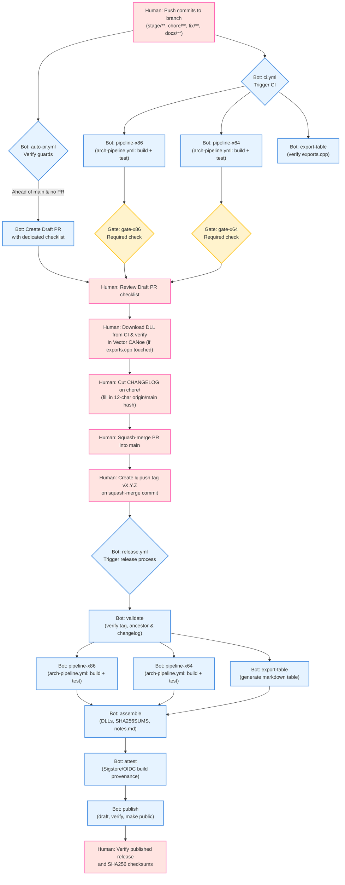
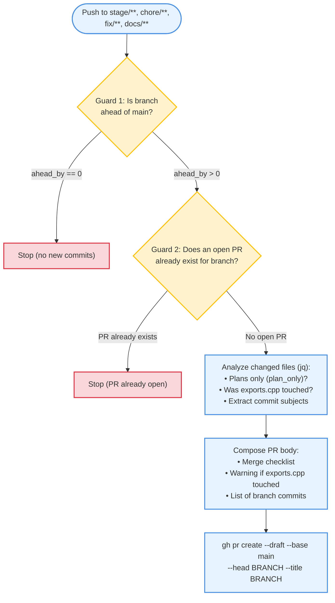
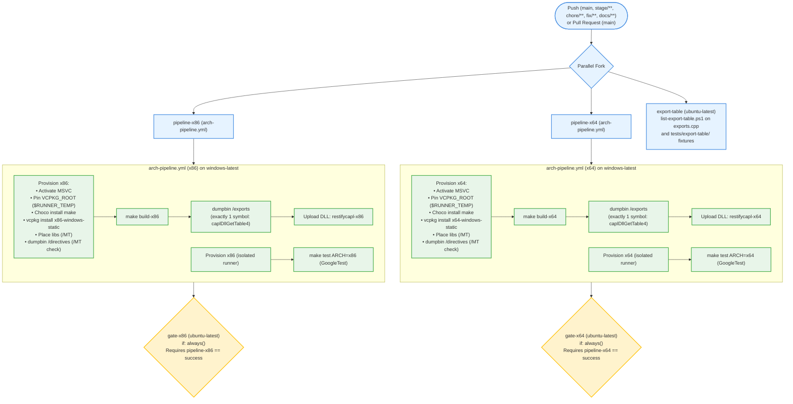
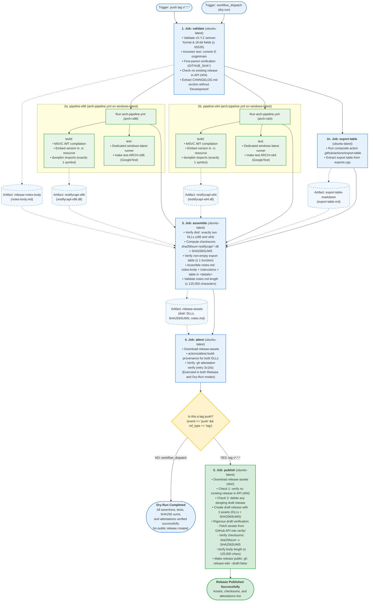

# CAPL REST DLL – GitHub Actions Current Flow & Human Gates

Documentation and mapping of the current CI/CD flow and Human Gates for the `restifycapl` project.

---

## 1. End-to-End Overview

The diagram below illustrates the complete lifecycle of code: from pushing commits on a working branch, through automated Draft PR creation, CI pipeline execution, human decision points (CANoe verification, CHANGELOG cut), up to tagging and release publication with cryptographic build provenance.

---

## 2. Detailed Flow: `auto-pr.yml`

Workflow executed on every push to working branches. Safely creates a Draft PR with a checklist tailored to the touched files.

---

## 3. Detailed Flow: `ci.yml` and `arch-pipeline.yml`

CI continuously enforces architecture parity (x86 and x64) as well as compliance with the Vector CANoe export contract. The `build` and `test` jobs are **strictly separated and executed in parallel** on dedicated `windows-latest` runners.

---

## 4. Detailed Flow: `release.yml`

The `release.yml` workflow provides deterministic, secure, and atomic releases of `restifycapl-x86.dll` and `restifycapl-x64.dll`. It can be run in two modes:
1. **Release Mode (Push tag `v*.*.*`)**: full build injecting the version from the tag into the Windows RC resource, full GoogleTest suite, export table verification, `SHA256SUMS` calculation, `notes.md` generation, Sigstore OIDC cryptographic attestation, and secure multi-step publication to GitHub Releases.
2. **Dry-Run Mode (`workflow_dispatch`)**: triggered manually on any branch prior to merge or release. Executes identical validation of the changelog against `origin/main`, compilation (dev version), full GoogleTest suite for both architectures, notes generation, and Sigstore attestation. **The `publish` job is skipped** (`if: github.event_name == 'push' && github.ref_type == 'tag'`), verifying the entire pipeline without publishing anything externally.

### 4.1. Architecture and Artifact Flow Diagram: `release.yml`

The diagram below reflects the actual GitHub Actions DAG structure. Jobs `pipeline-x86`, `pipeline-x64`, and `export-table` declare `needs: validate`, meaning they fan out **concurrently and independently** upon completion of validation.

### 4.2. Detailed `release.yml` Job Breakdown

| Job | Environment (`runs-on`) | Permissions (`permissions`) | Key Tasks & Assertions | Generated / Consumed Artifacts |
|---|---|---|---|---|
| `validate` | `ubuntu-latest` | `contents: read` | <ul><li>Full repository checkout (`fetch-depth: 0` – required for ancestor relationship check against `origin/main`).</li><li>Mode detection: tag `push` vs `dry-run` (`workflow_dispatch`).</li><li>For tag mode: validate semver regex format `vX.Y.Z` (no leading zeroes, each field $\le 65535$).</li><li>Assert `git merge-base --is-ancestor $GITHUB_SHA origin/main` (tag commit must be integrated into `main`).</li><li>Verify first parent (`GITHUB_SHA^` – squash-merge of the cut).</li><li>Check no existing release in GitHub API (must return 404).</li><li>Extract section from `CHANGELOG.md` (inline Python script), strip `### Development` header, and assert non-empty.</li></ul> | **Produces:** `release-notes-body` (`notes-body.md`). **Outputs:** `tag`, `version`. |
| `pipeline-x86` | Reusable workflow: `arch-pipeline.yml` (`windows-latest`) | `contents: read` | <ul><li>Runs two parallel jobs: `build` and `test` on independent Windows runners.</li><li>In `build`: MSVC `/MT` compilation (static CRT), inject version from tag into `restifycapl.rc`, verify directive flags, inspect export table (`dumpbin /exports` – exactly 1 symbol: `caplDllGetTable4`).</li><li>In `test`: provision test environment and execute full GoogleTest suite for x86.</li></ul> | **Produces:** `restifycapl-x86` (`restifycapl-x86.dll`). |
| `pipeline-x64` | Reusable workflow: `arch-pipeline.yml` (`windows-latest`) | `contents: read` | <ul><li>Identical scope to x86, but compiled and tested natively for 64-bit architecture (`x64`).</li><li>Guarantees strict binary and functional parity across architectures.</li></ul> | **Produces:** `restifycapl-x64` (`restifycapl-x64.dll`). |
| `export-table` | `ubuntu-latest` | `contents: read` | <ul><li>Runs composite action `.github/actions/export-table`.</li><li>Parses `src/exports.cpp` and runs regression tests against `tests/export-table/` fixtures.</li><li>Generates formatted Markdown table containing CAPL function names, return types, and parameter signatures.</li></ul> | **Produces:** `export-table-markdown` (`export-table.md`). |
| `assemble` | `ubuntu-latest` | `contents: read` | <ul><li>Waits for completion of: `validate`, `pipeline-x86`, `pipeline-x64`, `export-table`.</li><li>Downloads compiled DLLs and generated Markdown files.</li><li>Asserts contents of `dist/`: must contain exactly and only `restifycapl-x64.dll` and `restifycapl-x86.dll`.</li><li>Computes checksums: `sha256sum restifycapl-x86.dll restifycapl-x64.dll > dist/SHA256SUMS`.</li><li>Asserts that export table contains $\ge 1$ valid function row.</li><li>Assembles final `dist/notes.md` combining: changelog body, `### Using this release` block, and collapsible `
` containing the export table.</li><li>Validates notes length against GitHub API limit ($\le 125,000$ characters).</li><li>Appends preview of `SHA256SUMS` and `notes.md` to `$GITHUB_STEP_SUMMARY`.</li></ul> | **Produces:** `release-assets` (contains `dist/`: both DLLs, `SHA256SUMS`, `notes.md`). |
| `attest` | `ubuntu-latest` | `id-token: write` `attestations: write` `contents: read` | <ul><li>Downloads `release-assets` bundle.</li><li>Generates cryptographic Sigstore OIDC build provenance attestations for `restifycapl-x86.dll` and `restifycapl-x64.dll`.</li><li>Immediately verifies generated attestations using `gh attestation verify` with retry loop (3 attempts, 10s backoff, mitigating Sigstore index propagation delays).</li><li>Executed in both production and dry-run modes!</li></ul> | Confirms entry in GitHub Sigstore transparency log. |
| `publish` | `ubuntu-latest` | `contents: write` | <ul><li>Conditional: executed **only** on tag `push` (`if: github.event_name == 'push' && github.ref_type == 'tag'`).</li><li>Implements multi-step publication atomicity guards (see Section 4.3).</li><li>Publishes release via `gh release edit "$TAG" --draft=false`.</li><li>On failure, deterministic diagnostics step `if: failure()` inspects API state, reports whether release stayed private or went public, and prints recovery instructions.</li></ul> | **Publishes:** Official GitHub Release with 3 assets (`restifycapl-x86.dll`, `restifycapl-x64.dll`, `SHA256SUMS`). |

### 4.3. Seven Strict Publishing Guards in the `publish` Job

Releasing native libraries for industrial automation and Vector CANoe automotive environments requires absolute guarantees of integrity. Therefore, the `publish` job in `release.yml` implements 7 strict safeguards:

1. **Double tag uniqueness check**: Checking that no published release already exists for the tag is performed first in `validate`, and repeated in `publish` immediately prior to repository mutation (`gh api repos/.../releases/tags/$TAG` must return HTTP 404). Once published, a tag must never be overwritten.
2. **Dangling draft cleanup**: If a previous run was aborted before publication, the script finds and deletes existing drafts for this tag (`DELETE /releases/{id}`), guaranteeing idempotent re-runs.
3. **Draft-First publication pattern**: The release is created in private mode as a draft (`gh release create "$TAG" --draft --verify-tag`). No external user or automation process has access until all assets are successfully uploaded and validated.
4. **Server-side asset completeness verification**: After draft creation, the script queries GitHub API to verify that the uploaded asset list is exactly and only: `SHA256SUMS`, `restifycapl-x64.dll`, and `restifycapl-x86.dll`.
5. **On-the-fly checksum validation (`sha256sum -c`)**: Assets are downloaded directly from GitHub servers via `/releases/assets/{id}` into a clean `verify/` folder, followed by `sha256sum -c SHA256SUMS`. This proves that files on GitHub servers were not corrupted or truncated during transit.
6. **Atomic release publication (`--draft=false`)**: Transitioning from draft to public occurs in a single, final invocation: `gh release edit "$TAG" --draft=false`.
7. **Deterministic failure diagnostics (`if: failure()`)**: If any step in `publish` fails, the `if: failure()` hook inspects the release state via API. If the release never went public, the maintainer is instructed that deleting the tag and retrying is safe. If it became public, the script warns never to move the tag and instructs to follow the yank/withdraw procedure and release a new patch version.

---

## 5. Human Gates Table

| Gate ID | Timing | Human Action | Why Not Automated Today |
|---|---|---|---|
| **HG-1** | Start of work | Creates branch (`stage/**`, `chore/**`, `fix/**`, `docs/**`) and pushes initial commit. | Architectural decision to initiate a new task. |
| **HG-2** | After Draft PR creation | Reviews PR checklist: verifies CI is green, reviews clean, plan executed. | Formal quality and policy approval requirement prior to merge. |
| **HG-3** | Before merging changes to `exports.cpp` | Downloads compiled DLLs from CI, launches CANoe workstation (Windows VM / hardware), and verifies CAPL script compilation. | **No Vector CANoe licenses available on GitHub-hosted runners**. CANoe requires a hardware USB dongle or on-premise license server. |
| **HG-4** | Release preparation | Creates branch `chore/bpe-14-changelog-...`, retrieves `git rev-parse --short=12 origin/main`, writes parent `main` commit hash into `CHANGELOG.md` header, and updates diff links. | Strict project convention: product version cannot be hardcoded in files; changelog section is explicitly anchored to the base commit hash. |
| **HG-5** | After changelog approval | Performs Squash-Merge of PR into `main`. | Human maintainer decision on when to integrate the release into `main`. |
| **HG-6** | After squash-merge | Creates and pushes tag `vX.Y.Z` on the merge commit on `main`. | By architectural design, **pushing the tag is the sole and definitive publication trigger** (replaces approval gates inside GitHub Actions). |
| **HG-7** | After publication | Inspects published GitHub Release and SHA256 checksums. | Final sanity sign-off by repository maintainer. |
