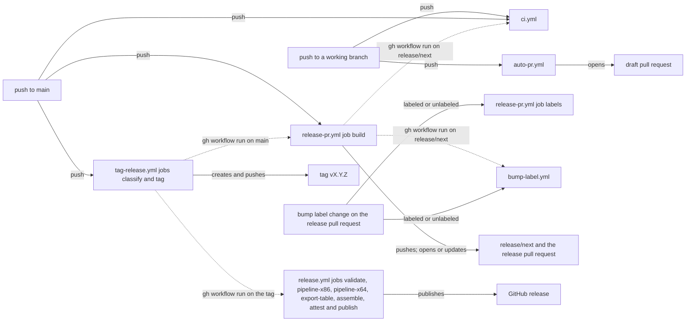

## Purpose

This file describes the CI/CD flow of the repository as it runs on `main`.

The flow is made of seven workflows in `.github/workflows/` and two composite actions in `.github/actions/`.

| File | `name:` | What it does |
|---|---|---|
| `ci.yml` | CI | Builds and tests the DLL on x86 and x64, and runs the lint and check jobs. |
| `arch-pipeline.yml` | Architecture pipeline | Reusable workflow that builds and tests one architecture. `ci.yml` and `release.yml` call it. |
| `auto-pr.yml` | Auto PR | Opens a draft pull request for a working branch. |
| `bump-label.yml` | Bump label | Its check `bump label` requires exactly one `bump:*` label on the `release/next` pull request. |
| `release-pr.yml` | Release PR | The release bot. Builds the `release/next` branch and its pull request, and keeps the `bump:*` label and the version preview in the pull request body up to date. |
| `tag-release.yml` | Tag Release | The tagging bot. Tags a merged release commit on `main`, dispatches `release-pr.yml` on `main` and dispatches `release.yml` on the tag. |
| `release.yml` | Release | Checks the tag, builds both DLLs, packs them and publishes the GitHub release. |
| `.github/actions/export-table/action.yml` | export-table | Composite action. Runs the export-table fixtures, checks `src/module/exports.cpp` and writes the job summary. `ci.yml` and `release.yml` use it. |
| `.github/actions/provision/action.yml` | Provision build environment | Composite action. Activates MSVC, provisions the pinned vcpkg tool and the static dependencies, and places them where the Makefile expects them. `arch-pipeline.yml` uses it. |

## Release path at a glance

The diagram shows the workflows of a release in order, from the first push to the published GitHub release. A solid arrow leads from an event to a workflow that starts on it, or from a workflow to the branch, tag, pull request or release that it pushes, opens, updates or publishes. A dashed arrow means that a step starts the workflow at the arrow head with `gh workflow run` on the ref in the label.



## What starts what

### The platform rule

GitHub has a platform rule that the workflows depend on:

- Events created with `GITHUB_TOKEN` (a push, a tag, a label change, a pull request) start no workflow runs. The only exceptions are `workflow_dispatch` and `repository_dispatch`.
- A dispatch needs the `Actions: write` permission, which a job gets from an explicit `permissions:` block.
- The `ref` of a dispatch can be a branch or a tag.
- An explicit `permissions:` block works whatever the repository default for workflow permissions is.
- A `pull_request` trigger without `types:` uses the GitHub defaults: opened, synchronize and reopened.

Every workflow here that pushes, labels or opens something as the bot depends on this rule.

### Triggers of each workflow

| Workflow | Events | Filters | Concurrency |
|---|---|---|---|
| `ci.yml` | `push`, `pull_request`, `workflow_dispatch` | Push: branches `main`, `feat/**`, `stage/**`, `chore/**`, `fix/**`, `docs/**`. Pull request: branches `main`. |  |
| `auto-pr.yml` | `push` | Push: branches `feat/**`, `stage/**`, `chore/**`, `fix/**`, `docs/**`. |  |
| `bump-label.yml` | `pull_request`, `workflow_dispatch` | Pull request: types opened, synchronize, reopened, labeled, unlabeled. | Workflow: `group` is `bump-label-labels-<pull request number>` for the actions `labeled` and `unlabeled` and `bump-label-refs-<head branch or ref>` otherwise; `cancel-in-progress` is `false` for `labeled` and `unlabeled` and `true` otherwise. |
| `release-pr.yml` | `push`, `workflow_dispatch`, `pull_request` | Push: branch `main`. Pull request: branches `main`, types labeled and unlabeled. | Job `build`: `group: release-pr-build`, `cancel-in-progress: false`. Job `labels`: `group: release-pr-labels`, `cancel-in-progress: false`. |
| `tag-release.yml` | `push` | Push: branch `main`. | Job `tag`: `group: tag-release`, `cancel-in-progress: false`. |
| `release.yml` | `push`, `workflow_dispatch` | Push: tags `v*.*.*`. | Workflow: `group: release-${{ github.ref }}`, `cancel-in-progress: false`. |
| `arch-pipeline.yml` | `workflow_call` only | Inputs: `arch` (required, x86 or x64) and `release-version` (optional; empty means a development build). |  |

The two composite actions run as steps of jobs: `provision` in the jobs `build` and `test` of `arch-pipeline.yml`, `export-table` in the jobs `export-table` of `ci.yml` and `release.yml`.

Some jobs inside these workflows run only for part of the events:

- In `ci.yml`, the job `actionlint` is skipped on a dispatch. The other jobs run.
- In `release-pr.yml`, the job `build` runs when the event is not `pull_request`, so on a push or a dispatch. The job `labels` runs only for a `pull_request` event whose head is `release/next`, from this repository, with a label whose name starts with `bump:`.
- In `tag-release.yml`, the job `classify` runs on every push to `main`. The job `tag` runs only when `classify` answered `tag` or `tagged`.
- In `release.yml`, the mode is `tag` on a tag ref and `dry-run` on any other ref. The job `publish` runs only on a tag ref.
- `bump-label.yml` does nothing and succeeds when the head branch is not `release/next`.

The jobs of `ci.yml` are `pipeline-x86` and `pipeline-x64` (both call `arch-pipeline.yml`), `gate-x86` (check `build + test (x86)`), `gate-x64` (check `build + test (x64)`), `export-table`, `changelog-fixtures` and `actionlint`.

### Dispatches made by the bots

The bots start other workflows with `gh workflow run`. Their jobs set `GH_TOKEN` to `github.token`. A dispatch is the one way for them to start a run, as a consequence of the platform rule.

| Who dispatches (workflow / job / step) | What it starts | Ref | When |
|---|---|---|---|
| `release-pr.yml` / `build` / "Dispatch CI and the bump label check on release/next" | `ci.yml` | `release/next` | When `release-pr.yml` rebuilt the branch (`steps.build.outputs.skip == 'false'`) |
| `release-pr.yml` / `build` / "Dispatch CI and the bump label check on release/next" | `bump-label.yml` | `release/next` | Same step and same condition as the row above |
| `tag-release.yml` / `tag` / "Dispatch the release pull request workflow on main" | `release-pr.yml` | `main` | When `steps.tip.outputs.proceed != 'false'` |
| `tag-release.yml` / `tag` / "Dispatch the release on the tag" | `release.yml` | The release tag (`vX.Y.Z`) | When `steps.tip.outputs.proceed != 'false'` and the lookup of the release of that tag fails and its error output holds `HTTP 404` |

The first step starts two workflows, `ci.yml` and `bump-label.yml`, in a loop.

The job `build` of `release-pr.yml` has `contents: write`, `pull-requests: write` and `actions: write`. The job `tag` of `tag-release.yml` has `contents: write`, `pull-requests: read` and `actions: write`. The `actions: write` permission is what allows the dispatch.

### What starts CI on `release/next`

- `release-pr.yml` pushes `release/next` with `git push --force-with-lease`. As a consequence of the platform rule, that push starts no run.
- The push filter of `ci.yml` lists `main`, `feat/**`, `stage/**`, `chore/**`, `fix/**` and `docs/**`.
- The bot opens the release pull request with `gh pr create --base main --head release/next --title 'release/next' --body-file "$body"`. As a consequence of the platform rule, this pull request does not start a `pull_request` run of `ci.yml`.
- So the only thing that starts `ci.yml` on `release/next` is the dispatch in the first row of the dispatch table. It runs the jobs of `ci.yml` on the tip of `release/next`. This gives the check runs `build + test (x86)` and `build + test (x64)` (the job names in `ci.yml`) on that branch.
- `bump-label.yml` starts on a `pull_request` event (opened, synchronize, reopened, labeled, unlabeled) and on a dispatch. The bot dispatches it on `release/next` after it rebuilds the branch.
- A `bump:*` label change on the `release/next` pull request starts the job `labels` of `release-pr.yml`.
- `tag-release.yml` pushes the release tag with `git push origin "refs/tags/$TAG"`. As a consequence of the platform rule, that push starts no run. The last step of its job `tag`, "Dispatch the release on the tag", dispatches `release.yml` on the tag.

### What starts CI on a working branch

A pull request opened by Auto PR does not start a `pull_request` run of CI (a consequence of the platform rule). The first CI run of a working branch comes from a push to the branch, which matches the push filter of `ci.yml`. Each later push to a branch with an open pull request starts both a `push` run and a `pull_request` run: `ci.yml` also starts on `pull_request` with base `main` and the default types.

## Branches, pull request titles and release levels

### Working branches

Five branch prefixes are working branches: `feat/`, `stage/`, `chore/`, `fix/` and `docs/`.

- A push to such a branch starts `ci.yml` and `auto-pr.yml`. Both use the same five prefixes.
- A push to `main` also starts `ci.yml`, but not `auto-pr.yml`.
- `auto-pr.yml` opens a draft pull request with base `main`. Its title is the branch name (`--title "${BRANCH}"`, where `BRANCH` is the branch name).
- Guard 1 ("Guard 1: branch ahead of main?") skips the creation when the branch has no commits ahead of `main`.
- Guard 2 ("Guard 2: PR already open for this branch?") skips the creation when an open pull request for the branch already exists.

### Squash-merge subject

`scripts/ci/changelog.ps1` reads the type of a change and the pull request number from the subject of each first-parent commit on `main`: the number `N` from a trailing ` (#N)`, where `N` has one to nine digits.

### Release levels

`scripts/ci/changelog.ps1` takes the type of a change from the branch prefix at the start of the squash subject. A subject that starts with none of these prefixes, and not with `release/`, has the type `unknown`.

| Prefix | Level |
|---|---|
| `feat/` | minor |
| `stage/` | minor |
| `fix/` | patch |
| `chore/` | no release |
| `docs/` | no release |
| unknown | no release |

- The level is the highest of the changes since the last tag: minor if there is any `feat/` or `stage/` change, else patch if there is any `fix/` change, else none.
- The level comes from the branch prefix, not from the commit types. A `feat/`, `stage/` or `fix/` pull request that has only `chore:` commits still releases. It is listed by its branch name, with a warning.
- The bot computes the level with `changelog.ps1 level`. If it is major, minor or patch, the job rebuilds `release/next` and opens or updates the release pull request. If it is none, the job closes every open release pull request with a comment and deletes `release/next` if the branch exists.
- The bot labels the release pull request `bump:<level>`. On every rebuild that is not skipped, it adds the computed label when there is no `bump:*` label, replaces a single other `bump:*` label with the computed one and comments, and changes nothing but warns when there are two or more. The `bump label` check and the tagging require exactly one `bump:*` label; the tagging also requires it to be `bump:major`, `bump:minor` or `bump:patch`.
- A change of type `unknown` raises no level of its own. The generator gives a warning for it and, unless it has a breaking marker, lists it under Development.

### Reserved branch `release/next`

- `release-pr.yml` creates and pushes the branch `release/next` and opens its pull request with the title `release/next`.
- Commits pushed to `release/next` by hand are overwritten the next time the bot rebuilds the branch.
- The generator gives a commit whose subject starts with `release/` the type `release` and ignores it when it computes the level and the entries.

### Breaking changes

- A breaking change is marked in a commit message of the pull request by `type!:` or a `BREAKING CHANGE:` footer. This works on any branch type.
- The marker is read from the commit messages of the pull request named by ` (#N)` in the squash subject. A subject without ` (#N)` is not read, and the generator gives a warning.
- A breaking change gives minor while the major version of the last tag is 0, and major from 1.0.0.
- While the major version of the last tag is 0, the level is never major; version 1.0.0 is reached only with the `bump:major` label.
- A breaking change is listed under "Breaking changes" in the release notes. A `chore/`, `docs/` or `unknown` pull request with a breaking marker is listed only under "Breaking changes", not under Development.

## Auto PR (`auto-pr.yml`)

`auto-pr.yml` has the `name:` Auto PR. It opens a draft pull request for a pushed working branch when the branch is ahead of `main` and has no open pull request.

### Trigger and permissions

- The only event is `push`, for the branches `feat/**`, `stage/**`, `chore/**`, `fix/**` and `docs/**`.
- The workflow has `contents: read` and `pull-requests: write`. Its one job, `open draft PR`, runs on `ubuntu-latest` with `GH_TOKEN` set to `secrets.GITHUB_TOKEN`.
- The job also sets `GH_REPO` to `github.repository` and `BRANCH` to `github.ref_name`.
- The job has four steps, in this order: "Guard 1: branch ahead of main?", "Guard 2: PR already open for this branch?", "Compose PR body" and "Create draft PR".

### Step "Guard 1: branch ahead of main?"

- The step has the id `ahead` and no `if:`.
- It calls `gh api "repos/${GH_REPO}/compare/main...${BRANCH}"` and writes the whole response to `$RUNNER_TEMP/compare.json`. "Compose PR body" reads this file instead of calling the API again.
- It reads `.ahead_by` from the file and prints "Branch '<branch>' is ahead of main by N commit(s)."
- If `ahead_by` is 0, it prints "No commits ahead of main -- nothing to open a PR for. Exiting." and writes `proceed=false` to `$GITHUB_OUTPUT`. Otherwise it writes `proceed=true`. In both cases the step ends with exit code 0.
- The script runs with `set -euo pipefail`. If `gh api` or `jq` ends with a non-zero exit code, the step ends with a non-zero exit code.

### Step "Guard 2: PR already open for this branch?"

- The step has the id `existing` and runs only if `steps.ahead.outputs.proceed == 'true'`.
- It runs `gh pr list --head "${BRANCH}" --state open --json number --jq '.[0].number // empty'`. Only an open pull request with this head branch counts.
- If a number is returned, it prints "Open PR #N already exists for '<branch>' -- nothing to do. Exiting." and writes `proceed=false`. Otherwise it prints "No open PR found for '<branch>' -- will create one." and writes `proceed=true`. In both cases the step ends with exit code 0.

### Step "Compose PR body"

- The step runs only if `steps.ahead.outputs.proceed == 'true' && steps.existing.outputs.proceed == 'true'`. It writes `$RUNNER_TEMP/pr-body.md`.
- Its inputs are `compare.json` and the `BRANCH` variable.

#### What the step reads from the compare file

| Value | Rule |
|---|---|
| `plan_only` | True when the compare lists at least one file and every file name matches `^docs/work/[^/]+/plans/.*\.md$`. False when the list of files is empty. |
| `exports_touched` | True when one of the files is `src/module/exports.cpp`. |
| Commit subjects | The first line of the message of each commit in the compare, one per line, in `$RUNNER_TEMP/subjects.txt`. |

#### The TODO line

The last line of the checklist depends on the branch prefix. `--` is two ASCII hyphens.

| Branch | TODO line |
|---|---|
| `stage/<N>-...`, where `<N>` is digits or two groups of digits joined by `-` | `Stage <N> -- TODO: task IDs (e.g. CPP/TEST/REV/HUM)` |
| Any other `stage/` branch, for example `stage/7a-x` | `Stage stage/7a-x -- TODO: task IDs (e.g. CPP/TEST/REV/HUM)`: the whole branch name, with `stage/`, takes the place of `<N>` |
| `chore/<id>-...`, where `<id>` is lower-case letters, `-` and digits, optionally followed by more `-<digits>` groups, for example `chore/rev-12-...` | `<ID> -- TODO: any additional REV/HUM IDs`, with `<ID>` in upper case |
| Any other `chore/` branch, for example `chore/ci-verify-draft-retry` | `TODO: stage and task IDs` |
| `feat/`, `fix/` and `docs/` | `TODO: stage and task IDs` |

#### The body

The body is built in this order.

1. The heading `## Merge checklist` and a blank line.
2. The plan-only paragraph, only if `plan_only` is true.
3. The first block of three items, always.
4. The CANoe item, only if `exports_touched` is true.
5. The second block of three items, always.
6. A blank line and the TODO line, always.
7. A separator and the exports.cpp warning, only if `exports_touched` is true.
8. A separator, the heading `### Commits on this branch` and one `- <subject>` line per commit, only if the list of subjects is not empty. The subjects are written with `printf -- '- %s\n'`.

The text that the file writes for the plan-only paragraph (item 2):

```
Plan-only branch: the `code-reviewer` and human-gate items below do not
apply. CI green and up-to-date-with-`main` still apply.
```

The text that the file writes for the first block (item 3):

```
- [ ] CI green on both legs (`build + test (x86)`, `build + test (x64)`)
- [ ] `code-reviewer` clean on this branch (`git diff main...HEAD`), zero Must-fix
- [ ] Human gate passed against the PR CI artifact, if this branch has one
```

The text that the file writes for the CANoe item (item 4):

```
- [ ] CANoe check: the CAPL nodes in capl/ compile in CANoe against the DLL from this PR's CI artifact (author before Ready for review, or reviewer before approval)
```

The text that the file writes for the second block (item 5):

```
- [ ] Commit messages follow the Conventional Commits skill
- [ ] Branch up to date with `main`
- [ ] Plan folded into `plan.md`, incl. any task-ID/section renumbering (last commit before marking Ready for review)
```

The text that the file writes for the exports.cpp warning (item 7), after a blank line, a line `---` and a blank line:

```
⚠️ This branch touches `src/module/exports.cpp`. Never have two open PRs that
both touch this file. Also confirm the `export-table` check is green: it is
not a required check, so a red result does not block the merge.
```

### Step "Create draft PR"

- The step runs under the same condition as "Compose PR body": both guards answered `true`.
- It runs `gh pr create --draft --base main --head "${BRANCH}" --title "${BRANCH}" --body-file "$RUNNER_TEMP/pr-body.md"`. The pull request is a draft, its base is `main`, its head is the pushed branch, its title is the branch name and its body is the composed file.
- The script runs with `set -euo pipefail`. If `gh pr create` ends with a non-zero exit code, the step ends with a non-zero exit code.

### Later pushes and failures

- Second push to a branch whose pull request is open: Guard 1 passes, Guard 2 finds the open pull request and answers `false`, and "Compose PR body" and "Create draft PR" are skipped. The title, the body and the draft state stay as they are.
- If the branch's pull request was closed, the next push to the branch opens a new one, provided the branch is still ahead of `main`.
- If `gh pr create` ends with a non-zero exit code, the next push to the branch runs both guards again; when both answer `true`, "Compose PR body" composes the body again and "Create draft PR" runs `gh pr create` again.

## CI (`ci.yml`)

### Permissions

- The workflow has `permissions: contents: read`.
- `export-table`, `changelog-fixtures` and `actionlint` each have their own block, `permissions: contents: read`.
- `pipeline-x86`, `pipeline-x64`, `gate-x86` and `gate-x64` have no `permissions:` block of their own.
- The only third-party action in `ci.yml` is `actions/checkout`, used in three jobs and pinned by SHA with the label `# v7.0.1`.

### Job dependencies

- The only `needs:` in the file are those of the two gates; each gate waits only for its own pipeline. No job has `needs:` on `export-table`, `changelog-fixtures` or `actionlint`.
- `pipeline-x86` and `pipeline-x64` have no `needs:`, so they run in parallel.

### Jobs `pipeline-x86` and `pipeline-x64`

- Each job calls `./.github/workflows/arch-pipeline.yml` and passes one input: `arch: x86` for `pipeline-x86`, `arch: x64` for `pipeline-x64`.
- `release-version` is not passed; its default in `arch-pipeline.yml` is `''`.
- The two jobs have no `name:`.

### Jobs `gate-x86` and `gate-x64`

- The `name:` of `gate-x86` is `build + test (x86)`. The `name:` of `gate-x64` is `build + test (x64)`.
- `gate-x86` has `needs: pipeline-x86` and `gate-x64` has `needs: pipeline-x64`. Both have `if: always()` and run on `ubuntu-latest`.
- Each gate has one step, "Require a successful pipeline", with `shell: bash`.
- The step sets the environment variable `PIPELINE_RESULT` to `needs.pipeline-x86.result` (`gate-x86`) or `needs.pipeline-x64.result` (`gate-x64`).
- The script of `gate-x86`:

  ```bash
  if [ "$PIPELINE_RESULT" != "success" ]; then
    echo "::error::pipeline-x86 finished with result '$PIPELINE_RESULT', expected 'success'"
    exit 1
  fi
  ```

- The script of `gate-x64` is the same, with `pipeline-x64` in the message.
- Any other result prints the error message and ends the step with `exit 1`.

### Job `export-table`

- The job runs on `ubuntu-latest`.
- Step 1 is `actions/checkout`, pinned by SHA.
- Step 2 is the local composite action `./.github/actions/export-table`.

### Job `changelog-fixtures`

- The job runs on `ubuntu-latest`.
- Step 1 is `actions/checkout`, pinned by SHA.
- Step 2, "Run the CHANGELOG fixtures", has `shell: bash` and runs `pwsh -NoProfile -File scripts/ci/changelog.ps1 fixtures -FixtureDir tests/changelog`.

### Job `actionlint`

- The job has `if: github.event_name != 'workflow_dispatch'`, so it is skipped on a dispatch. It runs on `ubuntu-latest`.
- The job sets `ACTIONLINT_VERSION` to `1.7.12`. The archive's SHA-256 is pinned in `ACTIONLINT_SHA256`.
- Step 1 is `actions/checkout`, pinned by SHA.
- Step 2, "Download actionlint and verify its SHA-256", has `shell: bash` and does three things in order. After each command, a non-zero exit code is turned into the error annotation below, followed by `exit 1`.
  1. It downloads `https://github.com/rhysd/actionlint/releases/download/v${ACTIONLINT_VERSION}/actionlint_${ACTIONLINT_VERSION}_linux_amd64.tar.gz` to `$RUNNER_TEMP/actionlint.tar.gz` with `curl --fail --silent --show-error --location --output`. On failure: `::error::actionlint download failed (exit $code): $out`.
  2. It checks the archive against `ACTIONLINT_SHA256` with `sha256sum --check`. On failure: `::error::actionlint archive does not match the pinned SHA-256: $out`.
  3. It extracts the member `actionlint` into `$RUNNER_TEMP` with `tar --extract --gzip`. On failure: `::error::actionlint extraction failed (exit $code): $out`.
- Step 3, "Lint the workflows", has `shell: bash`. It runs `"$RUNNER_TEMP/actionlint" -color`, echoes its standard output, and exits with the exit code of `actionlint`.

## Architecture pipeline (`arch-pipeline.yml`)

### Trigger and callers

- The only event is `workflow_call`.
- `ci.yml` calls the workflow twice, from `pipeline-x86` and `pipeline-x64`, and passes only `arch`.
- `release.yml` calls it twice, from `pipeline-x86` (`arch: x86`) and `pipeline-x64` (`arch: x64`). Both jobs have `needs: validate` and pass `release-version: ${{ needs.validate.outputs.version }}`.

### Inputs

- `arch` has the type `string` and is required. It has no default. Its description reads: "Target architecture, x86 or x64."
- `arch-pipeline.yml` does not check `arch`; the value is used in the make targets, the DLL path and the artifact name.
- `release-version` has the type `string` and is optional, with default `''`. Its description reads: "X.Y.Z to build and verify as a release; empty for a development build."

### Permissions

- The workflow has `permissions: contents: read`.
- The jobs `build` and `test` each repeat `permissions: contents: read`.

### Jobs

- The workflow has two jobs, `build` and `test`. Both have the `name:` equal to the job id and run on `windows-latest`.
- `build` and `test` have no `needs:`, so they run in parallel.
- `test` downloads no artifact and builds on its own via `make test`.
- Third-party actions in the file: `actions/checkout`, pinned by SHA with the label `# v7.0.1`, and `actions/upload-artifact`, pinned by SHA with the label `# v7.0.2`.

### What `release-version` changes

- When `release-version` is empty, the build step passes no `VER_*` variables to `make`, and the step "Check version resource against release-version" is skipped.
- When it is not empty, the build step validates it, passes the version variables to `make`, and the step "Check version resource against release-version" runs.
- The steps "Check DLL exports (dumpbin /exports)" and "Upload DLL artifact", the artifact name and the job `test` do not use the value.

### Job `build`

The job has six steps, in this order: "Checkout (full history)", "Provision build environment", "make build-${{ inputs.arch }}", "Check version resource against release-version", "Check DLL exports (dumpbin /exports)" and "Upload DLL artifact".

In the messages quoted in this section, a PowerShell variable or expression (for example `$env:RELEASE_VERSION`, `$dll` or `$($info.FileVersion)`) stands for its value at run time.

#### Step "Checkout (full history)"

- The step uses `actions/checkout` with `fetch-depth: 0`.

#### Step "Provision build environment"

- The step uses the local composite action `./.github/actions/provision` with the input `arch: ${{ inputs.arch }}`. It has no `if:`.

#### Step "make build-${{ inputs.arch }}"

- The step has no `if:`. It runs with `shell: pwsh` and sets `RELEASE_VERSION` to `inputs.release-version` and `ARCH` to `inputs.arch`.
- The script sets `$ErrorActionPreference = 'Stop'` and starts with an empty list of version arguments.
- If `RELEASE_VERSION` is not empty, it must match this regular expression: `^(0|[1-9][0-9]*)\.(0|[1-9][0-9]*)\.(0|[1-9][0-9]*)\z`. Otherwise the step throws `release-version must be X.Y.Z without leading zeros, got '$env:RELEASE_VERSION'`.
- The script splits the value on `.`. A field is rejected when its length is greater than 5 or its integer value is greater than 65535. The step then throws `release-version field '$field' exceeds 65535 (version resource fields are 16-bit)`.
- For a valid value the version arguments are `VER_MAJOR`, `VER_MINOR` and `VER_BUILD`, set to the first, second and third field, and `VER_REV=0`.
- The step then runs `make "build-$env:ARCH"` with the version arguments. If the exit code is not 0, it throws `make build-$env:ARCH failed (exit $LASTEXITCODE)`.

#### Step "Check version resource against release-version"

- The step runs only if `inputs.release-version != ''`. It runs with `shell: pwsh` and sets `RELEASE_VERSION` and `ARCH` like the build step.
- The step checks the format of `release-version` again, with the same regular expression and the same error text as the build step, but not the 65535 limit.
- It reads the version resource of `build\<arch>\restifycapl-<arch>.dll` with `[System.Diagnostics.FileVersionInfo]::GetVersionInfo`. `$dll` is the resolved full path.
- The expected numeric version is `<major>.<minor>.<patch>.0`, built from the three fields. The expected string is `v` followed by `release-version`.
- The step makes three comparisons and collects a message for each one that fails:
  - The actual numeric version (`FileMajorPart`, `FileMinorPart`, `FileBuildPart` and `FilePrivatePart`, joined by `.`) is compared with `-ne` to the expected numeric version. The message is `numeric version is $actualNumeric, expected $expectedNumeric`.
  - `FileVersion` is compared with `-cne` (case-sensitive) to the expected string. The message is `FileVersion is '$($info.FileVersion)', expected '$expectedString'`.
  - `ProductVersion` is compared with `-cne` to the expected string. The message is `ProductVersion is '$($info.ProductVersion)', expected '$expectedString'`.
- If there is at least one message, the step throws `Version resource of $dll does not match release-version ${env:RELEASE_VERSION}:` followed by the messages, one per line.
- If there is none, the step prints `Version resource of $dll matches $expectedNumeric / $expectedString.`

#### Step "Check DLL exports (dumpbin /exports)"

- The step has no `if:` and runs for every build, development builds included. It runs with `shell: pwsh` and sets `ARCH`.
- It runs `dumpbin /nologo /exports` on `build\<arch>\restifycapl-<arch>.dll`. If the exit code is not 0, it throws `dumpbin /exports $dll failed (exit $LASTEXITCODE)`.
- It writes the dumpbin output to the job summary before it checks the exports. The summary has the heading `### dumpbin /exports <dll>` and the output in a fenced block.
- It reads the exported names from the dumpbin table and the count from the "number of functions" line.
- If there is no "number of functions" line, the step throws `No 'number of functions' line found in the dumpbin output for $dll`.
- The step throws unless the count is 1, exactly one name was read, and that name is `caplDllGetTable4` (case-sensitive comparison). The message is `$dll must export exactly one function, caplDllGetTable4; found $functionCount function(s), named: $($names -join ', ')`.
- If the check passes, the step prints `$dll exports exactly caplDllGetTable4.`

#### Step "Upload DLL artifact"

- The step has no `if:`. It uses `actions/upload-artifact`.
- The artifact name is `restifycapl-<arch>` and the path is `build/<arch>/restifycapl-<arch>.dll`.
- The step sets `if-no-files-found: error` and `overwrite: true`.

### Job `test`

- The job has three steps, in this order: "Checkout (full history)", "Provision build environment" and "make test (ARCH=${{ inputs.arch }})".
- "Checkout (full history)" uses `actions/checkout` with `fetch-depth: 0`, like the same step in `build`.
- "Provision build environment" uses `./.github/actions/provision` with the input `arch: ${{ inputs.arch }}`, like the same step in `build`.
- "make test (ARCH=${{ inputs.arch }})" runs with `shell: pwsh` and sets `ARCH` to `inputs.arch`. It runs `make test "ARCH=$env:ARCH"`. If the exit code is not 0, it throws `make test ARCH=$env:ARCH failed (exit $LASTEXITCODE)`.
- The job does not use `release-version`; it runs the same way for a development and a release call.

## Composite action `provision`

### Header

- The action is in `.github/actions/provision/action.yml`. Its `name:` is `Provision build environment`.
- Its `description:` reads: "Activates MSVC, provisions the pinned vcpkg tool and the static dependencies, and places them where the Makefile expects them."
- It has one input, `arch`. The input is required and has no default. Its description reads: "Target architecture, x86 or x64."
- `runs.using` is `composite`.
- The action has twelve steps, in this order: "Validate arch input", "Activate MSVC developer environment (${{ inputs.arch }})", "Pin VCPKG_ROOT to a CI-only path (avoid VS-bundled vcpkg collision)", "Expose runner image version for cache keying", "Ensure make is available", "Cache vcpkg tool checkout", "Bootstrap vcpkg (full clone, pinned tool tag)", "Verify vcpkg tool pin matches vcpkg.json's builtin-baseline", "Cache vcpkg install root (${{ inputs.arch }}-windows-static)", "vcpkg install (${{ inputs.arch }}-windows-static)", "Place libs where the Makefile expects them" and "Verify /MT provenance (dumpbin /directives)".
- The jobs `build` and `test` of `arch-pipeline.yml` use the action, each with `arch: ${{ inputs.arch }}`.
- The first step throws `arch must be x86 or x64, got '$env:ARCH'` unless `arch` is exactly `x86` or `x64` (case-sensitive).
- The steps "Ensure make is available", "Bootstrap vcpkg (full clone, pinned tool tag)", "Verify vcpkg tool pin matches vcpkg.json's builtin-baseline", "vcpkg install (${{ inputs.arch }}-windows-static)", "Place libs where the Makefile expects them" and "Verify /MT provenance (dumpbin /directives)" set `$ErrorActionPreference = 'Stop'`.
- The steps "Validate arch input", "Pin VCPKG_ROOT to a CI-only path (avoid VS-bundled vcpkg collision)", "vcpkg install (${{ inputs.arch }}-windows-static)", "Place libs where the Makefile expects them" and "Verify /MT provenance (dumpbin /directives)" set `ARCH` to `inputs.arch`.
- In the messages quoted in this section, a PowerShell variable or expression (for example `$env:ARCH`, `$lib` or `$LASTEXITCODE`) stands for its value at run time.

### Step "Validate arch input"

- It runs `if ($env:ARCH -cne 'x86' -and $env:ARCH -cne 'x64') { throw "arch must be x86 or x64, got '$env:ARCH'" }`.

### Step "Activate MSVC developer environment (${{ inputs.arch }})"

- The step uses `ilammy/msvc-dev-cmd`, pinned by SHA with the label `# v1.13.0`.
- It passes `arch: ${{ inputs.arch }}`.

### Step "Pin VCPKG_ROOT to a CI-only path (avoid VS-bundled vcpkg collision)"

- It appends three lines to `$GITHUB_ENV`, each with `echo "..." >> $env:GITHUB_ENV`.
- The first line is `VCPKG_ROOT=$env:RUNNER_TEMP\vcpkg`.
- The second line is `VCPKG_PINNED_TAG=2026.07.29`.
- The third line is `VCPKG_INSTALL_ROOT=${{ github.workspace }}\vcpkg_installed-$env:ARCH`.

### Step "Expose runner image version for cache keying"

- The step runs `echo "IMAGE_VERSION=$env:ImageVersion" >> $env:GITHUB_ENV`.

### Step "Ensure make is available"

- It runs `choco install make -y --no-progress` only if `Get-Command make -ErrorAction SilentlyContinue` finds no `make`.
- It then always runs `make --version`.

### Step "Cache vcpkg tool checkout"

- The step has the id `vcpkg-tool-cache`. It uses `actions/cache`, pinned by SHA with the label `# v6.1.0`.
- The cache path is `${{ env.VCPKG_ROOT }}`.
- The cache key is `vcpkg-tool-${{ env.VCPKG_PINNED_TAG }}-${{ runner.os }}-${{ env.IMAGE_VERSION }}`.

### Step "Bootstrap vcpkg (full clone, pinned tool tag)"

- The step runs only if `steps.vcpkg-tool-cache.outputs.cache-hit != 'true'`.
- It runs `git clone https://github.com/microsoft/vcpkg.git "$env:VCPKG_ROOT"`. If the exit code is not 0, it throws `git clone of vcpkg failed (exit $LASTEXITCODE)`.
- It runs `git -C "$env:VCPKG_ROOT" checkout --quiet "$env:VCPKG_PINNED_TAG"`. If the exit code is not 0, it throws `git checkout $env:VCPKG_PINNED_TAG failed (exit $LASTEXITCODE)`.
- It reads the checked-out commit with `git -C "$env:VCPKG_ROOT" rev-parse HEAD` and prints `vcpkg tool pinned at $env:VCPKG_PINNED_TAG ($actualCommit)`.
- It runs `& "$env:VCPKG_ROOT\bootstrap-vcpkg.bat" -disableMetrics`. If the exit code is not 0, it throws `bootstrap-vcpkg.bat failed (exit $LASTEXITCODE)`.
- If `$env:VCPKG_ROOT\vcpkg.exe` does not exist, it throws `bootstrap-vcpkg.bat ran but vcpkg.exe still not found under $env:VCPKG_ROOT`.

### Step "Verify vcpkg tool pin matches vcpkg.json's builtin-baseline"

- The step has no `if:`, so it also runs on a cache hit.
- The step reads `builtin-baseline` from `vcpkg.json` and compares it with the commit checked out in `VCPKG_ROOT`.
- If they differ, the step throws a four-line message. Lines 1, 2 and 4 read:

  ```
  vcpkg.json's builtin-baseline ($baseline) does not match the pinned vcpkg TOOL's checked-out commit ($toolCommit, from VCPKG_PINNED_TAG=$env:VCPKG_PINNED_TAG).
  These are two independent pins (WHICH port versions resolve vs. WHICH vcpkg.exe resolves them) that must name the same commit -- otherwise version resolution reads baseline versions from one commit but checks them against a version database pinned at a different (often older) commit, producing 'no version database entry' errors.
  Fix by re-deriving the commit VCPKG_PINNED_TAG dereferences to (git ls-remote --tags https://github.com/microsoft/vcpkg.git <tag>) and setting vcpkg.json's builtin-baseline to that exact commit.
  ```

- Line 3 points to a section of a project document.
- If they are equal, the step prints `vcpkg tool pin ($toolCommit) matches vcpkg.json's builtin-baseline.`

### Step "Cache vcpkg install root (${{ inputs.arch }}-windows-static)"

- The step has the id `vcpkg-installed-cache`. It uses `actions/cache`, pinned by SHA with the label `# v6.1.0`.
- The cache path is `${{ env.VCPKG_INSTALL_ROOT }}`.
- The cache key is `vcpkg-installed-${{ inputs.arch }}-windows-static-${{ hashFiles('vcpkg.json') }}-${{ env.IMAGE_VERSION }}`.

### Step "vcpkg install (${{ inputs.arch }}-windows-static)"

- The step has `working-directory: ${{ github.workspace }}`.
- It runs `& "$env:VCPKG_ROOT\vcpkg.exe" install "--triplet=$env:ARCH-windows-static" "--x-install-root=$env:VCPKG_INSTALL_ROOT"`.
- If the exit code is not 0, it throws `vcpkg install --triplet=$env:ARCH-windows-static failed (exit $LASTEXITCODE)`.
- It then checks that the directory `<VCPKG_INSTALL_ROOT>\<arch>-windows-static\lib` exists.
- If the directory does not exist, it throws `vcpkg install exited 0 but expected lib directory not found: $tripletLibDir -- do not trust exit code alone (see scripts/setup-dev-env.ps1's Install-ManifestTriplet).`

### Step "Place libs where the Makefile expects them"

- The source directories are `<VCPKG_INSTALL_ROOT>\<arch>-windows-static\lib`, its subdirectory `manual-link`, `<VCPKG_INSTALL_ROOT>\<arch>-windows-static\include\gtest` and `<VCPKG_INSTALL_ROOT>\<arch>-windows-static\include\curl`.
- The destination directories are `lib\<arch>`, `lib\gtest\<arch>`, `include\vendor\gtest` and `include\vendor\curl`. The script creates them with `New-Item -ItemType Directory -Force`.
- The loop covers `libcurl.lib` and `zs.lib`. It copies each file from the source `lib` directory to `lib\<arch>` with `-Force`. If a file is missing, it throws `Expected product lib not found: $src`.
- `gtest.lib` comes from the source `lib` directory and `gtest_main.lib` from `manual-link`. Both are copied to `lib\gtest\<arch>`.
- If a file is missing, the step throws `Expected gtest.lib not found: $gtestLibSrc` or `Expected gtest_main.lib not found: $gtestMainLibSrc`.
- The step copies the content of the gtest header directory recursively to `include\vendor\gtest`. If the directory is missing, it throws `Expected gtest header directory not found: $srcGtestInclude`.
- The step copies the content of the curl header directory recursively to `include\vendor\curl`. If the directory is missing, it throws `Expected curl header directory not found: $srcCurlInclude`.
- It prints `Placed: $libDest\libcurl.lib, $libDest\zs.lib, $gtestLibDest\gtest.lib, $gtestLibDest\gtest_main.lib, headers under $gtestIncludeDest and $curlIncludeDest`.

### Step "Verify /MT provenance (dumpbin /directives)"

- It checks four files: `lib\<arch>\libcurl.lib`, `lib\<arch>\zs.lib`, `lib\gtest\<arch>\gtest.lib` and `lib\gtest\<arch>\gtest_main.lib`.
- For each file it runs `dumpbin /nologo /directives "$lib"` and joins the output lines with a line break.
- A file passes the first check when the output matches `/DEFAULTLIB:LIBCMT` and does not match `/DEFAULTLIB:LIBCMTD`.
- If the first check fails, the step prints `::error::$lib does not declare /DEFAULTLIB:LIBCMT (release static CRT) -- expected for /MT. A lib declaring only /DEFAULTLIB:LIBCMTD (debug static CRT) also fails this check.` and records the failure.
- Independently of the first check, if the output matches `/DEFAULTLIB:MSVCRT`, the step prints `::error::$lib declares /DEFAULTLIB:MSVCRT -- built with /MD, not /MT. Never mix /MT and /MD in one link (see msvc-build-conventions).` and records the failure.
- The loop goes through all four files before the step fails.
- If a failure was recorded, the step throws `/MT provenance check failed for one or more provisioned libs.`
- Otherwise it prints `All provisioned libs confirmed /DEFAULTLIB:LIBCMT, no MSVCRT.`

## Composite action `export-table`

### Header

- The action is in `.github/actions/export-table/action.yml`. Its `name:` is `export-table`.
- Its `description:` reads: "Runs the export-table fixtures, checks src/module/exports.cpp and writes the job summary."
- The action has one output, `markdown-path`, set only when `export-table.md` exists after the check.
- The description of the output reads: "Path of the generated export table markdown. Set only when the file exists after the check ran (the table could be parsed); not set otherwise, so consumers read an empty string."
- `runs.using` is `composite`.
- The action has three steps, in this order: "Run export-table fixtures" (id `fixtures`), "Check src/module/exports.cpp" (id `table`) and "Write job summary".
- All three steps run with `shell: pwsh`.
- The job `export-table` of `ci.yml` uses the action as a step with `uses: ./.github/actions/export-table`.
- The job `export-table` of `release.yml` uses the action in the step "Check the export table" (id `table`); a later step of that job reads the output `markdown-path`.

### Step "Run export-table fixtures"

- The step has the id `fixtures` and sets `FIXTURE_DIR` to `tests/export-table`.
- It runs `./scripts/list-export-table.ps1 -FixtureDir $env:FIXTURE_DIR`, which runs every `*.fixture` file in that directory, and then `exit $LASTEXITCODE`.

### Step "Check src/module/exports.cpp"

- The step has the id `table`, has `if: always()` and sets `EXPORTS_CPP` to `src/module/exports.cpp`.
- It creates the directory `export-table` under `$env:RUNNER_TEMP` with `New-Item -ItemType Directory -Force`. `$md` is `export-table.md` in that directory.
- It runs `./scripts/list-export-table.ps1 -Path $env:EXPORTS_CPP -MarkdownPath $md | Tee-Object -FilePath (Join-Path $dir 'output.txt')`.
- The script checks the table and, with `-MarkdownPath`, writes it as markdown to that file.
- For `-Path`, the script prints `export-table passed: <n> functions in <m> categories, checks 1-12 clean.` or `export-table: <n> of 12 checks failed.`
- The step keeps `$LASTEXITCODE` in `$code`.
- If `$md` exists, the step appends `markdown-path=$md` to `$env:GITHUB_OUTPUT`.
- The step ends with `exit $code`.

### Step "Write job summary"

- The step has `if: always()` and sets `FIXTURES_OUTCOME` to the outcome of the step `fixtures`.
- It takes the last line of `output.txt` (written by the `Tee-Object` in "Check src/module/exports.cpp") that matches `^export-table( passed)?:` and writes one result line to the job summary. If `output.txt` does not exist, the third text below is written.
- In the result texts below, `$($Matches[1])` and `$($Matches[2])` stand for the first and second number matched in that line.
- If the line matches `^export-table passed: (\d+) functions in (\d+) categories`, the result line is:

  ```
  export-table passed: $($Matches[1]) functions in $($Matches[2]) categories, checks 1-12 clean. Not a required check; read it on any branch that touches src/module/exports.cpp.
  ```

- If the line matches `^export-table: (\d+) of 12 checks failed`, the result line is:

  ```
  export-table FAILED: $($Matches[1]) of 12 checks failed in src/module/exports.cpp. This check is not required and does not block the merge, but a failing table cannot be released: release.yml requires it. Fix it before merging any change that touches src/module/exports.cpp.
  ```

- Otherwise the result line is:

  ```
  export-table FAILED: no result was produced for src/module/exports.cpp; see the step log.
  ```

- If `FIXTURES_OUTCOME` is not `success`, the line is preceded by `The export-table fixture run did not succeed; see the "Run export-table fixtures" step.` and a blank line.
- If `export-table.md` exists, its content follows.
- The text is appended to `$env:GITHUB_STEP_SUMMARY` as UTF-8 without BOM.

## Bump label (`bump-label.yml`)

### Permissions

- The workflow has `contents: read` and `pull-requests: read`.

### Job

- The job has the id `bump-label` and the `name:` `bump label`. It runs on `ubuntu-latest`.
- The job sets these environment variables:
  - `GH_TOKEN` is `secrets.GITHUB_TOKEN`.
  - `GH_REPO` is `github.repository`.
  - `REPO_OWNER` is `github.repository_owner`.
  - `HEAD_REF` is `github.head_ref || github.ref_name`.
  - `PR_NUMBER` is `github.event.pull_request.number`.
- On a dispatch, `HEAD_REF` is the dispatched ref (`release/next` when the bot dispatches it) and `PR_NUMBER` is empty, so the step looks the number up (`github.head_ref` and `github.event.pull_request` are set only for pull request events).
- In the messages quoted in this section, a shell variable (for example `$HEAD_REF` or `${number}`) stands for its value at run time.

### Step "Require exactly one bump label on release/next"

The step runs with `shell: bash`. It runs these parts in order.

#### Other head branches

- The step stores the path `$RUNNER_TEMP/bump-label.err` in `errfile`. The two `gh api` calls write their standard error to this file.
- If `HEAD_REF` is not `release/next` (exact comparison), the step prints the message below and ends with exit code 0.

  ```
  Head branch '$HEAD_REF' is not release/next: no bump label required.
  ```

#### The pull request number

- The step takes the number from `PR_NUMBER`.
- If `PR_NUMBER` is not empty and does not match `^[0-9]+$`, the step prints the message below and ends with exit code 1.

  ```
  ::error::unexpected pull request number: $number
  ```

- If `PR_NUMBER` is empty, the step looks the number up. It runs `gh api "repos/${GH_REPO}/pulls?state=open&head=${REPO_OWNER}:${HEAD_REF}" --jq '.[].number'`.
- If the command fails, the step prints the message below and ends with exit code 1. In the log, `$(tr '\r\n' '  ' < "$errfile")` is replaced by the content of `errfile` with each carriage return and line feed turned into a space. `$code` is the exit code of the command.

  ```
  ::error::could not list the pull requests of release/next (exit $code): $(tr '\r\n' '  ' < "$errfile")
  ```

- If the command prints nothing, the step prints the message below and ends with exit code 1.

  ```
  ::error::release/next has no open pull request, so its bump label cannot be checked
  ```

- If the output has more than one line, the step prints the message below and ends with exit code 1.

  ```
  ::error::release/next has more than one open pull request
  ```

- If the output contains a character that is not a digit, the step prints the message below and ends with exit code 1.

  ```
  ::error::unexpected output from the pull request lookup: $number
  ```

#### The labels

- The step reads the labels of the pull request with `gh api "repos/${GH_REPO}/pulls/${number}" --jq '.labels[].name'`.
- If the command fails, the step prints the message below and ends with exit code 1. The end of the message is the content of `errfile`, as above.

  ```
  ::error::could not read the labels of pull request #${number} (exit $code): $(tr '\r\n' '  ' < "$errfile")
  ```

- The step reads the names line by line. Every label whose name starts with `bump:` counts. For each one, the step adds 1 to `count` and appends a space and the name to `selected`.

#### The result

- If `count` is not 1, the step prints the message below and ends with exit code 1. With no matching label, the message ends with `found 0:`.

  ```
  ::error::pull request #${number} from release/next must carry exactly one bump:* label, found ${count}:${selected}
  ```

- If `count` is 1, the step prints the message below and ends with exit code 0.

  ```
  Pull request #${number} carries exactly one bump label:${selected}
  ```

## How the level, the version and the CHANGELOG section are computed (`changelog.ps1`)

In the messages quoted in this section, `<...>` stands for a value at run time.

### Range and change types

The last tag:

- The script lists the tags with `git tag --list`. A tag counts when it matches `^v([0-9]+)\.([0-9]+)\.([0-9]+)$`.
- A tag with a leading zero in a field is ignored. The script writes this to standard error: `ignored tag <name>: a field has a leading zero`.
- A tag with a field above 65535 is ignored. The script writes this to standard error: `ignored tag <name>: a field is above 65535`.
- Of the remaining tags, the highest wins. The tags are compared by number: first the major field, then the minor, then the patch.
- If no tag is left, the run ends with `::error::no tag of the form vX.Y.Z found; fetch the tags (a shallow checkout has none) or tag the first release by hand`.

The range:

- `-Base` is a full commit hash: 40 lowercase hex characters. Otherwise the run ends with exit code 2 and the usage text `-Base must be a full 40-character lowercase hex commit hash`.
- Without `-Base`, the script takes the result of `git rev-parse origin/main`, the tip of `origin/main`.
- The range is `git log --first-parent <last tag>..<Base>`. Only the first-parent commits are read. They are processed oldest first.

The subject of a commit:

- The script reads a trailing ` (#N)`, where `N` has one to nine digits and the text before it ends with a character that is not a space. The text before it is the subject text.
- The type is the branch prefix matched by `^(feat|stage|fix|chore|docs|release)/` at the start of the subject text. Without a match the type is `unknown`.
- A commit with the type `release` is skipped for the level and for the entries.

The commit messages of a pull request:

- `-PrMessages` is a JSON object from pull request number to the full commit messages, built by the workflow.
- The messages are read for a commit that has a number in its subject, is not of type `release` and has that number in the object.
- The first line of a message is parsed with `^([a-z]+)(?:\([^()]*\))?(!)?: (\S.*)$`: type, optional scope, optional `!`, and the text. A first line that does not match gives an empty type and the whole first line as the text.
- A line after the first line that starts with `BREAKING CHANGE:` or `BREAKING-CHANGE:` is a breaking footer. The first such line counts. If its text is not empty, it replaces the text of the message.
- A message is breaking when it has the `!` or a breaking footer.

The cut-off:

- Commits up to and including a fixed commit named in the script (`$CutOffSha`) are listed under Development and raise no level.

### Level

- `changelog.ps1 level` prints one of `major`, `minor`, `patch` or `none` on standard output. It takes `-Base` and `-PrMessages`.
- A commit of type `release` and a commit up to the cut-off are skipped.
- Breaking messages count for any branch type.
- The result is the first of these tests that holds:
  1. A message is breaking and the major field of the last tag is 1 or more: `major`.
  2. A message is breaking, or a commit has the type `feat` or `stage`: `minor`.
  3. A commit has the type `fix`: `patch`.
  4. Otherwise: `none`.
- The rule for a last tag with the major field 0 is part of this test: the first test does not hold, so a breaking message gives `minor`.

### Next version

- `changelog.ps1 next-version` takes exactly one of `-Level` and `-Label`. Otherwise the run ends with exit code 2 and the usage text `give exactly one of -Level and -Label`.
- `-Level` is `major`, `minor`, `patch` or `none`. `-Label` is `bump:major`, `bump:minor` or `bump:patch`. Any other value ends with exit code 2 and a usage text.
- With `-Label`, the level is the part of the label after `bump:`.
- The next version is computed from the last tag `X.Y.Z`:
  - `major`: `X+1.0.0`.
  - `minor`: `X.Y+1.0`.
  - `patch`: `X.Y.Z+1`.
- The level `none` ends with `::error::nothing to release: the level is none`.
- A field of the result above 65535 ends with `::error::the next version <version> has a field above 65535 (version resource fields are 16-bit)`.
- The output is `X.Y.Z`, without `v`.

### CHANGELOG section

`changelog.ps1 generate` adds a new release section to the CHANGELOG text and writes the result to a file.

Parameters:

| Parameter | Meaning |
|---|---|
| `-Base` | As in the range above. |
| `-Date` | The date in the heading, as `YYYY-MM-DD`. Default: today, UTC. A value that is not a real date ends with exit code 2 and the usage text `-Date must be a real date as YYYY-MM-DD`. |
| `-RepoUrl` | `https://github.com/<owner>/<repo>`. Default: taken from the first link definition of the file of the form `[<12 hex characters>]: <url>/commit/<40 hex characters>`. Another value ends with exit code 2 and the usage text `-RepoUrl must be https://github.com/<owner>/<repo>`. |
| `-ChangelogPath` | The file that is read. Default: `CHANGELOG.md`. |
| `-Output` | The file that is written. Default: `-ChangelogPath`, so the file is overwritten. |
| `-SectionOutput` | Optional. A second file that gets the new section alone. |
| `-PrMessages` | As in the range above. |

Before step 1, if the file has no such link definition and `-RepoUrl` is not given, the run ends with `::error::no repository URL: the file has no link definition to take it from; pass -RepoUrl`.

Steps, in this order:

1. The script drops the untagged sections. It reads `CHANGELOG.md` as it is at the last tag with `git show <last tag>:CHANGELOG.md`. Every section of the file whose heading `## [<12 hex characters>] - YYYY-MM-DD` has a hash that is not a heading in that version is removed. It is removed from its heading up to the next `## [` heading or link definition, together with its link definition `[<hash>]:`.
2. If a line of the remaining file starts with `## [<short>]`, where `<short>` is the first 12 characters of `-Base`, the run ends with `::error::the file already has a section for <short>`.
3. The script reads the range and builds the entries. It writes each warning to standard output as `::warning::<text>`.
4. If there is no entry under Breaking changes, Added or Fixed, the run ends with `::error::nothing to release since <last tag>: no feat/, stage/ or fix/ change and no breaking marker after the cut-off commit`.
5. The script builds the section and writes the files.

Entries and warnings:

- The commits are read oldest first. A commit of type `release` gives nothing.
- A commit up to the cut-off gives one Development entry with its subject text.
- A commit without a number in the subject gives the warning `the subject "<text>" has no "(#N)"; its commit messages and breaking markers were not read`.
- Each breaking message gives an entry under Breaking changes.
- A commit of type `feat`, `stage` or `fix`:
  - Each message that is not breaking and has the type `feat`, `stage` or `fix` gives an entry with the text of the message. The type `fix` goes under Fixed, the other two under Added.
  - If there is no such message and no breaking message, the subject text gives an entry instead: under Fixed for `fix`, under Added for the others. The script also gives the warning `"<text>" has no feat, stage, fix or breaking commit message; it is listed by its branch name`.
- A commit of another type gives one Development entry with its subject text, unless it has a breaking message.
- For the type `unknown`, the script also gives the warning `the subject "<text>" does not start with a feat/, stage/, fix/, chore/ or docs/ branch prefix; it is listed under Development`.
- The entry format is `- <text> ([#N](<RepoUrl>/pull/N))`. When the subject has no number, the entry is `- <text>`, without the link.

The section:

- The heading is `## [<short>] - <Date>`.
- The groups follow in this order: Breaking changes, Added, Fixed, Development. Each is a `### ` heading with a blank line before and after. A group without entries is omitted. The entries of a group keep the order of the commits, oldest first.

The placement in the file:

- The section goes before the first line that starts with `## [`. If there is none, it goes before the first link definition. If there is none either, it goes at the end of the file.
- A blank line follows the section. A blank line is also added before it when the line before is not blank.
- The link definition is `[<short>]: <RepoUrl>/commit/<full Base>`. It is placed directly above the first link definition that follows the new section. If there is none, it is appended at the end of the file, after a blank line.

The output files:

- The result goes to `-Output`, or over `-ChangelogPath` when `-Output` is not given.
- `-SectionOutput` gets the section alone: its lines, each ended with a line feed. It does not get the link definition.
- Both files are UTF-8 without a byte order mark.
- When a check fails, nothing is written.

### Version preview line

The first line of the pull request description built by `changelog.ps1 pr-body` is:

```
Version preview: <!-- version -->vX.Y.Z (vA.B.C + level)<!-- /version -->
```

- `vX.Y.Z` is the next version. `vA.B.C` is the last tag. `level` is `major`, `minor` or `patch`.
- With `-Label`, the next version and `level` come from the level of the label. Without it, they come from the computed level.
- `-Label` must be `bump:major`, `bump:minor` or `bump:patch`. Another value ends with exit code 2 and the usage text `-Label must be bump:major, bump:minor or bump:patch`.
- `release-pr.yml` always passes `-Label "bump:$LEVEL"` to `pr-body`.

`changelog.ps1 body-version` updates this line in an existing description:

- The parameters are `-Body` (the description file that is read), `-Label` and `-Output` (the file that is written). All three are required.
- The description must have exactly one line that holds a version marker. That line must hold `<!-- version -->` once and `<!-- /version -->` once, in this order.
- The command replaces the text between the two markers with the preview built from the label and the last tag.
- All other lines stay as they are, so the ticks in the checklist stay.
- The output is UTF-8 without a byte order mark.
- `-Output` may be the same file as `-Body`: the command reads `-Body` completely before it writes.
- If the description does not match, the run ends with `::error::<Body> must hold exactly one line with both version markers in order; found <count> line(s) with a marker`. `<Body>` is the value of `-Body`; `<count>` is the number of lines that hold either marker.

### Errors in general

- A failure ends with `::error::<message>` on standard output and exit code 1.
- An invalid argument ends with exit code 2. The script writes a message and a usage line to standard error.
- A JSON input file that cannot be read, or that has the wrong shape, ends with an `::error::` that names the file, and exit code 1.
- A failing `git` command ends with an `::error::` and exit code 1.

## Recognising a release commit (`changelog.ps1` and `fetch-pr-releases.sh`)

In the messages of `changelog.ps1` quoted in this section, `<...>` stands for a value at run time. In the messages and commands of `fetch-pr-releases.sh` quoted in this section, a shell variable (`$n`, `$code`, `$head_sha` or `$GITHUB_REPOSITORY`) stands for its value at run time, and `$(tr '\r\n' '  ' < "$errfile")` stands for the content of the script's error file, in which each carriage return and line feed is turned into a space.

This section describes how `changelog.ps1` decides whether a commit is a release commit. The subject of the commit and the pull request data decide this: the pull request whose number is in the subject must be merged as that commit, into `main`, from `release/next` of the same repository.

The callers:

- Two steps of the job `build` of `release-pr.yml`: "Fetch the pull request data of the release commits" and "Wait for the tag of a merged release commit".
- The job `classify` of `tag-release.yml`.

Both callers set `GH_TOKEN` to `github.token`.

### Release subject and candidates

- A release subject is a subject that matches `^release/next \(#([1-9][0-9]{0,8})\)$`: the text `release/next`, a space and the number `N` in parentheses after `#`. `N` has one to nine digits and no leading zero. This pattern is separate from the type `release` of the section on range and change types.
- The candidates are the commits of the range whose subject is a release subject. The range and `-Base` are as in the section on range and change types. The candidates are in the order of the `git log` output, which is git's order, newest first.
- `changelog.ps1 release-prs` prints the number of every candidate on standard output, one per line and once each, in the order of the candidates. It takes `-Base`.
- The end of the range is `-Base` for `release-prs`. Without `-Base`, and always for `pending-cut`, it is the result of `git rev-parse origin/main`, the tip of `origin/main`. If that result is not a full commit hash, the run ends with this error and exit code 1:

  ```
  ::error::git rev-parse origin/main did not print a full commit hash: <output>
  ```

### Pull request data file

`-PrReleases` of `pending-cut` and `release-commit` names a JSON file. The file is an object from the pull request number, as a string key, to the data of that pull request.

- An empty or omitted `-PrReleases` is an empty table.
- Every entry of the file is checked, whether a command uses it or not.
- An entry is an object with a boolean `found`. For an entry with `found` false, only `found` is checked.
- An entry with `found` true has these keys:

| Key | Type | Taken from the API field |
|---|---|---|
| `found` | boolean | set by `fetch-pr-releases.sh`: false on `HTTP 404`, otherwise true |
| `merged` | boolean | `merged` of the pull request |
| `mergeCommitSha` | string or null | `merge_commit_sha` of the pull request |
| `baseRef` | string | `base.ref` of the pull request |
| `baseRepo` | string | `base.repo.full_name` of the pull request |
| `headRef` | string | `head.ref` of the pull request |
| `headRepo` | string or null | `head.repo.full_name` of the pull request |
| `headSha` | string | `head.sha` of the pull request |
| `headParents` | array of strings, or null | the parents of the head commit |
| `headTree` | string or null | the tree of the head commit |

- The run ends as in the section on errors in general, with an `::error::` that names the file as given in `-PrReleases` (and, for an entry, its key and the field), and exit code 1: when the file cannot be read, is not valid UTF-8 or is not valid JSON; when it is not a JSON object; when an entry is not an object with a boolean `found`; and, for an entry with `found` true, when `mergeCommitSha`, `headRepo`, `headParents` or `headTree` is missing, when `baseRef`, `baseRepo`, `headRef` or `headSha` is missing or not a string, when `mergeCommitSha`, `headRepo` or `headTree` is neither a string nor null, when `merged` is missing or not a boolean, when `mergeCommitSha` is null and `merged` is true, or when `headParents` is neither an array of strings nor null.

### fetch-pr-releases.sh

`scripts/ci/fetch-pr-releases.sh <output-file>` writes the pull request data file. It reads the pull request numbers from standard input, one per line. It uses the environment variables `RUNNER_TEMP` and `GITHUB_REPOSITORY`, and the commands `gh` and `jq`.

- Without exactly one argument, the script writes `usage: fetch-pr-releases.sh <output-file>` to standard error and ends with exit code 2.
- The script first writes `{}` to the output file. The file stays `{}` when the input has no number.
- It skips empty lines.
- For each number `$n`, it runs `gh api "repos/$GITHUB_REPOSITORY/pulls/$n"`.
  - If the command fails and its error output holds the text `HTTP 404`, the entry is `{"found":false}`.
  - If the command fails otherwise, the script ends with exit code 1 and this error:

    ```
    ::error::could not read pull request #$n (exit $code): $(tr '\r\n' '  ' < "$errfile")
    ```

  - If the command succeeds and `.head.sha` of the result is not 40 lowercase hexadecimal characters, the script ends with exit code 1 and this error:

    ```
    ::error::unexpected head commit of pull request #$n: $head_sha
    ```

  - Otherwise the script runs `gh api "repos/$GITHUB_REPOSITORY/commits/$head_sha"`.
    - If it succeeds, the entry is `found` true with the keys of the table above, where `headParents` and `headTree` come from the parents and the tree of that commit.
    - If it fails and its error output holds `HTTP 404` or `HTTP 422`, the entry is the same, with `headParents` and `headTree` null.
    - If it fails otherwise, the script ends with exit code 1 and this error:

      ```
      ::error::could not read the head commit $head_sha of pull request #$n (exit $code): $(tr '\r\n' '  ' < "$errfile")
      ```

- The entry is added to the file under the key `$n`.

### Valid release commit

A candidate is a valid release commit when its pull request data passes the checks below. The data is the entry under the number of the candidate.

| # | Check | `pending-cut` when it fails | `release-commit` when it fails |
|---|---|---|---|
| 1 | `found` is true | skips the candidate | error |
| 2 | `merged` is the boolean true | skips the candidate | error |
| 3 | `mergeCommitSha` equals the hash of the commit (for `release-commit`, the value of `-Sha`) | skips the candidate | error |
| 4 | `baseRef` is `main` | skips the candidate | error |
| 5 | `headRef` is `release/next` | skips the candidate | answers `not-release` |
| 6 | `headRepo` is not null and equals `baseRepo` | skips the candidate | answers `not-release` |

- The checks run in the order of the table. The first check that fails decides.
- All comparisons are case-sensitive.
- Row 6 holds when the two full names in the data are equal.
- For the rows 1 to 4, `release-commit` prints this error and ends with exit code 1. `<reason>` is the text of the failed row: `the pull request was not found`, `the pull request is not merged`, `the pull request was merged as another commit` or `the base of the pull request is not main`.

  ```
  ::error::<first 12 characters of the hash> is a release/next (#<N>) commit, but <reason>
  ```

### Faithful release commit

A valid release commit is faithful when all of these hold:

- `git log -1 --format=%P%x09%T <sha>` gives exactly one parent.
- `headParents` and `headTree` of the data are not null.
- `headParents` has exactly one entry, and it equals that parent.
- `headTree` equals the tree of the commit.

`headParents` and `headTree` are the parents and the tree of the head commit of the pull request. A valid release commit that does not meet all of these is not faithful.

### pending-cut

`changelog.ps1 pending-cut` takes `-PrReleases` only.

- The range is `<last tag>..<tip>`, where `<tip>` is the tip of `origin/main`. Git leaves the commit of the last tag out of this range, so the last tag is on no candidate.
- The command reads the candidates first, then the data file. The file is read and checked even when there is no candidate.
- It walks the candidates newest first.
  - A candidate whose number has no key in the file ends the run with exit code 1 and this error:

    ```
    ::error::no pull request data for #<N>, the release commit <first 12 characters of the hash>
    ```

  - A candidate that is not a valid release commit is skipped.
  - The walk ends at the first valid release commit, and the answer is decided by it.
- The answer is printed on standard output:

| Answer | Condition |
|---|---|
| `proceed` | no candidate is a valid release commit |
| `waiting` | the first valid release commit is faithful and is the tip of `origin/main` |
| `abandoned` | the first valid release commit is not faithful, or it is faithful and is not the tip of `origin/main` |

- With `abandoned`, the command also writes a line to standard error. When the commit is not faithful:

  ```
  release commit <first 12 characters of the hash> (#<N>) abandoned: its parent or tree differs from the head of the pull request
  ```

  When it is faithful and is not the tip:

  ```
  release commit <first 12 characters of the hash> (#<N>) abandoned: it has no release tag and is not the origin/main tip
  ```

- The exit code is 0 for all three answers. A failure ends with exit code 1.
- The step that runs the command is "Wait for the tag of a merged release commit", in the section on the Release PR.

### release-commit

`changelog.ps1 release-commit` takes `-Sha` and `-PrReleases`. `-Sha` defaults to `$GITHUB_SHA`. If `-Sha` is empty, the run ends with exit code 2 and the usage text `-Sha is required (GITHUB_SHA is not set)`.

The section on release subject and candidates defines a candidate, a commit of the range with a release subject, for `release-prs` and `pending-cut`. `release-commit` judges the one commit that `-Sha` names.

The outcome, in the order of the checks:

| Condition | Standard output | Exit code |
|---|---|---|
| The subject of the commit is not a release subject. The command answers before it reads the data file. | `not-release` | 0 |
| The data file cannot be read or has the wrong shape (see the section on the pull request data file). | an `::error::` that names the file | 1 |
| The file has no key for the number in the subject. | `::error::no pull request data for #<N>, the subject of <first 12 characters of the hash>` | 1 |
| A check of rows 1 to 4 of the table in the section on a valid release commit fails. | the error quoted there, with the `<reason>` of the failed row | 1 |
| A check of row 5 or 6 fails. | `not-release` | 0 |
| The commit is valid and not faithful. | `not-faithful` | 0 |
| The commit is faithful and no tag is left as the last tag. | the error for no tag in the section on range and change types | 1 |
| The commit is faithful and the list of `git tag --points-at <sha>` includes the last tag. | `tagged` | 0 |
| The commit is faithful and the list does not include the last tag. | `tag` | 0 |

- `<sha>` is the value of `-Sha`. The last tag is the one of the section on range and change types.
- A failing `git` command ends with an `::error::` and exit code 1, as in the section on errors in general.
- The job `classify` of `tag-release.yml` uses the answers; see the section on Tag Release.

## Release PR (`release-pr.yml`)

### Jobs

- The workflow has two jobs, `build` and `labels`.
- The job `build` runs only if `github.event_name != 'pull_request'`. It runs on `ubuntu-latest`.
- The job `build` sets these environment variables:
  - `GH_TOKEN` is `github.token`.
  - `GH_REPO` is `github.repository`.
  - `REPO_OWNER` is `github.repository_owner`.
  - `EVENT_NAME` is `github.event_name`.
- The job `build` has fifteen steps, in this order: "Checkout main (full history and tags)", "Fetch the pull request data of the release commits", "Wait for the tag of a merged release commit", "Fetch the pull request data", "Compute the release level", "Look up the open release pull requests", "Close the release PR and delete release/next when nothing is left to release", "Stop when several release pull requests are open", "Generate the CHANGELOG section", "Generate the pull request body", "Build the release/next commit", "Push release/next", "Open or update the release pull request", "Keep exactly one bump label" and "Dispatch CI and the bump label check on release/next".

### Job `build`

In the messages quoted in this section, a shell variable (for example `$n`, `$COUNT` or `$code`) stands for its value at run time. `$(tr '\r\n' '  ' < "$errfile")` stands for the content of the step's error file, and `$(printf '%s' "$out" | tr '\r\n' '  ')` for `$out`; in both, each carriage return and line feed is turned into a space.

All steps except the first run with `shell: bash`.

#### Step "Checkout main (full history and tags)"

- The step uses `actions/checkout`, pinned by SHA with the label `# v7.0.1`.
- It checks out `main` with `fetch-depth: 0` and `fetch-tags: true`.

#### Step "Fetch the pull request data of the release commits"

- The step runs `changelog.ps1 release-prs` and passes its output to `scripts/ci/fetch-pr-releases.sh`, which writes `$RUNNER_TEMP/pr-releases.json`.
- If `release-prs` fails, the step prints its output and ends with exit code 1.

#### Step "Wait for the tag of a merged release commit"

- The step has the id `guard`.
- The step runs `changelog.ps1 pending-cut -PrReleases $RUNNER_TEMP/pr-releases.json`. If the command fails, the step prints its output and ends with exit code 1.
- For the answer `proceed` it writes `proceed=true` to `$GITHUB_OUTPUT`.
- For the answer `abandoned` it writes `proceed=true`, a notice and a summary line.
- For the answer `waiting` it writes `proceed=false`, a notice and a summary line. The step then ends with exit code 0.
- Any other answer ends with the error below and exit code 1.
- The notice for `abandoned`:

  ```
  ::notice::an untagged release commit was abandoned; a new release pull request covers the full range since the last tag
  ```

- The summary line for `abandoned`:

  ```
  A release commit since the last tag is abandoned (not faithful, or untagged and no longer the main tip). It is never tagged; the release pull request is rebuilt for the full range.
  ```

- The notice for `waiting`:

  ```
  ::notice::waiting for tag: the release commit is the main tip and has no tag yet; re-run the failed tag-release.yml run if it failed
  ```

- The summary line for `waiting`:

  ```
  Waiting for tag: the merged release commit is the main tip and has no tag yet. Nothing was changed. If the tagging run failed, re-run it.
  ```

- The error for any other answer, where `$out` is the answer:

  ```
  ::error::unexpected answer from pending-cut: $(printf '%s' "$out" | tr '\r\n' '  ')
  ```

- What the three answers mean is described in the section on recognising a release commit.
- When the guard writes `proceed=false`, the three steps that test `steps.guard.outputs.proceed == 'true'` are skipped, and every later step tests an output (`release` or `skip`) that only those steps or "Build the release/next commit" set, so no later step runs.

#### Step "Fetch the pull request data"

- The step has the id `fetch` and runs only if `steps.guard.outputs.proceed == 'true'`.
- It reads the tip of `origin/main` with `git rev-parse origin/main`, called `BASE` in the later steps, and writes it as the output `base`.
- It runs `changelog.ps1 prs -Base <base>`. If the command fails, the step prints its output and ends with exit code 1.
- For each number printed by `changelog.ps1 prs -Base <base>`, the step reads the pull request's commits and changed files with `gh api` and adds their commit messages and file names to `$RUNNER_TEMP/pr-messages.json` and `$RUNNER_TEMP/pr-files.json`.
- If reading the commits fails, the step ends with exit code 1 and this error:

  ```
  ::error::could not read the commits of pull request #$n (exit $code)
  ```

- If reading the changed files fails, the step ends with exit code 1 and this error:

  ```
  ::error::could not read the changed files of pull request #$n (exit $code)
  ```

#### Step "Compute the release level"

- The step has the id `level` and runs only if `steps.guard.outputs.proceed == 'true'`. It sets `BASE` to `steps.fetch.outputs.base`.
- It runs `changelog.ps1 level -Base "$BASE" -PrMessages "$RUNNER_TEMP/pr-messages.json"`. If the command fails, the step prints its output and ends with exit code 1.
- For `major`, `minor` or `patch` it sets `release=true`. For `none` it sets `release=false`.
- Any other answer ends with exit code 1 and this error:

  ```
  ::error::unexpected level from changelog.ps1: $(printf '%s' "$out" | tr '\r\n' '  ')
  ```

- The step writes the outputs `level` (the answer) and `release`.

#### Step "Look up the open release pull requests"

- The step has the id `lookup` and runs only if `steps.guard.outputs.proceed == 'true'`.
- It runs `gh api "repos/${GH_REPO}/pulls?state=open&base=main&head=${REPO_OWNER}:release/next" --jq '.[].number'` and keeps the standard error in `$RUNNER_TEMP/lookup.err`.
- If the command fails, the step ends with exit code 1 and this error:

  ```
  ::error::could not list the pull requests of release/next (exit $code): $(tr '\r\n' '  ' < "$errfile")
  ```

- If a line of the output is not a number, the step ends with exit code 1 and this error:

  ```
  ::error::unexpected output from the pull request lookup: $n
  ```

- The step writes the numbers, one per line, to `$RUNNER_TEMP/release-prs.txt`.
- The outputs are `count`, the number of lines, and `number`, the last number (empty if there is none).

#### Step "Close the release PR and delete release/next when nothing is left to release"

- The step runs only if `steps.level.outputs.release == 'false'`.
- For each number in `release-prs.txt` it runs `gh pr close "$n" --comment "Closed by the release bot: nothing on main is left to release."`.
- It then runs `git ls-remote --exit-code origin refs/heads/release/next`.
  - With exit code 0 it runs `git push origin --delete release/next`.
  - With exit code 2 it deletes nothing.
  - With any other exit code the step ends with exit code 1 and this error:

    ```
    ::error::could not look up release/next on the remote (exit $code)
    ```

- The summary line, where `$closed` is the number of closed pull requests and `$deleted` is `yes` or `no`:

  ```
  Nothing to release. Release pull requests closed: $closed. Branch release/next deleted: $deleted.
  ```

- The close step runs only when the level is none (`release == 'false'`); the steps from "Stop when several release pull requests are open" to "Generate the pull request body" and "Build the release/next commit" run only when it is major, minor or patch (`release == 'true'`).

#### Step "Stop when several release pull requests are open"

- The step runs only if `steps.level.outputs.release == 'true' && steps.lookup.outputs.count >= 2`. It sets `COUNT` to `steps.lookup.outputs.count`.
- It prints this error and ends with exit code 1:

  ```
  ::error::release/next has $COUNT open pull requests; close the extra ones by hand. Nothing was pushed or changed.
  ```

#### Step "Generate the CHANGELOG section"

- The step runs only if `steps.level.outputs.release == 'true'`. It sets `BASE` to `steps.fetch.outputs.base`.
- It runs `changelog.ps1 generate -Base "$BASE" -PrMessages "$RUNNER_TEMP/pr-messages.json" -Output "$RUNNER_TEMP/CHANGELOG.generated.md" -SectionOutput "$RUNNER_TEMP/section.md"`.
- It prints the output of the command. If the command fails, the step ends with exit code 1.

#### Step "Generate the pull request body"

- The step runs only if `steps.level.outputs.release == 'true'`. It sets `BASE` to `steps.fetch.outputs.base` and `LEVEL` to `steps.level.outputs.level`.
- It runs `changelog.ps1 pr-body -Base "$BASE" -PrMessages "$RUNNER_TEMP/pr-messages.json" -PrFiles "$RUNNER_TEMP/pr-files.json" -Label "bump:$LEVEL" -ChangelogPath "$RUNNER_TEMP/CHANGELOG.generated.md" -Output "$RUNNER_TEMP/pr-body.md"`.
- It prints the output of the command. If the command fails, the step ends with exit code 1.

#### Step "Build the release/next commit"

- The step has the id `build` and runs only if `steps.level.outputs.release == 'true'`. It sets `BASE` to `steps.fetch.outputs.base` and `COUNT` to `steps.lookup.outputs.count`.
- The step switches to `release/next` at `BASE` (`git switch -C`), copies the generated file over `CHANGELOG.md`, and commits only that file as `github-actions[bot]`.
- The commit message is:

  ```
  release: add the CHANGELOG section for ${BASE:0:12}
  ```

  `${BASE:0:12}` stands for the first 12 characters of `BASE`.
- The step reads the tree of the new commit and the commit of `refs/remotes/origin/release/next` with `git rev-parse`. It writes the commit of that ref, empty if the ref does not exist, as the output `remote`.
- The step sets `skip=true` only when `origin/release/next` exists, its parent is `BASE`, its tree equals the new commit's tree, the event is `push`, and exactly one release pull request is open; otherwise `skip=false`. It writes `skip` as an output.
- When `skip` is `true`, the step appends this summary line:

  ```
  Skipped: release/next already holds the same CHANGELOG commit on the same base and has an open pull request. Nothing was pushed, and the pull request body, checklist and label are left as they are.
  ```

#### Step "Push release/next"

- The step runs only if `steps.build.outputs.skip == 'false'`.
- `EXPECTED` is the commit of `refs/remotes/origin/release/next` read in "Build the release/next commit", empty when that ref does not exist; the step runs `git push --force-with-lease="release/next:${EXPECTED}" origin release/next`.

#### Step "Open or update the release pull request"

- The step has the id `pr` and runs only if `steps.build.outputs.skip == 'false'`. It sets `LEVEL` to `steps.level.outputs.level`, `COUNT` to `steps.lookup.outputs.count` and `NUMBER` to `steps.lookup.outputs.number`. The body file is `$RUNNER_TEMP/pr-body.md`.
- With `COUNT` equal to 0 the step creates the pull request with `gh pr create --base main --head release/next --title 'release/next' --body-file "$body"`.
  - If the command fails, the step ends with exit code 1 and this error, where `$out` is the output of the command:

    ```
    ::error::could not open the release pull request (exit $code): $(printf '%s' "$out" | tr '\r\n' '  ') $(tr '\r\n' '  ' < "$errfile")
    ```

  - The step takes the last line of the command's output as the URL, and the part after its last `/` as the number.
  - If the printed URL does not end in a number, the step looks the new pull request up with `gh api "repos/${GH_REPO}/pulls?state=open&base=main&head=${REPO_OWNER}:release/next" --jq '.[].number'` and takes the first number. If that command fails, the step ends with exit code 1 and this error:

    ```
    ::error::could not find the new release pull request (exit $code): $(tr '\r\n' '  ' < "$errfile")
    ```

  - If a line of its output is not a number, the step ends with exit code 1 and this error:

    ```
    ::error::unexpected output from the pull request lookup: $n
    ```

  - If no number is found, the step ends with exit code 1 and this error:

    ```
    ::error::could not determine the number of the new release pull request
    ```

  - The result word is `opened (#N)`.
- Otherwise the step uses `NUMBER` and runs `gh pr view "$number" --json state --jq .state`.
  - If the command fails, the step ends with exit code 1 and this error:

    ```
    ::error::could not read the state of release pull request #$number (exit $code): $(tr '\r\n' '  ' < "$errfile")
    ```

  - If the state is not `OPEN`, the step ends with exit code 1 and this error:

    ```
    ::error::release pull request #$number is no longer open (state: $state); the next push to main or a manual dispatch opens a new one
    ```

  - If the state is `OPEN`, the step runs `gh pr edit "$number" --body-file "$body"`. The result word is `updated (#N)`.
- The step writes the number as the output `number`. The summary line, where `$what` is the result word:

  ```
  Level $LEVEL. Release pull request $what.
  ```

#### Step "Keep exactly one bump label"

- The step runs only if `steps.build.outputs.skip == 'false'`. It sets `LEVEL` to `steps.level.outputs.level` and `NUMBER` to `steps.pr.outputs.number`.
- The computed label is `bump:$LEVEL`. The step reads the labels of the pull request with `gh pr view "$number" --json labels --jq '.labels[].name'` and counts those whose name starts with `bump:`.
- With no such label, the step runs `gh pr edit "$number" --add-label "$computed"`.
- With one such label that differs from the computed one, the step runs `gh pr edit "$number" --add-label "$computed" --remove-label "$existing"` and then `gh pr comment "$number"` with this body, where `$existing` is the old label and `$computed` the new one:

  ```
  The release bot replaced the label $existing with $computed, the level computed from the commits on main.
  ```

- With one such label equal to the computed one, the step changes nothing.
- With two or more such labels, the step changes nothing, prints this warning and ends with exit code 0.

  ```
  ::warning::pull request #$number has $count bump:* labels; none was changed, and the bump label check stays red until exactly one is left
  ```

#### Step "Dispatch CI and the bump label check on release/next"

- The step runs only if `steps.build.outputs.skip == 'false'`.
- The step dispatches `ci.yml`, then `bump-label.yml`, on `release/next`; a failed dispatch ends the step with the error below, so a failed `ci.yml` dispatch also means no `bump-label.yml` dispatch.
- The error, where `$workflow` is the workflow file and `$out` is the output of the command:

  ```
  ::error::could not dispatch $workflow on release/next (exit $code): $(printf '%s' "$out" | tr '\r\n' '  ') $(tr '\r\n' '  ' < "$errfile")
  ```

- After both dispatches the step appends this summary line:

  ```
  Dispatched ci.yml and bump-label.yml on release/next.
  ```

### The pull request description

In the texts quoted in this section, `<...>` stands for a value at run time.

`changelog.ps1 pr-body` writes the description to the `-Output` file. The step "Generate the pull request body" passes `$RUNNER_TEMP/pr-body.md`, and the step "Open or update the release pull request" passes that file as `--body-file`.

The file has these parts, in this order:

1. The version preview line, as described in the section on the version preview line, then a blank line.
2. The caution block, only when Breaking changes has entries. It is written as below, with one `> ` line for each breaking entry (an entry starts with `- `), then a blank line.

   ```
   > [!CAUTION]
   > **Breaking change.** This release contains:
   >
   > <entry>
   ```

3. The release notes. The heading and the sentence are:

   ```
   ## Release notes

   Development entries stay in CHANGELOG.md and are left out of the GitHub release notes.
   ```

   The groups follow in this order: Breaking changes, Added, Fixed. Each group is a blank line, the line `### <name>`, a blank line and its entries. A blank line follows the groups. The group Development is never written. At least one of the three groups is always present. Each breaking entry appears twice: in the caution block and under `### Breaking changes`.
4. The warnings, only when there is at least one warning. The format is:

   ```
   ## Warnings

   - <text>
   ```

   with one `- <text>` line for each warning, then a blank line. The warnings come in this order: first the warnings listed under "Entries and warnings" in the CHANGELOG section, then one warning for each commit after the cut-off whose subject has the type `fix` and a number (` (#N)`), when the changed files of that pull request in `-PrFiles` include `src/module/exports.cpp`. The commits are taken oldest first. The log line of that warning is:

   ```
   ::warning::the fix/ pull request #<number> changed src/module/exports.cpp; confirm that no export table row was renamed, reordered or removed
   ```

5. The review part:

   ```
   ## Review

   The release bot maintains this pull request: commits pushed to `release/next` by hand are overwritten the next time it rebuilds the branch, and the checklist below is reset on every rebuild. Squash-merging the pull request releases the version.

   - [ ] The release notes above read correctly for DLL and CAPL users
   - [ ] The `bump:*` label matches the intended version (the preview is the last tag plus the label's level)
   - [ ] The breaking changes in the caution block above are intended
   ```

   The third item is written only when Breaking changes has entries.

Other facts:

- The links of the entries use `-RepoUrl`. Without it, the URL is taken from the `-ChangelogPath` file in the same way as for `generate`: from the first link definition of the form `[<12 hex characters>]: <url>/commit/<40 hex characters>`. If there is none, the run ends with `::error::no repository URL: the file has no link definition to take it from; pass -RepoUrl`. A `-RepoUrl` of another form ends with exit code 2 and the usage text `-RepoUrl must be https://github.com/<owner>/<repo>`.
- The lines are joined with a line feed, and a line feed follows the last line. The file is UTF-8 without a byte order mark.
- The file is written only after all checks have passed. If there is no entry under Breaking changes, Added or Fixed, the run ends with `::error::nothing to release since <last tag>: no feat/, stage/ or fix/ change and no breaking marker after the cut-off commit`, the same error as step 4 of the CHANGELOG section.
- The script writes each warning to standard output as `::warning::<text>`. It does this before the check for an empty release, so the warnings are printed also when the run ends with that error.

### Job `labels`

In the messages quoted in this section, a shell variable (for example `$PR_NUMBER`, `$count` or `$code`) stands for its value at run time. `$(tr '\r\n' '  ' < "$errfile")` stands for the content of the step's error file, and `$(printf '%s' "$out" | tr '\r\n' '  ')` for `$out`; in both, each carriage return and line feed is turned into a space.

All steps except the first run with `shell: bash`.

- The job has the id `labels` and runs on `ubuntu-latest`.
- It runs only if all four conditions hold: the event is `pull_request`; `github.head_ref` is `release/next`; the full name of the head repository equals `github.repository`; the name of the label of the event starts with `bump:`.
- The permissions are `contents: read` and `pull-requests: write`.
- The concurrency group is `release-pr-labels`, with `cancel-in-progress: false`.
- The job sets these environment variables:
  - `GH_TOKEN` is `github.token`.
  - `GH_REPO` is `github.repository`.
  - `PR_NUMBER` is `github.event.pull_request.number`.
- The job has four steps, in this order: "Checkout main (full history and tags)", "Read the bump label and the body of the pull request", "Rewrite the version preview line of the body" and "Update the pull request body".

#### Step "Checkout main (full history and tags)"

- The step uses `actions/checkout`, pinned by SHA with the label `# v7.0.1`.
- It checks out `main` with `fetch-depth: 0`, `fetch-tags: true` and `persist-credentials: false`.

#### Step "Read the bump label and the body of the pull request"

- The step has the id `label`.
- If `PR_NUMBER` does not match `^[0-9]+$`, the step ends with exit code 1 and this error:

  ```
  ::error::unexpected pull request number: $PR_NUMBER
  ```

- It runs `gh api "repos/${GH_REPO}/pulls/${PR_NUMBER}"` and keeps the standard error in `$RUNNER_TEMP/pr.err`. If the command fails, the step ends with exit code 1 and this error:

  ```
  ::error::could not read pull request #$PR_NUMBER (exit $code): $(tr '\r\n' '  ' < "$errfile")
  ```

- It saves the response in `$RUNNER_TEMP/pr.json`.
- It runs `jq -j '.body // ""'` on the response and writes the result to `$RUNNER_TEMP/body.md`.
- It counts the labels of the response whose name starts with `bump:`, read with `jq -r '.labels[].name'`.
- If the count is not 1, the step prints this warning:

  ```
  ::warning::pull request #$PR_NUMBER has $count bump:* labels; the bump label check stays red until exactly one is left; the body was not changed
  ```

- If the count is 1 and the label is not exactly `bump:major`, `bump:minor` or `bump:patch`, the step prints this warning, where `$label` is the label:

  ```
  ::warning::the label $label is not bump:major, bump:minor or bump:patch; the bump label check stays red until it is replaced; the body was not changed
  ```

- After either warning the step appends this summary line and sets `label` to empty. The step then ends with exit code 0. The two later steps run only if `steps.label.outputs.label != ''`, so both are skipped.

  ```
  Pull request #$PR_NUMBER: nothing changed.
  ```

- The step ends by writing `label=$label` to `$GITHUB_OUTPUT`: the one `bump:*` label when both checks pass, empty after a warning.

#### Step "Rewrite the version preview line of the body"

- The step runs only if `steps.label.outputs.label != ''`. It sets `LABEL` to that output.
- It runs `pwsh -NoProfile -File scripts/ci/changelog.ps1 body-version -Body "$body" -Label "$LABEL" -Output "$body"`, where `body` is `$RUNNER_TEMP/body.md`. What `body-version` does is described in the section on the version preview line.
- The script is the one of the checkout of `main` made in the first step, and the last tag comes from the tags of that checkout.
- If the command fails, the step ends with exit code 1 and this error, where `$out` is the standard output of the command:

  ```
  ::error::could not rewrite the version preview of pull request #$PR_NUMBER (exit $code): $(printf '%s' "$out" | tr '\r\n' '  ')
  ```

#### Step "Update the pull request body"

- The step runs only if `steps.label.outputs.label != ''`. It sets `LABEL` to that output.
- It runs `gh pr edit "$PR_NUMBER" --body-file "$RUNNER_TEMP/body.md"` and keeps the standard error in `$RUNNER_TEMP/edit.err`.
- If the command fails, the step ends with exit code 1 and this error, where `$out` is the standard output of the command:

  ```
  ::error::could not update the body of pull request #$PR_NUMBER (exit $code): $(printf '%s' "$out" | tr '\r\n' '  ') $(tr '\r\n' '  ' < "$errfile")
  ```

- Otherwise the step appends this summary line:

  ```
  Pull request #$PR_NUMBER: version preview rewritten for label $LABEL.
  ```

## Tag Release (`tag-release.yml`)

The workflow has the permission `contents: read`. The triggers of the workflow and the concurrency of the job `tag` are in the section on triggers of each workflow. The permissions of the job `tag` are in the section on dispatches made by the bots.

In the messages and commands quoted in this section, a shell variable (for example `$out`, `$code`, `$PR_NUMBER` or `$TAG`) stands for its value at run time, and `${GITHUB_SHA:0:12}` and `${tip:0:12}` stand for the first 12 characters of `GITHUB_SHA` and of `tip`. `$(tr '\r\n' '  ' < "$errfile")` stands for the content of the step's error file, and `$(printf '%s' "$out" | tr '\r\n' '  ')` for `$out`; in both, each carriage return and line feed is turned into a space.

All steps except the first of each job run with `shell: bash`.

### Jobs

- The workflow has two jobs, `classify` and `tag`. Both run on `ubuntu-latest`.
- The job `classify` has three steps, in this order: "Checkout the pushed commit (full history and tags)", "Fetch the pull request data of the pushed commit" and "Classify the pushed commit".
- The job `tag` has nine steps, in this order: "Checkout the pushed commit (full history and tags)", "Reuse the tag already on the release commit", "Check that main still points at the release commit", "Read the bump label of the release pull request", "Compute the next version", "Create and push the annotated tag", "Find the existing tag of the release commit", "Dispatch the release pull request workflow on main" and "Dispatch the release on the tag".

### Job `classify`

- The permissions are `contents: read` and `pull-requests: read`.
- The job sets the environment variable `GH_TOKEN` to `github.token`.
- The job has two outputs: `outcome` is the output `outcome` of the step `classify`, and `number` is the output `number` of the step `subject`.

#### Step "Checkout the pushed commit (full history and tags)"

- The step uses `actions/checkout`, pinned by SHA with the label `# v7.0.1`.
- It checks out `github.sha` with `fetch-depth: 0`, `fetch-tags: true` and `persist-credentials: false`.

#### Step "Fetch the pull request data of the pushed commit"

- The step has the id `subject`.
- It reads the subject of the pushed commit with `git log -1 --format=%s "$GITHUB_SHA"`.
- If the subject is `release/next`, a space, `(#`, one or more digits and `)`, the digits are the pull request number, called `number` below. The step then runs `printf '%s\n' "$number" | bash scripts/ci/fetch-pr-releases.sh "$RUNNER_TEMP/pr-releases.json"`. The errors of the script are described in the section on fetch-pr-releases.sh.
- Otherwise the step writes `{}` to `$RUNNER_TEMP/pr-releases.json`.
- In both cases the step writes `number=$number` to `$GITHUB_OUTPUT`. `number` is empty when the subject did not match.

#### Step "Classify the pushed commit"

- The step has the id `classify`.
- It runs `pwsh -NoProfile -File scripts/ci/changelog.ps1 release-commit -Sha "$GITHUB_SHA" -PrReleases "$RUNNER_TEMP/pr-releases.json"`. If the command fails, the step prints its output and ends with exit code 1.
- For the answers `tag`, `tagged`, `not-release` and `not-faithful` the step writes `outcome=$out` to `$GITHUB_OUTPUT`, where `$out` is the answer. The step then ends with exit code 0. For `not-release` and `not-faithful` it first writes the texts below.
- The summary line for `not-release`:

  ```
  Not a release commit. Nothing to tag.
  ```

- The warning for `not-faithful`:

  ```
  ::warning::the release commit ${GITHUB_SHA:0:12} is not faithful (its content differs from the generated release pull request); it is not tagged
  ```

- The summary line for `not-faithful`:

  ```
  Release commit ${GITHUB_SHA:0:12} is not faithful. No tag was created.
  ```

- Any other answer ends with the error below and exit code 1, where `$out` is the answer:

  ```
  ::error::unexpected answer from release-commit: $(printf '%s' "$out" | tr '\r\n' '  ')
  ```

- What the answers mean is described in the section on release-commit.

### Job `tag`

- The job `tag` has `needs: classify` and runs only if `needs.classify.outputs.outcome == 'tag' || needs.classify.outputs.outcome == 'tagged'`.
- The job sets these environment variables:
  - `GH_TOKEN` is `github.token`.
  - `OUTCOME` is `needs.classify.outputs.outcome`.
  - `PR_NUMBER` is `needs.classify.outputs.number`.
- Five steps test a name against `^v[0-9]+\.[0-9]+\.[0-9]+$`, called the tag pattern below: "Reuse the tag already on the release commit", "Compute the next version", "Create and push the annotated tag", "Find the existing tag of the release commit" and "Dispatch the release on the tag".
- Several steps test `steps.guard.outputs.outcome || env.OUTCOME`, called the effective outcome below. When `OUTCOME` is `tag`, the step "Reuse the tag already on the release commit" runs and the effective outcome is the `outcome` it writes. When `OUTCOME` is `tagged`, that step is skipped and the effective outcome is `tagged`.
- The two dispatch steps test `steps.tip.outputs.proceed != 'false'`. They run when the step "Check that main still points at the release commit" wrote `proceed=true`, and when that step was skipped.
- Each row of the table is for a run in which no step ends with exit code 1. The last column names the steps after the checkout that run, by these short names: Reuse ("Reuse the tag already on the release commit"), Check main ("Check that main still points at the release commit"), Read label ("Read the bump label of the release pull request"), Compute version ("Compute the next version"), Create and push ("Create and push the annotated tag"), Find existing tag ("Find the existing tag of the release commit"), Dispatch release PR ("Dispatch the release pull request workflow on main") and Dispatch release ("Dispatch the release on the tag").

| `OUTCOME` | Effective outcome | `proceed` | Steps after the checkout that run |
|---|---|---|---|
| `tag` | `tag` | `true` | Reuse, Check main, Read label, Compute version, Create and push, Dispatch release PR, Dispatch release |
| `tag` | `tag` | `false` | Reuse, Check main |
| `tag` | `tagged` | not written | Reuse, Find existing tag, Dispatch release PR, Dispatch release |
| `tagged` | `tagged` | not written | Find existing tag, Dispatch release PR, Dispatch release |

#### Step "Checkout the pushed commit (full history and tags)"

- The step uses `actions/checkout`, pinned by SHA with the label `# v7.0.1`.
- It checks out `github.sha` with `fetch-depth: 0` and `fetch-tags: true`.

#### Step "Reuse the tag already on the release commit"

- The step has the id `guard` and runs only if `env.OUTCOME == 'tag'`.
- It lists the tags with `git tag --list`, sorted with `sort -V`, and keeps the last name that matches the tag pattern as `highest`.
- If `highest` is not empty and `git rev-parse "refs/tags/$highest^{commit}"` equals `$GITHUB_SHA`, the outcome is `tagged` and the step appends the summary line below. Otherwise the outcome is `tag`.
- The step writes `outcome=$outcome` to `$GITHUB_OUTPUT`.
- The summary line, where `$highest` is the name kept:

  ```
  The latest tag $highest already points at ${GITHUB_SHA:0:12}. Reusing it.
  ```

#### Step "Check that main still points at the release commit"

- The step has the id `tip` and runs only if `(steps.guard.outputs.outcome || env.OUTCOME) == 'tag'`.
- It runs `git ls-remote origin refs/heads/main` and keeps the standard error in `$RUNNER_TEMP/tip.err`. If the command fails, the step ends with exit code 1 and this error:

  ```
  ::error::could not read main on the remote (exit $code): $(tr '\r\n' '  ' < "$errfile")
  ```

- The step takes `tip` from the output with `cut -f1`.
- If `tip` is not `$GITHUB_SHA`, the step prints the warning below and appends the summary line below. It writes `proceed=false` to `$GITHUB_OUTPUT`. The step then ends with exit code 0.
- Otherwise it writes `proceed=true`.
- The warning:

  ```
  ::warning::release commit abandoned: main moved from ${GITHUB_SHA:0:12} to ${tip:0:12}; no tag was created and nothing was dispatched
  ```

- The summary line:

  ```
  Release commit ${GITHUB_SHA:0:12} abandoned: main moved. No tag, no dispatch.
  ```

#### Step "Read the bump label of the release pull request"

- The step has the id `label` and runs only if `(steps.guard.outputs.outcome || env.OUTCOME) == 'tag' && steps.tip.outputs.proceed == 'true'`.
- If `PR_NUMBER` does not match `^[0-9]+$`, the step ends with exit code 1 and this error:

  ```
  ::error::unexpected pull request number: $PR_NUMBER
  ```

- It runs `gh api "repos/$GITHUB_REPOSITORY/pulls/$PR_NUMBER" --jq '.labels[].name'` and keeps the standard error in `$RUNNER_TEMP/labels.err`. If the command fails, the step ends with exit code 1 and this error:

  ```
  ::error::could not read the labels of pull request #$PR_NUMBER (exit $code): $(tr '\r\n' '  ' < "$errfile")
  ```

- The step reads the names line by line. Every label whose name starts with `bump:` counts. `count` is the number of those labels.
- If `count` is not 1, the step ends with exit code 1 and this error:

  ```
  ::error::pull request #$PR_NUMBER has $count bump:* labels, exactly one is required; no tag was created
  ```

- If `count` is 1 and that label, `$label`, is not `bump:major`, `bump:minor` or `bump:patch`, the step ends with exit code 1 and this error:

  ```
  ::error::the label $label of pull request #$PR_NUMBER is not bump:major, bump:minor or bump:patch; no tag was created
  ```

- The step ends by writing `label=$label` to `$GITHUB_OUTPUT`.

#### Step "Compute the next version"

- The step has the id `version` and runs only if `(steps.guard.outputs.outcome || env.OUTCOME) == 'tag' && steps.tip.outputs.proceed == 'true'`. It sets `LABEL` to `steps.label.outputs.label`.
- It runs `pwsh -NoProfile -File scripts/ci/changelog.ps1 next-version -Label "$LABEL"`. What `next-version` computes is described in the section on next version. If the command fails, the step prints its output and ends with exit code 1.
- The tag is `v` followed by the output. If it does not match the tag pattern, the step ends with exit code 1 and this error:

  ```
  ::error::unexpected version from changelog.ps1: $(printf '%s' "$out" | tr '\r\n' '  ')
  ```

- The step writes `tag=$tag` to `$GITHUB_OUTPUT`.

#### Step "Create and push the annotated tag"

- The step has the id `create` and runs only if `(steps.guard.outputs.outcome || env.OUTCOME) == 'tag' && steps.tip.outputs.proceed == 'true'`. It sets `TAG` to `steps.version.outputs.tag`.
- If `TAG` does not match the tag pattern, the step ends with exit code 1 and this error:

  ```
  ::error::unexpected tag name: $TAG
  ```

- It runs `git` with `-c user.name='github-actions[bot]'`, a `-c user.email=` option and the arguments `tag -a "$TAG" -m "$TAG" "$GITHUB_SHA"`. Then it runs `git push origin "refs/tags/$TAG"`.
- It writes `tag=$TAG` to `$GITHUB_OUTPUT` and appends this summary line:

  ```
  Tagged ${GITHUB_SHA:0:12} as $TAG.
  ```

#### Step "Find the existing tag of the release commit"

- The step has the id `existing` and runs only if `(steps.guard.outputs.outcome || env.OUTCOME) == 'tagged'`.
- It lists the tags with `git tag --points-at "$GITHUB_SHA"`, sorted with `sort -V`, and keeps the last name that matches the tag pattern as `tag`.
- If no name matches, the step ends with exit code 1 and this error:

  ```
  ::error::no vX.Y.Z tag points at ${GITHUB_SHA:0:12}
  ```

- Otherwise it writes `tag=$tag` to `$GITHUB_OUTPUT`.

#### Step "Dispatch the release pull request workflow on main"

- The step runs only if `steps.tip.outputs.proceed != 'false'`.
- It runs `gh workflow run release-pr.yml --ref main` and keeps the standard error in `$RUNNER_TEMP/dispatch.err`. If the command fails, the step ends with exit code 1 and this error, where `$out` is the output of the command:

  ```
  ::error::could not dispatch release-pr.yml on main (exit $code): $(printf '%s' "$out" | tr '\r\n' '  ') $(tr '\r\n' '  ' < "$errfile")
  ```

- Otherwise the step appends this summary line:

  ```
  Dispatched release-pr.yml on main.
  ```

#### Step "Dispatch the release on the tag"

- The step runs only if `steps.tip.outputs.proceed != 'false'`. It sets `TAG` to `steps.create.outputs.tag || steps.existing.outputs.tag`.
- If `TAG` does not match the tag pattern, the step ends with exit code 1 and this error:

  ```
  ::error::unexpected tag name: $TAG
  ```

- It looks up the release of the tag with `gh api "repos/$GITHUB_REPOSITORY/releases/tags/$TAG"` and keeps the standard error in `$RUNNER_TEMP/release.err`.
  - If the lookup succeeds, the step appends this summary line and ends with exit code 0:

    ```
    A published release for $TAG exists. Release not dispatched.
    ```

  - If the lookup fails and its error output holds `HTTP 404`, the step runs `gh workflow run release.yml --ref "$TAG"`. If that command fails, the step ends with exit code 1 and this error, where `$out` is the output of the command:

    ```
    ::error::could not dispatch release.yml on $TAG (exit $code): $(printf '%s' "$out" | tr '\r\n' '  ') $(tr '\r\n' '  ' < "$errfile")
    ```

    Otherwise it appends this summary line:

    ```
    Dispatched release.yml on $TAG.
    ```

  - If the lookup fails otherwise, the step ends with exit code 1 and this error:

    ```
    ::error::could not look up the release of $TAG (exit $code): $(tr '\r\n' '  ' < "$errfile")
    ```

## Release (`release.yml`)

The workflow has the permission `contents: read`. The triggers and the concurrency group of the workflow are in the section on triggers of each workflow.

In the messages and commands quoted in this section, a shell variable (for example `$TAG`, `$code`, `$n` or `$dll`) stands for its value at run time. In the messages of `changelog.ps1` quoted in this section, `<...>` stands for a value at run time.

Every step with `run:` runs with `shell: bash`.

### Jobs

- The workflow has seven jobs, in this order: `validate`, `pipeline-x86`, `pipeline-x64`, `export-table`, `assemble`, `attest` and `publish`.
- `pipeline-x86` and `pipeline-x64` consist only of `needs:`, `uses:` and `with:`. They call `arch-pipeline.yml` as described in the section on Architecture pipeline, which also names the artifacts they upload.
- The other five jobs run on `ubuntu-latest`.
- Third-party actions in the file, each pinned by SHA with a label: `actions/checkout` with `# v7.0.1`, `actions/upload-artifact` with `# v7.0.2`, `actions/download-artifact` with `# v7.0.0` and `actions/attest-build-provenance` with `# v4.2.2`.
- `validate` is the first job. The other jobs have these `needs:`:

| Job | `needs:` |
|---|---|
| `pipeline-x86` | `validate` |
| `pipeline-x64` | `validate` |
| `export-table` | `validate` |
| `assemble` | `validate`, `pipeline-x86`, `pipeline-x64`, `export-table` |
| `attest` | `assemble` |
| `publish` | `validate`, `export-table`, `assemble`, `attest` |

- `publish` has `if: github.ref_type == 'tag'`.
- The mode is set by the step "Select mode" of `validate`; the rule for it is in the section on triggers of each workflow. The table compares the two modes.

| | Mode `tag` | Mode `dry-run` |
|---|---|---|
| Step "Validate the tag" | Runs and writes the outputs `tag` and `version`. | Skipped. |
| Step "Extract the CHANGELOG section for the release notes" | Runs with `-Mode tag`. | Runs with `-Mode dry-run`. |
| Step "Show the version" | Runs. | Skipped. |
| Step "Preview the next release" | Skipped. | Runs. |
| Jobs `validate` to `attest` | Run. | Run. |
| Job `publish` | Runs. | Skipped. |

### Job `validate`

- The permissions are `contents: read` and `pull-requests: read`.
- The job has two outputs: `tag` is the output `tag` of the step `tag`, and `version` is the output `version` of the step `tag`.
- The job has eight steps, in this order: "Checkout (full history)", "Select mode", "Validate the tag", "Run the CHANGELOG fixtures", "Extract the CHANGELOG section for the release notes", "Show the version", "Preview the next release" and "Upload the notes body".

#### Step "Checkout (full history)"

- The step uses `actions/checkout`, pinned by SHA with the label `# v7.0.1`, with `fetch-depth: 0`.

#### Step "Select mode"

- The step has the id `mode`.
- It writes `mode=tag` to `$GITHUB_OUTPUT` when `$GITHUB_REF_TYPE` is `tag`, and `mode=dry-run` otherwise.

#### Step "Validate the tag"

- The step has the id `tag` and runs only if `steps.mode.outputs.mode == 'tag'`.
- It sets `GH_TOKEN` to `github.token` and `TAG` to `github.ref_name`.
- The step makes the checks below in this order. The first check that fails ends the step with exit code 1.
  1. `TAG` must match `^v(0|[1-9][0-9]*)\.(0|[1-9][0-9]*)\.(0|[1-9][0-9]*)$`. Otherwise:

     ```
     ::error::tag '$TAG' is not of the form vX.Y.Z without leading zeros
     ```

  2. No field of the tag may be longer than 5 characters or above 65535. Otherwise:

     ```
     ::error::tag '$TAG' has a field above 65535 (version resource fields are 16-bit)
     ```

  3. `git merge-base --is-ancestor "$GITHUB_SHA" origin/main` must succeed. Otherwise:

     ```
     ::error::the tagged commit is not an ancestor of origin/main
     ```

  4. `git rev-list --parents -n 1 "$GITHUB_SHA"`, read into an array with `read -r -a`, must give at least 2 words. Otherwise:

     ```
     ::error::the tagged commit has no parent; tag the squash-merge commit of the CHANGELOG cut
     ```

  5. The step runs `gh api "repos/$GITHUB_REPOSITORY/releases/tags/$TAG"` and keeps its error output as `$err`; its standard output is discarded.
     - If the command succeeds, the step ends with this error:

       ```
       ::error::a published release for $TAG already exists; never move a published tag
       ```

     - If the command fails and its error output does not hold `HTTP 404`, the step ends with this error:

       ```
       ::error::could not check for an existing release: $err
       ```

     - If the command fails and its error output holds `HTTP 404`, the check passes.
- The step then writes `tag=$TAG` and `version=${TAG#v}` to `$GITHUB_OUTPUT`.

#### Step "Run the CHANGELOG fixtures"

- The step runs the same command as the step "Run the CHANGELOG fixtures" of the job `changelog-fixtures`, described in the section on CI.

#### Step "Extract the CHANGELOG section for the release notes"

- The step sets `MODE` to `steps.mode.outputs.mode`.
- It runs `pwsh -NoProfile -File scripts/ci/changelog.ps1 notes -Mode "$MODE" -Sha "$GITHUB_SHA" -Output "$RUNNER_TEMP/notes-body.md"`.
- The command writes the notes body to the `-Output` file and appends this summary line, where `<heading>` is the heading line of the section it chose and `<mode>` is the value of `-Mode`:

  ```
  Release notes taken from the CHANGELOG section `<heading>` (<mode> mode).
  ```

How `notes` locates the section:

- In mode `tag`, the section is the one whose heading matches `## [<12 lowercase hex characters>] - YYYY-MM-DD`, where the 12 characters are a prefix of the output of `git rev-parse <sha>^` and `<sha>` is the value of `-Sha`. There must be exactly one such heading. Otherwise the command ends with this error:

  ```
  ::error::the tag must be on the squash-merge commit of the CHANGELOG cut; expected exactly one "## [<first 12 characters of that output>] - YYYY-MM-DD" heading, found <count>
  ```

- In mode `dry-run`, the section is the first one, from the top of `CHANGELOG.md`, whose heading starts with `## [` and whose body is not empty. If there is none, the command ends with this error:

  ```
  ::error::no CHANGELOG.md section has release notes once "### Development" is removed
  ```

- In both modes, the body is made like this:
  - It takes the lines of the section up to the next heading that starts with `## [` or the next link definition.
  - It removes the `### Development` block: the line `### Development` and the lines after it up to the next line that starts with `### `, or up to the end of the section. If a section that the command reads has more than one line `### Development`, the command ends with this error:

    ```
    ::error::the section has more than one "### Development" block
    ```

  - A body is empty when each of its lines is blank or starts with `### `. In mode `tag`, an empty body ends the command with this error:

    ```
    ::error::the CHANGELOG section <heading> is empty once "### Development" is removed
    ```

#### Step "Show the version"

- The step runs only if `steps.mode.outputs.mode == 'tag'`. It sets `TAG_VERSION` to `steps.tag.outputs.version`.
- It appends this line to the job summary:

  ```
  Version $TAG_VERSION, taken from the tag.
  ```

#### Step "Preview the next release"

- The step runs only if `steps.mode.outputs.mode == 'dry-run'`. It sets `GH_TOKEN` to `github.token`.
- Each outcome described below ends the step with `exit 0`.
- The step keeps four files in `$RUNNER_TEMP`: `pr-messages.json`, `pr-arg.json`, `CHANGELOG.generated.md` and `section.md`.
- It runs `changelog.ps1` through a helper that keeps the exit code in `$code`, the standard output in `$out`, and in `$reason` the standard output with a leading `::error::` removed from each line.
- The commands, in this order:
  1. `pwsh -NoProfile -File scripts/ci/changelog.ps1 prs`. The command prints one pull request number per line. The step reads `$out` line by line and skips empty lines.
  2. The step writes `{}` to `pr-messages.json`. For each pull request number `n`, it reads the commit messages with `gh api --paginate --slurp "repos/$GITHUB_REPOSITORY/pulls/$n/commits" | jq -c '[.[][].commit.message]'`, writes them to `pr-arg.json` and adds them to `pr-messages.json` with `jq`, under the key `n`. The shape of the file is the one of `-PrMessages` in the section on range and change types.
  3. `changelog.ps1 level -PrMessages "$messages"`, where `messages` is `pr-messages.json`. Its output is `level`.
  4. If `level` is not `none`, `changelog.ps1 next-version -Level "$level"`. Its output is `version`.
  5. `changelog.ps1 generate -PrMessages "$messages" -Output "$generated" -SectionOutput "$section"`, where `generated` is `CHANGELOG.generated.md` and `section` is `section.md`. After it, the step prints the output of the command to the log with `echo "$out"`.
- If `prs`, `level` or `next-version` ends with a non-zero exit code, or one of the two commands of item 2 does, the step prints the warning of the table, appends its summary line and ends with `exit 0`:

| Failure | `::warning::` | Summary line |
|---|---|---|
| `prs` fails | `::warning::could not list the pull requests (exit $code)` | `No release preview: could not list the pull requests since the last tag: $reason` |
| The command that reads the commits of `n` (`gh api` with `jq -c`) fails | `::warning::could not read the commits of pull request #$n (exit $code)` | `No release preview: could not read the commits of pull request #$n.` |
| The `jq` that adds the commits of `n` to `pr-messages.json` fails | `::warning::could not add the commits of pull request #$n to the messages file (exit $code)` | `No release preview: could not add the commits of pull request #$n to the messages file.` |
| `level` fails | `::warning::level failed with exit code $code` | `No release preview: the level could not be computed: $reason` |
| `next-version` fails | `::warning::next-version failed with exit code $code` | `No release preview: the version could not be computed: $reason` |

- If `generate` fails, the step appends the summary line `Level $level, next version $version, but the section could not be generated: $reason` and ends with `exit 0`.
- If `level` is `none`, the step appends this summary line and ends with `exit 0`:

  ```
  Nothing to release: no commit since the last tag, after the cut-off, is a feat/, stage/ or fix/ change or a breaking change. A dry run publishes nothing.
  ```

- If `generate` succeeds, the step appends this summary line:

  ```
  Level $level, next version $version, computed from origin/main with no bump label. A dry run publishes nothing and changes no file.
  ```

  The line is followed by a `<details>` block: `<details><summary>Generated CHANGELOG section</summary>`, a fenced block opened with four backticks and `markdown` that holds the content of `section.md`, and `</details>`.

#### Step "Upload the notes body"

- The step uses `actions/upload-artifact`, pinned by SHA with the label `# v7.0.2`.
- The artifact name is `release-notes-body` and the path is `${{ runner.temp }}/notes-body.md`.
- The step sets `if-no-files-found: error` and `overwrite: true`.

### Job `export-table`

- The permissions are `contents: read`.
- The job has three steps, in this order: "Checkout", "Check the export table" and "Upload the export table markdown".

#### Step "Checkout"

- The step uses `actions/checkout`, pinned by SHA with the label `# v7.0.1`.

#### Step "Check the export table"

- The step has the id `table` and uses `./.github/actions/export-table`. What the action does is described in the section on Composite action `export-table`.

#### Step "Upload the export table markdown"

- The step runs only if `${{ !cancelled() && steps.table.outputs.markdown-path != '' }}`.
- It uses `actions/upload-artifact`, pinned by SHA with the label `# v7.0.2`.
- The artifact name is `export-table-markdown` and the path is `${{ steps.table.outputs.markdown-path }}`.
- The step sets `if-no-files-found: error` and `overwrite: true`.

### Job `assemble`

- The permissions are `contents: read`.
- The job has six steps, in this order: "Download restifycapl-x86.dll", "Download restifycapl-x64.dll", "Download the notes body", "Download the export table markdown", "Write SHA256SUMS and the release notes" and "Upload the release assets".
- The first four steps use `actions/download-artifact`, pinned by SHA with the label `# v7.0.0`:

| Step | Artifact | Path |
|---|---|---|
| "Download restifycapl-x86.dll" | `restifycapl-x86` | `dist` |
| "Download restifycapl-x64.dll" | `restifycapl-x64` | `dist` |
| "Download the notes body" | `release-notes-body` | `parts/body` |
| "Download the export table markdown" | `export-table-markdown` | `parts/table` |

#### Step "Write SHA256SUMS and the release notes"

The step does these things in this order:

- It lists `dist` with `ls -1 dist`.
- It requires the names in `dist` to be exactly `restifycapl-x64.dll` and `restifycapl-x86.dll`. Otherwise it ends with exit code 1 and this error:

  ```
  ::error::dist must contain exactly the two DLLs
  ```

- It creates `dist/SHA256SUMS` with `sha256sum restifycapl-x86.dll restifycapl-x64.dll`, run in `dist`.
- It counts the lines of `parts/table/export-table.md` that match `^\| [0-9]+ \| `, called `rows` below. A row of the table has the form ``| <index> | `<signature>` | <description> |``. If `rows` is less than 1, it ends with exit code 1 and this error:

  ```
  ::error::the export table markdown has no function rows
  ```

- It writes `dist/notes.md` with these parts, in this order:
  1. The content of `parts/body/notes-body.md`.
  2. The heading `### Using this release`.
  3. Three paragraphs. The first two read:

     ```
     Take `capl/` from this tag's source archive; a DLL and `capl/` from different versions fail at CAPL compile.

     Check a download: in PowerShell, `Get-FileHash restifycapl-x64.dll` must print the hash listed for that file in `SHA256SUMS` (likewise `restifycapl-x86.dll`).
     ```

     The third paragraph says that both DLLs carry a GitHub build-provenance attestation, which the release workflow verifies before publishing, and points to a document in the source archive for verifying it yourself.
  4. The heading `### Export table`.
  5. A `<details>` block whose `<summary>` is `$rows functions`, with the content of `parts/table/export-table.md` and then `</details>`.
- It counts the characters of `dist/notes.md`: the length of the file decoded as UTF-8, minus the number of surrogate pairs. If the count, `chars`, is above 125000, it ends with exit code 1 and this error:

  ```
  ::error::release notes are $chars characters, the limit is 125000
  ```

- It appends to the job summary: the heading `### SHA256SUMS`, the content of `dist/SHA256SUMS` in a fenced block, the heading `### notes.md` and the content of `dist/notes.md`.

#### Step "Upload the release assets"

- The step uses `actions/upload-artifact`, pinned by SHA with the label `# v7.0.2`.
- The artifact name is `release-assets` and the path is `dist`.
- The step sets `if-no-files-found: error` and `overwrite: true`.

### Job `attest`

- The permissions are `id-token: write`, `attestations: write` and `contents: read`.
- The job has three steps, in this order: "Download the release assets", "Attest build provenance" and "Verify the attestations".

#### Step "Download the release assets"

- The step uses `actions/download-artifact`, pinned by SHA with the label `# v7.0.0`. The artifact name is `release-assets` and the path is `dist`.

#### Step "Attest build provenance"

- The step uses `actions/attest-build-provenance`, pinned by SHA with the label `# v4.2.2`.
- `subject-path` is the two lines `dist/restifycapl-x86.dll` and `dist/restifycapl-x64.dll`.

#### Step "Verify the attestations"

- The step sets `GH_TOKEN` to `github.token`.
- For `restifycapl-x86.dll` and then `restifycapl-x64.dll`, called `$dll`, it runs `gh attestation verify "dist/$dll" --repo "$GITHUB_REPOSITORY" --signer-workflow "$GITHUB_REPOSITORY/.github/workflows/release.yml"` up to 3 times.
- For each DLL, the attempts stop at the first success. After each failed attempt, including the third, the step runs `sleep 10`.
- If no attempt succeeds for a DLL, the step ends with exit code 1 and this error:

  ```
  ::error::attestation of $dll could not be verified
  ```

### Job `publish`

- The permissions are `contents: write`.
- The job sets these environment variables:
  - `GH_TOKEN` is `github.token`.
  - `TAG` is `needs.validate.outputs.tag`.
- The job has seven steps, in this order: "Download the release assets", "Require that no published release exists for the tag", "Delete a leftover draft for the tag", "Create the draft release and upload the assets", "Verify the draft", "Make the release public" and "Say what state the release is in".

#### Step "Download the release assets"

- The step uses `actions/download-artifact`, pinned by SHA with the label `# v7.0.0`. The artifact name is `release-assets` and the path is `dist`.

#### Step "Require that no published release exists for the tag"

- The step makes check 5 of the step "Validate the tag" again, with the same command and the same outcomes.
  - If the command succeeds, the step ends with exit code 1 and this error:

    ```
    ::error::a published release for $TAG already exists; never move a published tag
    ```

  - If the command fails and its error output does not hold `HTTP 404`, the step ends with exit code 1 and this error:

    ```
    ::error::could not check for an existing release: $err
    ```

#### Step "Delete a leftover draft for the tag"

- The step lists the releases with `gh api --paginate "repos/$GITHUB_REPOSITORY/releases"` and passes the list to `jq -r --arg tag "$TAG" '.[] | select(.draft and .tag_name == $tag) | .id'`, which prints the id of each release whose `draft` is true and whose `tag_name` is `$TAG`.
- For each id, it prints `deleting leftover draft $id` and runs `gh api -X DELETE "repos/$GITHUB_REPOSITORY/releases/$id"`.

#### Step "Create the draft release and upload the assets"

- The step runs `gh release create "$TAG" --repo "$GITHUB_REPOSITORY" --draft --verify-tag --title "$TAG" --notes-file dist/notes.md dist/restifycapl-x86.dll dist/restifycapl-x64.dll dist/SHA256SUMS`.

#### Step "Verify the draft"

The step does these things in this order:

- It makes up to 10 attempts. In each, it sets `all` to the output of `gh api --paginate --slurp "repos/$GITHUB_REPOSITORY/releases"`, `draft` to the output of `echo "$all" | jq -c --arg tag "$TAG" '[.[][] | select(.draft and .tag_name == $tag)]'` and `count` to the length of `draft`.
- The attempts stop at the first one whose `count` is not 0. After attempts 1 to 9, when `count` is 0, the step prints `no draft for $TAG listed yet (attempt $attempt of 10)` and runs `sleep 3`. After the 10th attempt it goes on to the next check.
- If `count` is not 1, it ends with exit code 1 and the error below. In the log, the `$(...)` part is replaced by a JSON array on one line with the `id`, `tag_name` and `name` of every release in `all` whose `draft` is true, whatever its tag.

  ```
  ::error::expected exactly one draft for $TAG, found $count; listed drafts: $(echo "$all" | jq -c '[.[][] | select(.draft) | {id, tag_name, name}]')
  ```

- It takes the names of the assets of the draft, sorted and joined with a space, as `names`. If `names` is not `SHA256SUMS restifycapl-x64.dll restifycapl-x86.dll`, it ends with exit code 1 and this error:

  ```
  ::error::the draft must carry exactly three assets, found: $names
  ```

- It sets `chars` to `.[0].body | length` of `draft`, computed with `jq`. If `chars` is above 125000, it ends with exit code 1 and this error:

  ```
  ::error::the draft notes are $chars characters, the limit is 125000
  ```

- It creates the directory `verify`. For each asset of the draft, it runs `gh api -H "Accept: application/octet-stream" "repos/$GITHUB_REPOSITORY/releases/assets/$id" > "verify/$name"`, where `$id` and `$name` are the id and name of the asset.
- It runs `sha256sum -c SHA256SUMS` in `verify`.

#### Step "Make the release public"

- The step runs `gh release edit "$TAG" --repo "$GITHUB_REPOSITORY" --draft=false`.

#### Step "Say what state the release is in"

- The step has `if: failure()`.
- It runs `gh api "repos/$GITHUB_REPOSITORY/releases/tags/$TAG"`, discarding its output and error output, and sets `msg` by the exit status of the command.
  - If the command succeeds, `msg` is:

    ```
    The release for $TAG is public. Never move the tag; fix forward through a fix/ pull request and the next version.
    ```

  - Otherwise `msg` is:

    ```
    Nothing is public for $TAG. Re-run the failed jobs for a transient failure. For a defect, the tag stays and its name is never reused: fix it through a fix/ pull request and release the next version; the draft may be deleted.
    ```

- It prints `::error::$msg` and appends `$msg` to the job summary.

## What a person does

This section lists the events that start the workflows, in the order of a release, and what the workflows do on each. The bots push, label and open pull requests with `GITHUB_TOKEN`; as a consequence of the platform rule, an event in the first column of the next table starts the runs in its row only when it is not made with `GITHUB_TOKEN`.

| Event | What the workflows do | What the files read and require |
|---|---|---|
| A push to a branch whose name starts with `feat/`, `stage/`, `chore/`, `fix/` or `docs/` | `ci.yml` runs its jobs. `auto-pr.yml` opens a draft pull request with base `main` and the branch name as title when the branch is ahead of `main` and has no open pull request. | The branch prefix gives the type of the change. `type!:` or a `BREAKING CHANGE:` footer in a commit message marks a breaking change. |
| A later push to such a branch while a pull request for it is open | `ci.yml` runs a `push` run and a `pull_request` run. `bump-label.yml` runs the check `bump label`, which does nothing and succeeds because the head branch is not `release/next`. In `auto-pr.yml`, Guard 2 finds the open pull request and answers `false`, so "Compose PR body" and "Create draft PR" are skipped. | Guard 2 counts only an open pull request whose head is the branch. |
| A new commit on `main` whose subject is not `release/next (#N)` | `release-pr.yml` (job `build`) computes the level. For none, it closes the open release pull requests and deletes `release/next` if it exists. Otherwise it rebuilds `release/next`; unless the rebuild is skipped, it pushes the branch, opens or updates the release pull request, runs the step "Keep exactly one bump label" and dispatches `ci.yml` and `bump-label.yml` on `release/next`. The job `classify` of `tag-release.yml` answers `not-release`, and `ci.yml` runs. | The branch prefix at the start of the subject gives the type of the change, and the pull request number is read from the trailing ` (#N)`. |
| A `bump:*` label added to or removed from the release pull request | `release-pr.yml` (job `labels`) rewrites the version preview line of the pull request description when the pull request has exactly one `bump:*` label and it is `bump:major`, `bump:minor` or `bump:patch`; the other lines of the description stay as they are. `bump-label.yml` runs the check `bump label`. | The check `bump label` requires exactly one `bump:*` label. |
| A new commit on `main` whose subject is `release/next (#N)` | The job `classify` of `tag-release.yml` classifies the commit. For the answer `tag`, the job `tag` checks that `main` still points at the commit, reads the label, pushes the annotated tag, dispatches `release-pr.yml` on `main`, and dispatches `release.yml` on the tag when the lookup of the release of the tag fails and its error output holds `HTTP 404`. `release.yml` builds both DLLs and publishes the release. `ci.yml` and `release-pr.yml` also run. | For the pull request `#N` of the subject, `merged` is true, `mergeCommitSha` is the hash of this commit, `baseRef` is `main`, `headRef` is `release/next` and `headRepo` equals `baseRepo`. The commit has one parent; that parent and the tree of the commit equal the only parent and the tree of the head commit of the pull request. The pull request has exactly one `bump:*` label, and it is `bump:major`, `bump:minor` or `bump:patch`. |

- The next rebuild of `release/next` that is not skipped replaces a single `bump:*` label that differs from the computed one (and comments), rewrites the pull request description, resets the checklist and overwrites commits pushed to `release/next` by hand.
- When no release pull request is open, the next run of the job `build` of `release-pr.yml` that reaches the step "Build the release/next commit" opens a new one: the skip needs exactly one open release pull request, and the step "Open or update the release pull request" creates the pull request when none is open.
- On the push of a release commit, `release-pr.yml` also runs. While the release commit is faithful, is the tip of `main` and has no tag, its step "Wait for the tag of a merged release commit" answers `waiting` and the later steps of the job `build` are skipped.

### Dispatches and tag pushes the files accept

| Event | What the workflows do |
|---|---|
| A dispatch of `ci.yml` on any ref | All jobs run except `actionlint`, which is skipped. |
| A dispatch of `bump-label.yml` | The check `bump label` runs on the dispatched ref. For a ref other than `release/next` it does nothing and succeeds; for `release/next` it looks up the open pull request of `release/next` and requires exactly one `bump:*` label. |
| A dispatch of `release-pr.yml` | The job `build` runs the same steps as on a push. The step "Build the release/next commit" writes `skip=false`, because it writes `skip=true` only for the event `push`. |
| A dispatch of `release.yml` on a ref that is not a tag | The mode is `dry-run`: the jobs `validate` to `attest` run, the job `publish` is skipped, and the step "Preview the next release" writes the preview of the next release to the job summary. |
| A dispatch of `release.yml` on a tag, or a push of a tag `v*.*.*` | The mode is `tag`: the step "Validate the tag" checks the tag, and the job `publish` runs. |

## When something fails

The tables list, for each workflow, the steps that end with a non-zero exit code or stop at a guard, what the files write in that case, and what a later run does as the files define it. Messages are quoted as the files write them. In a message, a shell or PowerShell variable (for example `$n`, `$code`, `$TAG`, `$env:ARCH` or `$dll`) and a placeholder in angle brackets (for example `<N>`) stand for their value at run time. `$(tr '\r\n' '  ' < "$errfile")` stands for the content of the step's error file and `$(printf '%s' "$out" | tr '\r\n' '  ')` for `$out`; in both, each carriage return and line feed is turned into a space. In the Markdown source of the tables, each `|` in a quoted message or pattern is preceded by a backslash.

### Auto PR

| Workflow / job / steps | Outcome | What the files write | What a later run does |
|---|---|---|---|
| `auto-pr.yml`, job `open draft PR`, steps "Guard 1: branch ahead of main?", "Guard 2: PR already open for this branch?" and "Create draft PR" | `gh api "repos/${GH_REPO}/compare/main...${BRANCH}"`, `jq -r '.ahead_by'`, `gh pr list --head "${BRANCH}" --state open --json number --jq '.[0].number // empty'` or `gh pr create` ends with a non-zero exit code. Each of the three steps runs with `set -euo pipefail`. | The output of the failed command. | A push to a branch whose name starts with `feat/`, `stage/`, `chore/`, `fix/` or `docs/` runs both guards again. A run in which `ahead_by` is not 0 and `gh pr list` prints no number runs "Compose PR body" and "Create draft PR", which runs `gh pr create --draft --base main --head "${BRANCH}" --title "${BRANCH}" --body-file "$RUNNER_TEMP/pr-body.md"`. |
| `auto-pr.yml`, job `open draft PR`, steps "Guard 1: branch ahead of main?" and "Guard 2: PR already open for this branch?" | Guard 1: `ahead_by` is 0. Guard 2: `gh pr list` prints a number. | Guard 1 prints `Branch '${BRANCH}' is ahead of main by ${ahead_by} commit(s).` and `No commits ahead of main -- nothing to open a PR for. Exiting.` and writes `proceed=false` to `$GITHUB_OUTPUT`. Guard 2 prints `Open PR #${existing_pr} already exists for '${BRANCH}' -- nothing to do. Exiting.` and writes `proceed=false`. "Compose PR body" and "Create draft PR" each have `if: steps.ahead.outputs.proceed == 'true' && steps.existing.outputs.proceed == 'true'`. | A push to the branch in which `ahead_by` is not 0 writes `proceed=true` in Guard 1, and Guard 2, which has `if: steps.ahead.outputs.proceed == 'true'`, runs. A push in which Guard 2 finds no open pull request whose head is the branch prints `No open PR found for '${BRANCH}' -- will create one.` and writes `proceed=true`. |

### Release PR

| Workflow / job / steps | Outcome | What the files write | What a later run does |
|---|---|---|---|
| `release-pr.yml`, job `build`, step "Fetch the pull request data of the release commits" | `changelog.ps1 release-prs` ends with a non-zero exit code, or `scripts/ci/fetch-pr-releases.sh` ends with exit code 1. | After `release-prs` the step prints the output of the command and ends with exit code 1. When `git rev-parse origin/main` does not print a full commit hash, the output is `::error::git rev-parse origin/main did not print a full commit hash: <output>`, where `<output>` is what the command printed. For `fetch-pr-releases.sh`: `gh api "repos/$GITHUB_REPOSITORY/pulls/$n"` fails and its error output does not hold `HTTP 404`: `::error::could not read pull request #$n (exit $code): $(tr '\r\n' '  ' < "$errfile")`. `.head.sha` of the pull request is not 40 lowercase hexadecimal characters: `::error::unexpected head commit of pull request #$n: $head_sha`. `gh api "repos/$GITHUB_REPOSITORY/commits/$head_sha"` fails and its error output holds neither `HTTP 404` nor `HTTP 422`: `::error::could not read the head commit $head_sha of pull request #$n (exit $code): $(tr '\r\n' '  ' < "$errfile")`. | A run of `release-pr.yml` on the event `push` (branch `main`) or `workflow_dispatch` runs the step again. A run in which `gh api "repos/$GITHUB_REPOSITORY/pulls/$n"` fails with `HTTP 404` in its error output writes `{"found":false}` as the entry of `$n`. A run in which the commit call fails with `HTTP 404` or `HTTP 422` writes the entry of `$n` with `found` true and `headParents` and `headTree` null. |
| `release-pr.yml`, job `build`, step "Wait for the tag of a merged release commit" | `changelog.ps1 pending-cut -PrReleases "$RUNNER_TEMP/pr-releases.json"` ends with a non-zero exit code, or prints an answer other than `proceed`, `abandoned` and `waiting`. | After a non-zero exit code the step prints the output of the command and ends with exit code 1. A candidate whose number has no key in the file gives `::error::no pull request data for #<N>, the release commit <first 12 characters of the hash>`. A file that cannot be read or has the wrong shape gives an `::error::` that names `$RUNNER_TEMP/pr-releases.json`. For any other answer the step ends with exit code 1 and the error is `::error::unexpected answer from pending-cut: $(printf '%s' "$out" \| tr '\r\n' '  ')`. | A run of `release-pr.yml` on the event `push` (branch `main`) or `workflow_dispatch` runs the command again. A run in which no candidate is a valid release commit gets the answer `proceed` and the step writes `proceed=true`. |
| `release-pr.yml`, job `build`, step "Wait for the tag of a merged release commit" | Answer `waiting`: the first valid release commit, newest first, is faithful and is the tip of `origin/main`. | The step writes `proceed=false` to `$GITHUB_OUTPUT`, the notice `::notice::waiting for tag: the release commit is the main tip and has no tag yet; re-run the failed tag-release.yml run if it failed` and the summary line `Waiting for tag: the merged release commit is the main tip and has no tag yet. Nothing was changed. If the tagging run failed, re-run it.` The steps "Fetch the pull request data", "Compute the release level" and "Look up the open release pull requests" each have `if: steps.guard.outputs.proceed == 'true'`. | A run of `release-pr.yml` in which this release commit is not the tip of `origin/main` and is the first valid release commit, newest first, of the range from the last tag to the tip of `origin/main` gets the answer `abandoned` and writes `proceed=true`; its step "Fetch the pull request data" runs `changelog.ps1 prs -Base "$base"` with `base` set by `git rev-parse origin/main`. A run of `tag-release.yml` that tags this commit runs `gh workflow run release-pr.yml --ref main`. A run of `release-pr.yml` in which this commit carries the last tag, the highest tag of the form `vX.Y.Z`, has it outside the range; with no other valid release commit in the range the answer is `proceed`. |
| `release-pr.yml`, job `build`, step "Wait for the tag of a merged release commit" | Answer `abandoned`: the first valid release commit, newest first, is not faithful, or it is faithful and is not the tip of `origin/main`. | `pending-cut` writes to standard error `release commit <first 12 characters of the hash> (#<N>) abandoned: its parent or tree differs from the head of the pull request` for a commit that is not faithful, and `release commit <first 12 characters of the hash> (#<N>) abandoned: it has no release tag and is not the origin/main tip` for a faithful commit that is not the tip. The step writes `proceed=true`, the notice `::notice::an untagged release commit was abandoned; a new release pull request covers the full range since the last tag` and the summary line `A release commit since the last tag is abandoned (not faithful, or untagged and no longer the main tip). It is never tagged; the release pull request is rebuilt for the full range.` | A run of `release-pr.yml` on the event `push` (branch `main`) or `workflow_dispatch` runs `pending-cut` again. |
| `release-pr.yml`, job `build`, step "Fetch the pull request data" | `changelog.ps1 prs -Base "$base"` ends with a non-zero exit code, or a `gh api --paginate --slurp` call for a number it printed ends with a non-zero exit code. | After `prs` the step prints the output of the command and ends with exit code 1. The call for the commits of pull request `$n` gives `::error::could not read the commits of pull request #$n (exit $code)`. The call for its changed files gives `::error::could not read the changed files of pull request #$n (exit $code)`. | A run in which `steps.guard.outputs.proceed == 'true'` runs the step again; it sets `base` with `git rev-parse origin/main`. |
| `release-pr.yml`, job `build`, step "Compute the release level" | `changelog.ps1 level -Base "$BASE" -PrMessages "$RUNNER_TEMP/pr-messages.json"` ends with a non-zero exit code, or prints an answer other than `major`, `minor`, `patch` and `none`. | After a non-zero exit code the step prints the output of the command and ends with exit code 1. For any other answer the step ends with exit code 1 and the error is `::error::unexpected level from changelog.ps1: $(printf '%s' "$out" \| tr '\r\n' '  ')`. | A run in which `steps.guard.outputs.proceed == 'true'` runs the command again; `major`, `minor` and `patch` write `release=true`, and `none` writes `release=false`. |
| `release-pr.yml`, job `build`, step "Look up the open release pull requests" | `gh api "repos/${GH_REPO}/pulls?state=open&base=main&head=${REPO_OWNER}:release/next" --jq '.[].number'` ends with a non-zero exit code, or a line of its output is not a number. | `::error::could not list the pull requests of release/next (exit $code): $(tr '\r\n' '  ' < "$errfile")` after the non-zero exit code. `::error::unexpected output from the pull request lookup: $n` for a line that is not a number. Both end the step with exit code 1. | A run in which every line is a number writes the numbers to `$RUNNER_TEMP/release-prs.txt` and the outputs `count`, the number of non-empty lines, and `number`, the last number. |
| `release-pr.yml`, job `build`, step "Close the release PR and delete release/next when nothing is left to release" | `git ls-remote --exit-code origin refs/heads/release/next` ends with an exit code other than 0 and 2. | `::error::could not look up release/next on the remote (exit $code)` and exit code 1. | A run of `release-pr.yml` in which `steps.level.outputs.release == 'false'` runs `gh pr close "$n" --comment "Closed by the release bot: nothing on main is left to release."` for each number in `release-prs.txt` and `git ls-remote --exit-code origin refs/heads/release/next` again; exit code 0 runs `git push origin --delete release/next`. The step appends the summary line `Nothing to release. Release pull requests closed: $closed. Branch release/next deleted: $deleted.` |
| `release-pr.yml`, job `build`, step "Stop when several release pull requests are open" | `steps.level.outputs.release == 'true'` and `steps.lookup.outputs.count >= 2`. | `::error::release/next has $COUNT open pull requests; close the extra ones by hand. Nothing was pushed or changed.` and exit code 1. | A run in which `steps.lookup.outputs.count` is 0 or 1 runs the step "Generate the CHANGELOG section", which has `if: steps.level.outputs.release == 'true'`. |
| `release-pr.yml`, job `build`, step "Generate the CHANGELOG section" | `changelog.ps1 generate -Base "$BASE" -PrMessages "$RUNNER_TEMP/pr-messages.json" -Output "$RUNNER_TEMP/CHANGELOG.generated.md" -SectionOutput "$RUNNER_TEMP/section.md"` ends with a non-zero exit code. | The step prints the output of the command and ends with exit code 1. A line of the CHANGELOG text starts with `## [<short>]`, where `<short>` is the first 12 characters of `-Base`: `::error::the file already has a section for <short>`. No entry under Breaking changes, Added or Fixed: `::error::nothing to release since <last tag>: no feat/, stage/ or fix/ change and no breaking marker after the cut-off commit`. No tag matches `vX.Y.Z`: `::error::no tag of the form vX.Y.Z found; fetch the tags (a shallow checkout has none) or tag the first release by hand`. No `-RepoUrl` and no link definition of the form `[<12 hex characters>]: <url>/commit/<40 hex characters>` in the file: `::error::no repository URL: the file has no link definition to take it from; pass -RepoUrl`. | A run in which `steps.level.outputs.release == 'true'` runs the command again. The command drops every section of the file whose heading hash is not the hash of a heading in `git show <last tag>:CHANGELOG.md`, and the link definitions of those sections, before it checks for `## [<short>]`. |
| `release-pr.yml`, job `build`, step "Generate the pull request body" | `changelog.ps1 pr-body -Base "$BASE" -PrMessages "$RUNNER_TEMP/pr-messages.json" -PrFiles "$RUNNER_TEMP/pr-files.json" -Label "bump:$LEVEL" -ChangelogPath "$RUNNER_TEMP/CHANGELOG.generated.md" -Output "$RUNNER_TEMP/pr-body.md"` ends with a non-zero exit code. For each commit after the cut-off whose subject has the type `fix` and a number, with `src/module/exports.cpp` among the changed files of that pull request, the command prints a warning. | The step prints the output of the command and ends with exit code 1. The warning is `::warning::the fix/ pull request #<number> changed src/module/exports.cpp; confirm that no export table row was renamed, reordered or removed`, and the body lists it under `## Warnings`. | A run in which `steps.level.outputs.release == 'true'` runs the command again, with `-Label "bump:$LEVEL"`. |
| `release-pr.yml`, job `build`, step "Build the release/next commit" | `skip` is `true`: `origin/release/next` exists, its parent is `BASE`, its tree equals the tree of the new commit, `EVENT_NAME` is `push` and `COUNT` is 1. | The step writes `skip=true` and appends the summary line `Skipped: release/next already holds the same CHANGELOG commit on the same base and has an open pull request. Nothing was pushed, and the pull request body, checklist and label are left as they are.` The steps "Push release/next", "Open or update the release pull request", "Keep exactly one bump label" and "Dispatch CI and the bump label check on release/next" each have `if: steps.build.outputs.skip == 'false'`. | A run of `release-pr.yml` on the event `workflow_dispatch` writes `skip=false`, because the step writes `skip=true` only if `EVENT_NAME` is `push`. |
| `release-pr.yml`, job `build`, step "Push release/next" | `git push --force-with-lease="release/next:${EXPECTED}" origin release/next` ends with a non-zero exit code. | The output of `git push`. | A run in which `steps.build.outputs.skip == 'false'` runs the push with `EXPECTED` set to the commit of `refs/remotes/origin/release/next` that the step "Build the release/next commit" read, empty if that ref does not exist. |
| `release-pr.yml`, job `build`, step "Open or update the release pull request" | With `COUNT` 0: `gh pr create --base main --head release/next --title 'release/next' --body-file "$body"` ends with a non-zero exit code, the lookup `gh api "repos/${GH_REPO}/pulls?state=open&base=main&head=${REPO_OWNER}:release/next" --jq '.[].number'` ends with a non-zero exit code, a line of its output is not a number, or no number is found. With a `COUNT` other than 0: `gh pr view "$number" --json state --jq .state` ends with a non-zero exit code or prints a state other than `OPEN`. | `::error::could not open the release pull request (exit $code): $(printf '%s' "$out" \| tr '\r\n' '  ') $(tr '\r\n' '  ' < "$errfile")` for `gh pr create`. `::error::could not find the new release pull request (exit $code): $(tr '\r\n' '  ' < "$errfile")` for the lookup. `::error::unexpected output from the pull request lookup: $n` for a line that is not a number. `::error::could not determine the number of the new release pull request` when no number is found. `::error::could not read the state of release pull request #$number (exit $code): $(tr '\r\n' '  ' < "$errfile")` for `gh pr view`. `::error::release pull request #$number is no longer open (state: $state); the next push to main or a manual dispatch opens a new one` for a state other than `OPEN`. Each ends the step with exit code 1. | A run in which `steps.lookup.outputs.count` is 0 and `steps.build.outputs.skip == 'false'` creates the pull request with `gh pr create`. A run in which the count is not 0 and `gh pr view` prints `OPEN` runs `gh pr edit "$number" --body-file "$body"`. |
| `release-pr.yml`, job `build`, step "Keep exactly one bump label" | The pull request has two or more labels whose name starts with `bump:`. | `::warning::pull request #$number has $count bump:* labels; none was changed, and the bump label check stays red until exactly one is left` | A run in which `steps.build.outputs.skip == 'false'` reads the labels again with `gh pr view "$number" --json labels --jq '.labels[].name'`. With no `bump:*` label it runs `gh pr edit "$number" --add-label "$computed"`. With one that differs from `bump:$LEVEL` it runs `gh pr edit "$number" --add-label "$computed" --remove-label "$existing"` and `gh pr comment "$number"` with the body `The release bot replaced the label $existing with $computed, the level computed from the commits on main.` |
| `release-pr.yml`, job `build`, step "Dispatch CI and the bump label check on release/next" | `gh workflow run "$workflow" --ref release/next` ends with a non-zero exit code for `ci.yml` or for `bump-label.yml`. | `::error::could not dispatch $workflow on release/next (exit $code): $(printf '%s' "$out" \| tr '\r\n' '  ') $(tr '\r\n' '  ' < "$errfile")` and exit code 1. The loop runs `ci.yml` first and `bump-label.yml` second; the failing `gh workflow run` ends the step with `exit 1` inside the loop, so a failed `ci.yml` dispatch ends the loop before `bump-label.yml` is dispatched. | A run in which `steps.build.outputs.skip == 'false'` dispatches `ci.yml` and `bump-label.yml` again and appends `Dispatched ci.yml and bump-label.yml on release/next.` A run on the event `workflow_dispatch` writes `skip=false`, because the step "Build the release/next commit" writes `skip=true` only if `EVENT_NAME` is `push`. |
| `release-pr.yml`, job `labels`, step "Read the bump label and the body of the pull request" | `PR_NUMBER` does not match `^[0-9]+$`, or `gh api "repos/${GH_REPO}/pulls/${PR_NUMBER}"` ends with a non-zero exit code. | `::error::unexpected pull request number: $PR_NUMBER` and `::error::could not read pull request #$PR_NUMBER (exit $code): $(tr '\r\n' '  ' < "$errfile")`, each with exit code 1. | A run of `release-pr.yml` on the event `pull_request` whose base branch is `main`, with the action `labeled` or `unlabeled`, in which `github.head_ref` is `release/next`, the full name of the head repository equals `github.repository` and the name of the label starts with `bump:`, runs the job `labels`. |
| `release-pr.yml`, job `labels`, step "Read the bump label and the body of the pull request" | The pull request has a number of `bump:*` labels other than 1, or exactly one label that is not `bump:major`, `bump:minor` or `bump:patch`. | `::warning::pull request #$PR_NUMBER has $count bump:* labels; the bump label check stays red until exactly one is left; the body was not changed` for the count. `::warning::the label $label is not bump:major, bump:minor or bump:patch; the bump label check stays red until it is replaced; the body was not changed` for the label. After either warning the step appends `Pull request #$PR_NUMBER: nothing changed.` and writes `label=` with an empty value. "Rewrite the version preview line of the body" and "Update the pull request body" each have `if: steps.label.outputs.label != ''`. | A run in which the pull request has exactly one `bump:*` label and it is `bump:major`, `bump:minor` or `bump:patch` writes `label=$label`, and both later steps meet their `if:`. |
| `release-pr.yml`, job `labels`, step "Rewrite the version preview line of the body" | `pwsh -NoProfile -File scripts/ci/changelog.ps1 body-version -Body "$body" -Label "$LABEL" -Output "$body"` ends with a non-zero exit code. | `::error::could not rewrite the version preview of pull request #$PR_NUMBER (exit $code): $(printf '%s' "$out" \| tr '\r\n' '  ')` and exit code 1, where `$out` is the standard output of the command. For a description that does not have exactly one line holding both version markers in order, `$out` holds `::error::<Body> must hold exactly one line with both version markers in order; found <count> line(s) with a marker`, where `<Body>` is the value of `-Body` and `<count>` is the number of lines that hold either marker. | A run in which `steps.label.outputs.label != ''` runs the command again with the label as `LABEL`. |
| `release-pr.yml`, job `labels`, step "Update the pull request body" | `gh pr edit "$PR_NUMBER" --body-file "$RUNNER_TEMP/body.md"` ends with a non-zero exit code. | `::error::could not update the body of pull request #$PR_NUMBER (exit $code): $(printf '%s' "$out" \| tr '\r\n' '  ') $(tr '\r\n' '  ' < "$errfile")` and exit code 1, where `$out` is the standard output of the command. | A run in which `steps.label.outputs.label != ''` runs the command again and appends `Pull request #$PR_NUMBER: version preview rewritten for label $LABEL.` |

### Bump label check

| Workflow / job / steps | Outcome | What the files write | What a later run does |
|---|---|---|---|
| `bump-label.yml`, job `bump-label` (check `bump label`), step "Require exactly one bump label on release/next" | `PR_NUMBER` is not empty and does not match `^[0-9]+$`. The lookup `gh api "repos/${GH_REPO}/pulls?state=open&head=${REPO_OWNER}:${HEAD_REF}" --jq '.[].number'`, which runs when `PR_NUMBER` is empty, ends with a non-zero exit code, prints nothing, prints more than one line, or prints a character that is not a digit. `gh api "repos/${GH_REPO}/pulls/${number}" --jq '.labels[].name'` ends with a non-zero exit code. | `::error::unexpected pull request number: $number` for a `PR_NUMBER` that does not match. `::error::could not list the pull requests of release/next (exit $code): $(tr '\r\n' '  ' < "$errfile")` for the exit code of the lookup. `::error::release/next has no open pull request, so its bump label cannot be checked` for no output. `::error::release/next has more than one open pull request` for more than one line. `::error::unexpected output from the pull request lookup: $number` for a character that is not a digit. `::error::could not read the labels of pull request #${number} (exit $code): $(tr '\r\n' '  ' < "$errfile")` for the labels. Each ends the step with exit code 1. | A run in which `PR_NUMBER` is empty, as on a dispatch, looks the number up with `gh api "repos/${GH_REPO}/pulls?state=open&head=${REPO_OWNER}:${HEAD_REF}" --jq '.[].number'`. A run in which the lookup prints exactly one number, or in which `PR_NUMBER` is a number, reads the labels of that pull request and counts the label names that start with `bump:`. |
| `bump-label.yml`, check `bump label`, same step | `count` of the labels whose name starts with `bump:` is not 1. | `::error::pull request #${number} from release/next must carry exactly one bump:* label, found ${count}:${selected}` and exit code 1. With no such label the message ends with `found 0:`. | A run in which `count` is 1 prints `Pull request #${number} carries exactly one bump label:${selected}` and ends with exit code 0. |

### Tag Release

| Workflow / job / steps | Outcome | What the files write | What a later run does |
|---|---|---|---|
| `tag-release.yml`, job `classify`, step "Fetch the pull request data of the pushed commit" | The subject of the pushed commit is `release/next (#<N>)` and `scripts/ci/fetch-pr-releases.sh` ends with exit code 1. | `::error::could not read pull request #$n (exit $code): $(tr '\r\n' '  ' < "$errfile")` when `gh api "repos/$GITHUB_REPOSITORY/pulls/$n"` fails and its error output does not hold `HTTP 404`. `::error::unexpected head commit of pull request #$n: $head_sha` when `.head.sha` is not 40 lowercase hexadecimal characters. `::error::could not read the head commit $head_sha of pull request #$n (exit $code): $(tr '\r\n' '  ' < "$errfile")` when `gh api "repos/$GITHUB_REPOSITORY/commits/$head_sha"` fails and its error output holds neither `HTTP 404` nor `HTTP 422`. | A push to `main` runs the job `classify`. |
| `tag-release.yml`, job `classify`, step "Classify the pushed commit" | `changelog.ps1 release-commit -Sha "$GITHUB_SHA" -PrReleases "$RUNNER_TEMP/pr-releases.json"` ends with a non-zero exit code, or prints an answer other than `tag`, `tagged`, `not-release` and `not-faithful`. | After a non-zero exit code the step prints the output of the command and ends with exit code 1. The output can be `::error::<first 12 characters of the hash> is a release/next (#<N>) commit, but <reason>`, where `<reason>` is `the pull request was not found`, `the pull request is not merged`, `the pull request was merged as another commit` or `the base of the pull request is not main`; `::error::no pull request data for #<N>, the subject of <first 12 characters of the hash>`; `::error::no tag of the form vX.Y.Z found; fetch the tags (a shallow checkout has none) or tag the first release by hand`; or an `::error::` that names `$RUNNER_TEMP/pr-releases.json`. For any other answer the step ends with exit code 1 and the error is `::error::unexpected answer from release-commit: $(printf '%s' "$out" \| tr '\r\n' '  ')`. | A push to `main` runs `tag-release.yml`. A run in which the subject is not `release/next (#<N>)` gets the answer `not-release` before the data file is read. |
| `tag-release.yml`, job `classify`, step "Classify the pushed commit" | Answer `not-faithful`: the commit is a valid release commit and `git log -1 --format=%P%x09%T` gives other than one parent, `headParents` or `headTree` is null, `headParents` does not have exactly one entry equal to that parent, or `headTree` differs from the tree of the commit. | `::warning::the release commit ${GITHUB_SHA:0:12} is not faithful (its content differs from the generated release pull request); it is not tagged` and the summary line `Release commit ${GITHUB_SHA:0:12} is not faithful. No tag was created.` The step writes `outcome=not-faithful`. The job `tag` has `if: needs.classify.outputs.outcome == 'tag' \|\| needs.classify.outputs.outcome == 'tagged'`. | A run of `release-pr.yml` in which this release commit is not faithful and is the first valid release commit, newest first, of the range from the last tag to the tip of `origin/main` gets the answer `abandoned` and writes `proceed=true`; its step "Fetch the pull request data" runs `changelog.ps1 prs -Base "$base"` with `base` set by `git rev-parse origin/main`. |
| `tag-release.yml`, job `tag`, step "Check that main still points at the release commit" | `git ls-remote origin refs/heads/main` ends with a non-zero exit code. | `::error::could not read main on the remote (exit $code): $(tr '\r\n' '  ' < "$errfile")` and exit code 1. | A run in which the command succeeds takes `tip` from its output with `cut -f1` and writes `proceed=true` when `tip` is `$GITHUB_SHA`. |
| `tag-release.yml`, job `tag`, step "Check that main still points at the release commit" | `tip` is not `$GITHUB_SHA`. | `::warning::release commit abandoned: main moved from ${GITHUB_SHA:0:12} to ${tip:0:12}; no tag was created and nothing was dispatched` and the summary line `Release commit ${GITHUB_SHA:0:12} abandoned: main moved. No tag, no dispatch.` The step writes `proceed=false`. The steps "Dispatch the release pull request workflow on main" and "Dispatch the release on the tag" each have `if: steps.tip.outputs.proceed != 'false'`. | A run of `release-pr.yml` in which this release commit is not the tip of `origin/main` and is the first valid release commit, newest first, of the range from the last tag to the tip of `origin/main` gets the answer `abandoned` and writes `proceed=true`; its step "Fetch the pull request data" runs `changelog.ps1 prs -Base "$base"` with `base` set by `git rev-parse origin/main`. |
| `tag-release.yml`, job `tag`, step "Read the bump label of the release pull request" | `PR_NUMBER` does not match `^[0-9]+$`, `gh api "repos/$GITHUB_REPOSITORY/pulls/$PR_NUMBER" --jq '.labels[].name'` ends with a non-zero exit code, the count of labels whose name starts with `bump:` is not 1, or the one label is not `bump:major`, `bump:minor` or `bump:patch`. | `::error::unexpected pull request number: $PR_NUMBER`, `::error::could not read the labels of pull request #$PR_NUMBER (exit $code): $(tr '\r\n' '  ' < "$errfile")`, `::error::pull request #$PR_NUMBER has $count bump:* labels, exactly one is required; no tag was created` and `::error::the label $label of pull request #$PR_NUMBER is not bump:major, bump:minor or bump:patch; no tag was created`, in the order of the conditions. Each ends the step with exit code 1. | A run in which the count is 1 and the label is `bump:major`, `bump:minor` or `bump:patch` writes `label=$label`. |
| `tag-release.yml`, job `tag`, step "Compute the next version" | `changelog.ps1 next-version -Label "$LABEL"` ends with a non-zero exit code, or `v` followed by its output does not match `^v[0-9]+\.[0-9]+\.[0-9]+$`. | After a non-zero exit code the step prints the output of the command and ends with exit code 1; the output can be `::error::the next version <version> has a field above 65535 (version resource fields are 16-bit)`. For a tag that does not match, the error is `::error::unexpected version from changelog.ps1: $(printf '%s' "$out" \| tr '\r\n' '  ')` and the exit code is 1. | A run in which the output matches writes `tag=$tag`. |
| `tag-release.yml`, job `tag`, step "Create and push the annotated tag" | `TAG` does not match `^v[0-9]+\.[0-9]+\.[0-9]+$`, or `git` with the arguments `tag -a "$TAG" -m "$TAG" "$GITHUB_SHA"` or `git push origin "refs/tags/$TAG"` ends with a non-zero exit code. | `::error::unexpected tag name: $TAG` and exit code 1 for a name that does not match. The output of `git` for the two commands. | A push to `main` whose commit the job `classify` answers `tag` runs "Reuse the tag already on the release commit". It lists the tags with `git tag --list`, sorted with `sort -V`; it writes the outcome `tagged` when the last name that matches `^v[0-9]+\.[0-9]+\.[0-9]+$` points at `$GITHUB_SHA` and the outcome `tag` otherwise. |
| `tag-release.yml`, job `tag`, step "Find the existing tag of the release commit" | No name in `git tag --points-at "$GITHUB_SHA"`, sorted with `sort -V`, matches `^v[0-9]+\.[0-9]+\.[0-9]+$`. | `::error::no vX.Y.Z tag points at ${GITHUB_SHA:0:12}` and exit code 1. | A run in which a name matches writes `tag=<last matching name>`. |
| `tag-release.yml`, job `tag`, step "Dispatch the release pull request workflow on main" | `gh workflow run release-pr.yml --ref main` ends with a non-zero exit code. | `::error::could not dispatch release-pr.yml on main (exit $code): $(printf '%s' "$out" \| tr '\r\n' '  ') $(tr '\r\n' '  ' < "$errfile")` and exit code 1. | A run in which `steps.tip.outputs.proceed != 'false'` runs the step again; it appends `Dispatched release-pr.yml on main.` |
| `tag-release.yml`, job `tag`, step "Dispatch the release on the tag" | `TAG` does not match `^v[0-9]+\.[0-9]+\.[0-9]+$`, `gh api "repos/$GITHUB_REPOSITORY/releases/tags/$TAG"` fails without `HTTP 404` in its error output, or `gh workflow run release.yml --ref "$TAG"` ends with a non-zero exit code. | `::error::unexpected tag name: $TAG` for a name that does not match. `::error::could not look up the release of $TAG (exit $code): $(tr '\r\n' '  ' < "$errfile")` for the lookup. `::error::could not dispatch release.yml on $TAG (exit $code): $(printf '%s' "$out" \| tr '\r\n' '  ') $(tr '\r\n' '  ' < "$errfile")` for `gh workflow run`. Each ends the step with exit code 1. When the lookup succeeds, the step appends `A published release for $TAG exists. Release not dispatched.` and ends with exit code 0. | A run in which the lookup fails with `HTTP 404` in its error output runs `gh workflow run release.yml --ref "$TAG"` and appends `Dispatched release.yml on $TAG.` |

### Release

| Workflow / job / steps | Outcome | What the files write | What a later run does |
|---|---|---|---|
| `release.yml`, job `validate`, step "Validate the tag" | The step makes five checks in order, and the first check that fails ends the step with exit code 1. `TAG` does not match `^v(0\|[1-9][0-9]*)\.(0\|[1-9][0-9]*)\.(0\|[1-9][0-9]*)$`. A field of the tag is longer than 5 characters or above 65535. `git merge-base --is-ancestor "$GITHUB_SHA" origin/main` ends with a non-zero exit code. `git rev-list --parents -n 1 "$GITHUB_SHA"` gives fewer than 2 words. `gh api "repos/$GITHUB_REPOSITORY/releases/tags/$TAG"` succeeds, or fails with an error output that does not hold `HTTP 404`. | In the order of the checks: `::error::tag '$TAG' is not of the form vX.Y.Z without leading zeros`, `::error::tag '$TAG' has a field above 65535 (version resource fields are 16-bit)`, `::error::the tagged commit is not an ancestor of origin/main`, `::error::the tagged commit has no parent; tag the squash-merge commit of the CHANGELOG cut`, `::error::a published release for $TAG already exists; never move a published tag` when `gh api` succeeds, and `::error::could not check for an existing release: $err` when it fails without `HTTP 404`, where `$err` is its error output. | A dispatch of `release.yml` on a tag, or a push of a tag `v*.*.*`, has the mode `tag` and runs the step again. |
| `release.yml`, job `validate`, step "Extract the CHANGELOG section for the release notes" | `changelog.ps1 notes -Mode "$MODE" -Sha "$GITHUB_SHA" -Output "$RUNNER_TEMP/notes-body.md"` ends with a non-zero exit code. | In mode `tag`, not exactly one heading `## [<12 lowercase hex characters>] - YYYY-MM-DD` whose 12 characters are a prefix of the output of `git rev-parse <sha>^`: `::error::the tag must be on the squash-merge commit of the CHANGELOG cut; expected exactly one "## [<first 12 characters of that output>] - YYYY-MM-DD" heading, found <count>`. In mode `dry-run`, no section whose heading starts with `## [` has a body that is not empty: `::error::no CHANGELOG.md section has release notes once "### Development" is removed`. In both modes, a section that the command reads has more than one line `### Development`: `::error::the section has more than one "### Development" block`. In mode `tag`, a body in which each line is blank or starts with `### `: `::error::the CHANGELOG section <heading> is empty once "### Development" is removed`. | A run of `release.yml` on a ref that is not a tag runs the command with `-Mode dry-run`, where the section is the first one from the top of `CHANGELOG.md` whose heading starts with `## [` and whose body is not empty. A run on a tag runs it with `-Mode tag`. |
| `release.yml`, job `validate`, step "Preview the next release" | A command of the step ends with a non-zero exit code, or the level is `none`. The step ends with `exit 0` in each case. | `changelog.ps1 prs`: `::warning::could not list the pull requests (exit $code)` and the summary line `No release preview: could not list the pull requests since the last tag: $reason`. `gh api --paginate --slurp "repos/$GITHUB_REPOSITORY/pulls/$n/commits" \| jq -c '[.[][].commit.message]'`: `::warning::could not read the commits of pull request #$n (exit $code)` and the summary line `No release preview: could not read the commits of pull request #$n.` The `jq` that adds the commits of `n` to `pr-messages.json`: `::warning::could not add the commits of pull request #$n to the messages file (exit $code)` and the summary line `No release preview: could not add the commits of pull request #$n to the messages file.` `changelog.ps1 level -PrMessages "$messages"`: `::warning::level failed with exit code $code` and the summary line `No release preview: the level could not be computed: $reason`. Level `none`: the summary line `Nothing to release: no commit since the last tag, after the cut-off, is a feat/, stage/ or fix/ change or a breaking change. A dry run publishes nothing.` `changelog.ps1 next-version -Level "$level"`: `::warning::next-version failed with exit code $code` and the summary line `No release preview: the version could not be computed: $reason`. `changelog.ps1 generate -PrMessages "$messages" -Output "$generated" -SectionOutput "$section"`: the step prints the output of the command with `echo "$out"` and appends the summary line `Level $level, next version $version, but the section could not be generated: $reason`. `$reason` is the standard output of the command with a leading `::error::` removed from each line. | A dispatch of `release.yml` on a ref that is not a tag runs the step again. |
| `release.yml`, job `export-table`, step "Check the export table" (the action `./.github/actions/export-table`) | `./scripts/list-export-table.ps1 -FixtureDir $env:FIXTURE_DIR` with `FIXTURE_DIR` set to `tests/export-table` ends with a non-zero exit code, or `./scripts/list-export-table.ps1 -Path $env:EXPORTS_CPP -MarkdownPath $md` with `EXPORTS_CPP` set to `src/module/exports.cpp` ends with a non-zero exit code. | The second command writes `export-table: <n> of 12 checks failed.` The step "Write job summary" writes `export-table FAILED: $($Matches[1]) of 12 checks failed in src/module/exports.cpp. This check is not required and does not block the merge, but a failing table cannot be released: release.yml requires it. Fix it before merging any change that touches src/module/exports.cpp.` for that line, and `export-table FAILED: no result was produced for src/module/exports.cpp; see the step log.` when `output.txt` has no line that starts with `export-table:` or `export-table passed:`. When the fixture step's outcome is not `success`, the summary starts with `The export-table fixture run did not succeed; see the "Run export-table fixtures" step.` | The steps "Check src/module/exports.cpp" and "Write job summary" each have `if: always()`. A run in which the check passes writes `export-table passed: $($Matches[1]) functions in $($Matches[2]) categories, checks 1-12 clean. Not a required check; read it on any branch that touches src/module/exports.cpp.` |
| `release.yml`, jobs `pipeline-x86` and `pipeline-x64` (`arch-pipeline.yml`, job `build`), steps "make build-${{ inputs.arch }}", "Check version resource against release-version" and "Check DLL exports (dumpbin /exports)" | The step throws. | "make build-${{ inputs.arch }}": `release-version must be X.Y.Z without leading zeros, got '$env:RELEASE_VERSION'`, `release-version field '$field' exceeds 65535 (version resource fields are 16-bit)` and `make build-$env:ARCH failed (exit $LASTEXITCODE)`. "Check version resource against release-version": `release-version must be X.Y.Z without leading zeros, got '$env:RELEASE_VERSION'`, and `Version resource of $dll does not match release-version ${env:RELEASE_VERSION}:` followed by one line for each failed comparison: `numeric version is $actualNumeric, expected $expectedNumeric`, `FileVersion is '$($info.FileVersion)', expected '$expectedString'` or `ProductVersion is '$($info.ProductVersion)', expected '$expectedString'`. "Check DLL exports (dumpbin /exports)": `dumpbin /exports $dll failed (exit $LASTEXITCODE)`, `No 'number of functions' line found in the dumpbin output for $dll` and `$dll must export exactly one function, caplDllGetTable4; found $functionCount function(s), named: $($names -join ', ')`. | A run of `release.yml` calls `arch-pipeline.yml` with `arch` `x86` from `pipeline-x86` and `x64` from `pipeline-x64`, and with `release-version` set to `needs.validate.outputs.version`. A non-empty `release-version` is checked and passed to `make` as `VER_MAJOR`, `VER_MINOR`, `VER_BUILD` and `VER_REV=0`, and the step "Check version resource against release-version" has `if: inputs.release-version != ''`. |
| `release.yml`, jobs `pipeline-x86` and `pipeline-x64` (`arch-pipeline.yml`, job `test`), step "make test (ARCH=${{ inputs.arch }})" | `make test "ARCH=$env:ARCH"` ends with a non-zero exit code. | The step throws `make test ARCH=$env:ARCH failed (exit $LASTEXITCODE)`. | A run of `release.yml` runs `make test "ARCH=$env:ARCH"` in the job `test` of each of the two calls. |
| `release.yml`, jobs `pipeline-x86` and `pipeline-x64` (`arch-pipeline.yml`, jobs `build` and `test`), step "Provision build environment" (the action `./.github/actions/provision`) | A step of the action throws or prints an `::error::` line. | "Validate arch input": `arch must be x86 or x64, got '$env:ARCH'`. "Bootstrap vcpkg (full clone, pinned tool tag)": `git clone of vcpkg failed (exit $LASTEXITCODE)`, `git checkout $env:VCPKG_PINNED_TAG failed (exit $LASTEXITCODE)`, `bootstrap-vcpkg.bat failed (exit $LASTEXITCODE)` and `bootstrap-vcpkg.bat ran but vcpkg.exe still not found under $env:VCPKG_ROOT`. "Verify vcpkg tool pin matches vcpkg.json's builtin-baseline": a four-line message whose lines 1, 2 and 4 read `vcpkg.json's builtin-baseline ($baseline) does not match the pinned vcpkg TOOL's checked-out commit ($toolCommit, from VCPKG_PINNED_TAG=$env:VCPKG_PINNED_TAG).`, `These are two independent pins (WHICH port versions resolve vs. WHICH vcpkg.exe resolves them) that must name the same commit -- otherwise version resolution reads baseline versions from one commit but checks them against a version database pinned at a different (often older) commit, producing 'no version database entry' errors.` and `Fix by re-deriving the commit VCPKG_PINNED_TAG dereferences to (git ls-remote --tags https://github.com/microsoft/vcpkg.git <tag>) and setting vcpkg.json's builtin-baseline to that exact commit.` Line 3 points to a section of a project document. "vcpkg install (${{ inputs.arch }}-windows-static)": `vcpkg install --triplet=$env:ARCH-windows-static failed (exit $LASTEXITCODE)` and `vcpkg install exited 0 but expected lib directory not found: $tripletLibDir -- do not trust exit code alone (see scripts/setup-dev-env.ps1's Install-ManifestTriplet).` "Place libs where the Makefile expects them": `Expected product lib not found: $src`, `Expected gtest.lib not found: $gtestLibSrc`, `Expected gtest_main.lib not found: $gtestMainLibSrc`, `Expected gtest header directory not found: $srcGtestInclude` and `Expected curl header directory not found: $srcCurlInclude`. "Verify /MT provenance (dumpbin /directives)": for a lib whose directives do not match `/DEFAULTLIB:LIBCMT` or match `/DEFAULTLIB:LIBCMTD`, `::error::$lib does not declare /DEFAULTLIB:LIBCMT (release static CRT) -- expected for /MT. A lib declaring only /DEFAULTLIB:LIBCMTD (debug static CRT) also fails this check.`; for a lib whose directives match `/DEFAULTLIB:MSVCRT`, `::error::$lib declares /DEFAULTLIB:MSVCRT -- built with /MD, not /MT. Never mix /MT and /MD in one link (see msvc-build-conventions).`; and after all four libs `/MT provenance check failed for one or more provisioned libs.` | A run of `release.yml` runs the action in each of the jobs `build` and `test` of each of the two calls. |
| `release.yml`, job `assemble`, step "Write SHA256SUMS and the release notes" | The names of the files in `dist`, sorted, are not exactly `restifycapl-x64.dll` and `restifycapl-x86.dll`, fewer than 1 line of `parts/table/export-table.md` matches `^\\| [0-9]+ \\| `, or the number of characters of `dist/notes.md`, `chars`, is above 125000. | In the order of the conditions, each with exit code 1: `::error::dist must contain exactly the two DLLs`, `::error::the export table markdown has no function rows` and `::error::release notes are $chars characters, the limit is 125000`. | A run of `release.yml` runs the step again on the artifacts `restifycapl-x86`, `restifycapl-x64`, `release-notes-body` and `export-table-markdown`. |
| `release.yml`, job `attest`, step "Verify the attestations" | For `restifycapl-x86.dll` and for `restifycapl-x64.dll`, in this order, `gh attestation verify "dist/$dll" --repo "$GITHUB_REPOSITORY" --signer-workflow "$GITHUB_REPOSITORY/.github/workflows/release.yml"` ends with a non-zero exit code in each of 3 attempts. | After every failed attempt, including the third, the step runs `sleep 10`. For a DLL with no successful attempt it writes `::error::attestation of $dll could not be verified` and ends with exit code 1. | A run of `release.yml` runs the step with up to 3 attempts for each DLL; the attempts for a DLL end at the first success. |
| `release.yml`, job `publish`, step "Require that no published release exists for the tag" | `gh api "repos/$GITHUB_REPOSITORY/releases/tags/$TAG"` succeeds, or fails with an error output that does not hold `HTTP 404`. The step runs with `set -euo pipefail`. | `::error::a published release for $TAG already exists; never move a published tag` when the command succeeds. `::error::could not check for an existing release: $err` when it fails without `HTTP 404`, where `$err` is its error output. Each ends the step with exit code 1. | A run in which the command fails with `HTTP 404` in its error output ends the step with exit code 0. |
| `release.yml`, job `publish`, steps "Delete a leftover draft for the tag" and "Create the draft release and upload the assets" | `gh api -X DELETE "repos/$GITHUB_REPOSITORY/releases/$id"` ends with a non-zero exit code; the step runs with `set -euo pipefail`. `gh release create "$TAG" --repo "$GITHUB_REPOSITORY" --draft --verify-tag --title "$TAG" --notes-file dist/notes.md dist/restifycapl-x86.dll dist/restifycapl-x64.dll dist/SHA256SUMS` ends with a non-zero exit code. | For each id of a release whose `draft` is true and whose `tag_name` is `$TAG`, the first step prints `deleting leftover draft $id` before the delete call. The output of `gh api` for a failed delete call. The output of `gh release create`. | A dispatch of `release.yml` on the tag runs in mode `tag`, and its step "Delete a leftover draft for the tag" deletes each draft whose `tag_name` is the tag. |
| `release.yml`, job `publish`, step "Verify the draft" | Up to 10 attempts read `gh api --paginate --slurp "repos/$GITHUB_REPOSITORY/releases"`. After the loop the count of drafts whose `tag_name` is `$TAG` is not 1, the sorted asset names are not `SHA256SUMS restifycapl-x64.dll restifycapl-x86.dll`, the notes are above 125000 characters, or `sha256sum -c SHA256SUMS` in `verify` ends with a non-zero exit code. | After attempts 1 to 9 with a count of 0, the step prints `no draft for $TAG listed yet (attempt $attempt of 10)` and runs `sleep 3`. For the count: `::error::expected exactly one draft for $TAG, found $count; listed drafts: $(echo "$all" \| jq -c '[.[][] \| select(.draft) \| {id, tag_name, name}]')`; in the log its `$(...)` part is a JSON array on one line with the `id`, `tag_name` and `name` of every release whose `draft` is true, whatever its tag. `::error::the draft must carry exactly three assets, found: $names` for the asset names. `::error::the draft notes are $chars characters, the limit is 125000` for the notes. The output of `sha256sum -c SHA256SUMS` for the checksums. Each error ends the step with exit code 1. | A dispatch of `release.yml` on the tag runs in mode `tag`, and its step "Delete a leftover draft for the tag" deletes each draft whose `tag_name` is the tag. |
| `release.yml`, job `publish`, step "Make the release public" | `gh release edit "$TAG" --repo "$GITHUB_REPOSITORY" --draft=false` ends with a non-zero exit code. | The output of `gh release edit`. | A dispatch of `release.yml` on the tag in which `gh api "repos/$GITHUB_REPOSITORY/releases/tags/$TAG"` succeeds ends the step "Validate the tag" with `::error::a published release for $TAG already exists; never move a published tag`. A dispatch in which it fails with `HTTP 404` in its error output passes the step "Validate the tag", and the step "Delete a leftover draft for the tag" deletes each draft whose `tag_name` is the tag. |
| `release.yml`, job `publish`, step "Say what state the release is in" | The step has `if: failure()`. | The step sets `msg` by the exit status of `gh api "repos/$GITHUB_REPOSITORY/releases/tags/$TAG"`, which it runs with its output and error output discarded: for exit status 0 it is `The release for $TAG is public. Never move the tag; fix forward through a fix/ pull request and the next version.` and otherwise `Nothing is public for $TAG. Re-run the failed jobs for a transient failure. For a defect, the tag stays and its name is never reused: fix it through a fix/ pull request and release the next version; the draft may be deleted.` The step prints `::error::$msg` and appends `$msg` to the job summary. | A dispatch of `release.yml` on the tag runs in mode `tag`, and its step "Delete a leftover draft for the tag" deletes each draft whose `tag_name` is the tag. |

## Settings outside the files

The facts in this section come from the repository settings, from decisions of the repository owner, from the GitHub documentation and from the Git documentation, not from the files of the repository. Each row states its source.

### Repository settings

| Setting | Value | What the workflows depend on it for | Source |
|---|---|---|---|
| Ruleset `main` | The repository has exactly one ruleset; its name is `main`, its target is branches, it applies to the default branch (`main`), its enforcement is active. | The rules of the ruleset `main` apply to the branch `main`. | read from the repository ruleset |
| Ruleset rule 'Restrict deletions' and rule 'Block force pushes' | Both are present. | `release.yml` requires the tagged commit to be an ancestor of `origin/main`; the ruleset rejects a deletion of `main` and a push to `main` that is not a fast forward. | read from the repository ruleset |
| Ruleset rule 'Require a pull request before merging' | Present; required approving reviews: 0; dismiss stale reviews on push: off; require review from code owners: off; require approval of the most recent push: off; require conversation resolution: off; allowed merge methods: merge, squash and rebase. | A pull request is needed for a change to reach `main`. `scripts/ci/changelog.ps1` reads the type of a change and the pull request number only from a subject that ends in ` (#N)`, the form of a squash-merge subject. | read from the repository ruleset |
| Ruleset rule 'Require status checks to pass' | Required checks are `build + test (x64)`, `build + test (x86)` and `bump label`, each from the GitHub Actions app; 'Require branches to be up to date before merging' is on; 'Do not require status checks on creation' is off. | The checks `build + test (x64)` and `build + test (x86)` come from the jobs `gate-x64` and `gate-x86` of `ci.yml`; the check `bump label` comes from the job of `bump-label.yml`; the jobs `export-table`, `changelog-fixtures` and `actionlint` of `ci.yml` are not among the required checks. | read from the repository ruleset |
| Rules for other branches | The ruleset `main` includes only the default branch (`~DEFAULT_BRANCH`). The rules that the API returns for the branch `release/next` and for the branch `feat/example` are an empty list. | `release-pr.yml` pushes `release/next` with `--force-with-lease` and deletes it with `git push origin --delete release/next`; `ci.yml` and `auto-pr.yml` start on a push to a working branch (`feat/`, `stage/`, `chore/`, `fix/`, `docs/`). These branches are outside the ruleset `main`. | read from the repository ruleset and from the rules of the branches `release/next` and `feat/example` |
| Rules for tags | The repository has one ruleset; its target is branches. | `tag-release.yml` pushes the tag `vX.Y.Z` with `git push origin "refs/tags/$TAG"`; the tag is outside the ruleset `main`. | read from the repository rulesets; confirmed by the repository owner |
| Where the rules come from | The rules of the repository's branches and tags come from the ruleset `main` alone, with no classic branch protection and no organization ruleset. | Every rule in this table comes from the ruleset `main`. | confirmed by the repository owner |
| Labels | The labels `bump:major`, `bump:minor` and `bump:patch` exist. | `release-pr.yml` adds and removes them with `gh pr edit`; `tag-release.yml` reads the level from the one `bump:*` label. | read from the repository |
| Default commit message for squash merging | The pull request title. | The subject of a squash-merge commit is the pull request title followed by ` (#N)`; the squash commit of the release pull request has the subject `release/next (#N)`, by which `release-pr.yml` and `tag-release.yml` recognise a release commit. | confirmed by the repository owner |
| 'Allow GitHub Actions to create and approve pull requests' | On. | `auto-pr.yml` and `release-pr.yml` open pull requests with `gh pr create` and `GITHUB_TOKEN`. | confirmed by the repository owner |
| Automatic deletion of head branches after a merge | On. | After a merge the head branch is deleted, `release/next` included; `release-pr.yml` pushes it again with an empty expected value for `--force-with-lease`. | confirmed by the repository owner |

### Decisions of the repository owner

| Decision | What it means for the workflows | Source |
|---|---|---|
| A release is decided by reviewing the release pull request and merging it. | Everything after the merge (tag, build, publication) is done by `tag-release.yml` and `release.yml`. | confirmed by the repository owner |
| A red check `bump label` is meant to block the merge of the release pull request. | The check `bump label` requires exactly one `bump:*` label on the release pull request; the tagging in `tag-release.yml` requires exactly one `bump:*` label, and that label must be `bump:major`, `bump:minor` or `bump:patch`. | confirmed by the repository owner |
| Nobody edits the title of a pull request. | The title stays the branch name set by `auto-pr.yml`, or `release/next`, so the subject of the squash commit keeps the prefix from which the type is read. | confirmed by the repository owner |
| A manual tag push is not a supported way to release. | A manual release run is a dispatch of `release.yml` on an existing tag; on a tag ref `release.yml` runs in mode `tag`. | confirmed by the repository owner |
| The intended repair for a failed run of `tag-release.yml` is to re-run that run from the Actions page. | In the waiting state, the step 'Wait for the tag of a merged release commit' of `release-pr.yml` names this re-run in its notice and in its step summary. | confirmed by the repository owner |

### Behaviour stated by the GitHub and Git documentation

| Subject | What the documentation states | What the workflows depend on it for | Source |
|---|---|---|---|
| Re-run of a run | "You can re-run a workflow run, all failed jobs in a workflow run, or specific jobs in a workflow run up to 30 days after its initial run." and "The workflow will also use the same `GITHUB_SHA` (commit SHA) and `GITHUB_REF` (git ref) of the original event that triggered the workflow run." and "A workflow run can be re-run a maximum of 50 times. This limit includes both full re-runs and re-runs of a subset of jobs." and "Re-runs use the privileges of the actor who initially triggered the workflow, not the privileges of the actor who initiated the re-run." | The step 'Wait for the tag of a merged release commit' of `release-pr.yml` names a re-run of the failed `tag-release.yml` run in its notice and step summary, and the step 'Say what state the release is in' of `release.yml` names a re-run of the failed jobs as the repair for a transient failure; the re-run uses the commit of the original run. | GitHub documentation |
| Re-run of failed jobs | "Re-run all of the failed jobs and their dependent jobs in a workflow run using the `id` of the workflow run." | `release.yml` has dependent jobs (`assemble`, `attest`, `publish`). | GitHub documentation |
| Status check functions | "A default status check of `success()` is applied unless you include one of these functions." and "Returns `true` when all previous steps have succeeded." (success) and "Returns `true` when any previous step of a job fails. If you have a chain of dependent jobs, `failure()` returns `true` if any ancestor job fails." (failure) and "Returns `true` if the workflow was canceled." (cancelled) and "Causes the step to always execute, and returns `true`, even when canceled." (always) | The step 'Say what state the release is in' of `release.yml` has `if: failure()`; the jobs `gate-x86` and `gate-x64` of `ci.yml` and the two steps of the action `export-table` have `if: always()`; a step of the job `export-table` of `release.yml` has `if: ${{ !cancelled() && steps.table.outputs.markdown-path != '' }}`. | GitHub documentation |
| Dependent jobs | "If a job fails or is skipped, all jobs that need it are skipped unless the jobs use a conditional expression that causes the job to continue." | The job `assemble` needs `validate`, `pipeline-x86`, `pipeline-x64` and `export-table`; the job `attest` needs `assemble`; the job `publish` needs `validate`, `export-table`, `assemble` and `attest`. The jobs `pipeline-x86`, `pipeline-x64` and `export-table` need `validate`. | GitHub documentation |
| Concurrency | "This means that there can be at most one running job or workflow in a concurrency group at any time." and "By default, any existing `pending` job or workflow in the same concurrency group will be canceled and the new queued job or workflow will take its place." and "To also cancel any currently running job or workflow in the same concurrency group, specify `cancel-in-progress: true`." | The groups `release-pr-build` and `release-pr-labels` of `release-pr.yml`, the group `tag-release` of `tag-release.yml` and the group `release-${{ github.ref }}` of `release.yml` have `cancel-in-progress: false`. | GitHub documentation |
| Check runs of a `workflow_dispatch` run | "For checks created by workflow jobs to be evaluated for a pull request, the workflow run must be triggered by one of these events: `push`, `pull_request`, `pull_request_review`, `pull_request_target`, `deployment`, `deployment_status`" and "For example, if a workflow is triggered by `workflow_dispatch` on a pull request's head branch, checks reported by its jobs do not appear in the pull request's checks section. Even if the checks pass for the head commit, they do not satisfy a required status check in a branch ruleset." | The step 'Dispatch CI and the bump label check on release/next' of `release-pr.yml` starts `ci.yml` and `bump-label.yml` on `release/next` with `gh workflow run`, that is by `workflow_dispatch`; the ruleset requires the checks `build + test (x64)`, `build + test (x86)` and `bump label`. | GitHub documentation |
| Required checks and the latest commit | "Required checks must pass on the latest commit SHA. Checks from earlier commits don't satisfy the requirement." and "Successful check statuses are `success`, `skipped`, and `neutral`." | The required checks are evaluated on the head commit of the release pull request. | GitHub documentation |
| 'Require branches to be up to date before merging' | "The topic branch **must** be up to date with the base branch before merging." | The ruleset `main` has 'Require branches to be up to date before merging' on. | GitHub documentation |
| Pull request rule and merge methods | "The pull request doesn't necessarily have to be approved, but it must be opened." and "Optionally, you can require a merge type of merge, squash, or rebase. This means the targeted branches may only be merged based on the allowed type." | The ruleset allows merge, squash and rebase. | GitHub documentation |
| Bypass | "When you create a ruleset, you can allow certain users to bypass the rules in the ruleset." | The rules of the ruleset `main` apply to every actor not on its bypass list; the bypass list is not readable without authentication. | GitHub documentation |
| Squash merge | "Pull requests with squashed commits are merged using the fast-forward option." and "Squashing turns all commits in the pull request into one commit on the base branch." | A release commit is faithful only when its parent and tree equal those of the head commit of the release pull request. | GitHub documentation |
| Squash merge message | "The default message uses the commit title and message if the pull request contains only 1 commit, or the pull request title and list of commits if the pull request contains 2 or more commits. You can also choose to use just the pull request title, the pull request title and commit details, or the pull request title and description." | The subject of a squash commit depends on this setting; the default of the repository is the pull request title (confirmed by the repository owner). | GitHub documentation |
| Events of the `GITHUB_TOKEN` | "When you use the repository's `GITHUB_TOKEN` to perform tasks, events triggered by the `GITHUB_TOKEN` will not create a new workflow run, with the following exceptions:" and "`workflow_dispatch` and `repository_dispatch` events always create workflow runs." and "Once a workflow has run at least once, you can dispatch it against any branch or tag via the GitHub API or GitHub CLI." and "The git reference for the workflow. The reference can be a branch or tag name." | The bot dispatches workflows with `gh workflow run` on `main`, on `release/next` and on the tag, and a dispatch by the `GITHUB_TOKEN` starts a run. | GitHub documentation |
| Releases by tag | "Get a published release with the specified tag." and "Information about published releases are available to everyone. Only users with push access will receive listings for draft releases." | The jobs `validate` and `publish` of `release.yml` and the job `tag` of `tag-release.yml` look up `releases/tags/<tag>`; the steps 'Delete a leftover draft for the tag' and 'Verify the draft' of `publish` list the releases. | GitHub documentation |
| Retention | "By default, GitHub stores build logs and artifacts for 90 days, and this retention period can be customized." | The artifacts of a run of `release.yml` are used by its later jobs. | GitHub documentation |
| Git push with a lease | "`--force-with-lease=<refname>:<expect>` will protect `<refname>` (alone), if it is going to be updated, by requiring its current value to be the same as the specified value `<expect>` (which is allowed to be different from the remote-tracking branch we have for the refname, or we do not even have to have such a remote-tracking branch when this form is used)." and "If `<expect>` is the empty string, then the named ref must not already exist." | The step 'Push release/next' of `release-pr.yml` pushes `release/next` with `--force-with-lease="release/next:${EXPECTED}"`, where `EXPECTED` is empty when the remote branch does not exist. | Git documentation (git push) |

### Not established

| Subject | What is not established | What depends on it |
|---|---|---|
| Bypass list of the ruleset `main` | Which actors are on it; it is not readable without authentication. | Which actors the rules of the ruleset `main` apply to. |
| Check runs of a `workflow_dispatch` run on `release/next` | Whether the checks of the runs that `release-pr.yml` dispatches on `release/next` satisfy the required checks of the release pull request in this repository. The documentation states: "Even if the checks pass for the head commit, they do not satisfy a required status check in a branch ruleset." | The required checks `build + test (x64)`, `build + test (x86)` and `bump label` of the release pull request. |
| Merge methods enabled in the repository settings (the repository-level switches) | They are not readable without authentication. | The subject of the commit on `main`. |
| Artifact and log retention period set for the repository | It is not readable without authentication (the documented default is 90 days). | Re-run of failed jobs of `release.yml` after the artifacts expired. |
| Behaviour of a re-run | Which version of the workflow file a re-run uses; whether a re-run keeps the event of the original run; whether 'Re-run failed jobs' reuses the outputs and artifacts of the jobs that succeeded; whether a re-run of a `workflow_dispatch` run uses the same inputs. | The repair by re-run. |
| Status values for cancelled and skipped work | The value of `failure()` for a cancelled step or run. | The step 'Say what state the release is in'. |
| Lookup of a draft release by tag | Whether the lookup `releases/tags/<tag>` returns `HTTP 404` for a release that is still a draft; whether a just-created draft is listed at once. | The step 'Verify the draft' of the job `publish`, the step 'Dispatch the release on the tag' of `tag-release.yml`, and the step 'Delete a leftover draft for the tag'. |
| Parent of a squash commit | Whether the squash commit always has the tip of `main` at the merge time as its only parent. | The faithfulness of a release commit. |
| Closing the release pull request by hand | Whether it is a supported action is not decided. | `release-pr.yml` opens a new release pull request at the next run. |
