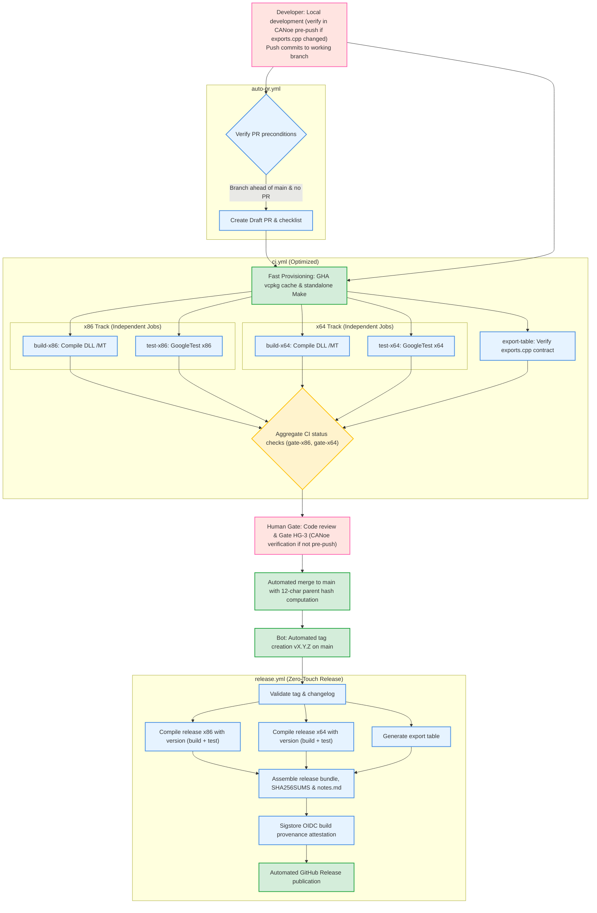
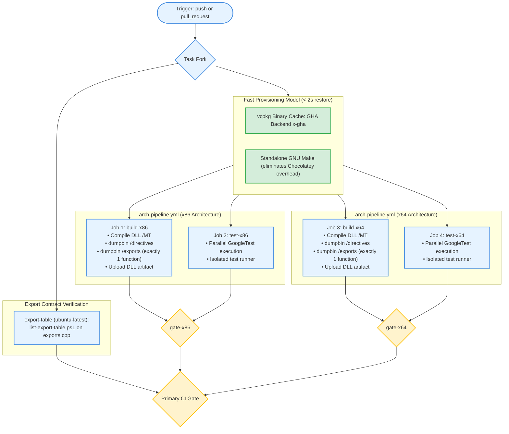
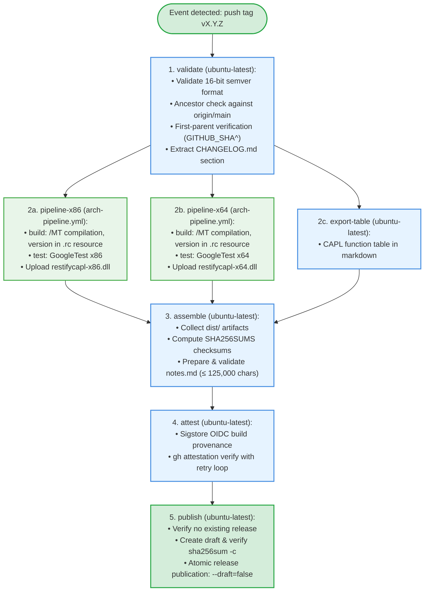

# CAPL REST DLL – GitHub Actions Target Flow & Optimization Roadmap

Documentation of the target CI/CD flow model following optimizations and the automation roadmap for the `restifycapl` project.

Strict architectural constraints:
- **`build` and `test` jobs remain 100% separated and parallel** for both architectures (`x86` and `x64`).
- Strict export contract (`caplDllGetTable4`, `exports.cpp`) and static `/MT` runtime libraries are fully preserved.
- Product version (`vX.Y.Z`) is strictly derived from the Git tag.

---

## 1. Target End-to-End Flow

The diagram below illustrates the optimized CI/CD workflow. Automated tasks take over repetitive operations (tool provisioning, GoogleTest unit testing, export table validation, changelog cutting, tagging, and publication). The engineer's focus is concentrated on CANoe integration verification (locally pre-push or during PR approval) and substantive code review.

---

## 2. Optimized Compilation & Test Pipeline (`arch-pipeline.yml`)

`build` and `test` jobs remain strictly decoupled across independent Windows runners, while their wall-clock runtimes are reduced through toolchain and caching optimizations.

---

## 3. Release Automation Pipeline (`release.yml`)

Clear DAG dependency graph without synthetic intermediary nodes, preserving full parallelism across `pipeline-x86`, `pipeline-x64`, and `export-table`.

---

## 4. Human Gates Reduction Matrix

| Gate ID | Before Optimization ([docs/ci-flow.md](file:///C:/Workspace/restifycapl/docs/ci-flow.md)) | After Optimization | Optimization Status |
|---|---|---|---|
| **HG-1** | Manual branch creation & push | Unchanged (developer decision) | Unchanged (Natural start of work) |
| **HG-2** | Manual checklist review | Automated CI status checks & bot assertions | Partial (Substantive code review) |
| **HG-3** | **Library verification in CANoe** | **Strict quality gate: local pre-push verification by developer OR verification by maintainer during PR approval (PR Approval Gate)** | **Preserved as a conscious human gate** (cannot be automated on cloud runners due to Vector CANoe hardware licensing) |
| **HG-4** | Manual 12-char hash entry & CHANGELOG cut | Automated script computing parent commit hash and formatting changelog section | **Automated** |
| **HG-5** | Manual squash-merge | Bot auto-merge upon approved review (or single-click maintainer merge) | **Optimized** |
| **HG-6** | Manual tag creation & push `vX.Y.Z` | Helper workflow or release-driven tag automation | **Optimized** |
| **HG-7** | Manual release verification & publishing | Automated Sigstore attestation & 7-step atomic publish workflow | **Fully Automated (Zero-Touch)** |

---

## 5. Role Allocation and Implementation Stages

- **Stage 1**: Standardization & synchronization of process documentation (`ci-flow.md` and `ci-optimized-flow.md`) -> `plan-writer` / `build-pipeline-engineer`.
- **Stage 2**: CI provisioning optimization (standalone GNU make, vcpkg `x-gha` cache, startup time reduced from ~30s to <2s) strictly preserving parallel `build` and `test` jobs and `/MT` flags -> `build-pipeline-engineer`. Checkpoint: verify no `/MT` regressions.
- **Stage 3**: Automated 12-char hash calculation and `CHANGELOG.md` header formatting on `chore/` branches -> `build-pipeline-engineer`.
- **Stage 4**: Release automation and publication hardening (Zero-Touch Release) preserving all 7 atomic publishing safeguards in `publish` -> `build-pipeline-engineer`. Checkpoint: verify test release on staging environment.
