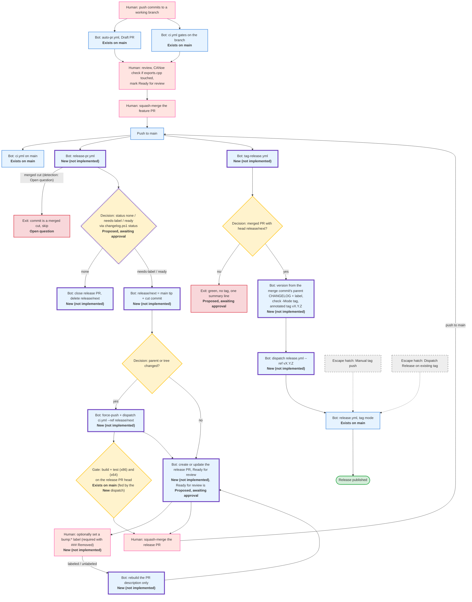
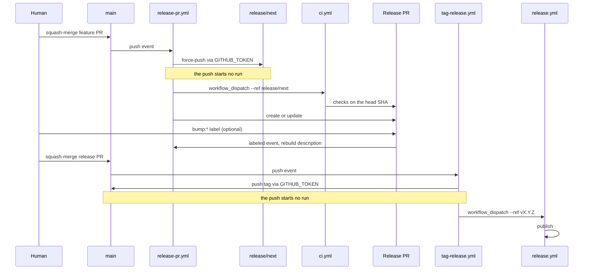
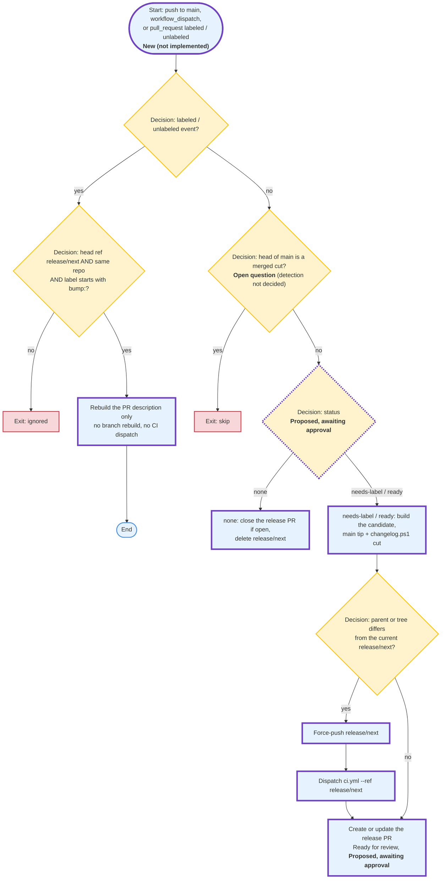
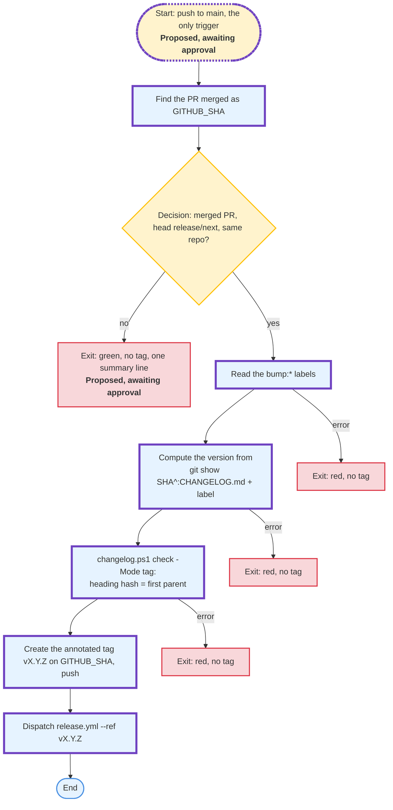

# CAPL REST DLL – GitHub Actions Target Flow (zero-touch release)

> **Status: target state, not implemented.** This document shows where the CI/CD flow is heading and how much a human still has to do for a release. The flow that runs on `main` today is described in [docs/ci-flow.md](ci-flow.md); this document does not merge with it.
>
> Sections 1 to 6 have the same titles and the same order as the sections of [docs/ci-flow.md](ci-flow.md), so that the two documents can be read side by side. Sections 7 to 9 are extensions that have no counterpart there.
>
> Every element carries one of four visible statuses:
>
> - **Exists on `main`**: present today in `.github/workflows/`, `.github/actions/` or `scripts/ci/changelog.ps1` on `main`.
> - **New (not implemented)**: part of the target flow, not written yet. Nothing marked New is claimed to work or to be verified.
> - **Proposed, awaiting approval**: a design choice the maintainer has not approved yet.
> - **Open question**: a problem with no settled answer.
>
> Proposed and Open question items are not decisions; this document changes if they change.
>
> A claim marked **(repo setting, outside the code)** concerns a GitHub repository setting that is configured in the repository settings, not in any file of this repository, so it cannot be confirmed from the code.
>
> A claim marked **(platform behavior, outside the code)** concerns behavior of the GitHub platform itself, which no file of this repository defines or can change.

---

## Principles

- **The main track is fully automatic.** From a squash-merged functional change to a published release, workflows do every step. The manual path exists only as escape hatches (Section 5.2), and none of them is automated.
- **A human appears in the main release track for two mandatory actions (verify, squash-merge; three if the release PR stays a draft), one conditional action (a `bump:*` label when `### Removed` is present) and an optional post-release inspection** (Section 7, Section 5).
- **No secrets and no personal access token.** Workflows authenticate only with `GITHUB_TOKEN`, with explicit `permissions` in every new workflow.
- **Follow-up runs are dispatched.** Where a bot needs a follow-up run, it dispatches it explicitly (the `GITHUB_TOKEN` rule is in Section 1.2).
- **Unchanged constraints:** build and test remain separate parallel jobs per architecture (x86 and x64); the required checks stay `build + test (x86)` and `build + test (x64)`; the export contract and `/MT` are untouched; the product version exists only in the Git tag; CHANGELOG headings stay `## [<12-char hash>] - YYYY-MM-DD`.
- **Release content is edited in one place:** `## [Unreleased]` on `main`. Anything committed by hand to the bot's branch is overwritten.
- **Rationale lives elsewhere.** This document maps who does what; the reasons are in [docs/ci-pipeline.md](ci-pipeline.md) and [docs/release-process.md](release-process.md) and are not repeated here.

---

## 1. End-to-End Overview

Diagram legend: pink nodes are humans, blue nodes are workflows, yellow nodes are decisions and gates, red nodes are exits, grey dashed nodes are escape hatches, a node with a thick purple border is **New (not implemented)**, and a yellow node with a thick dashed purple border is **Proposed, awaiting approval**.

Not every escape hatch is drawn; all of them are listed in Section 5.2.

The squash-merge of the release PR is itself a push to `main`, so three workflows start: `ci.yml`, `release-pr.yml` and `tag-release.yml`. `release-pr.yml` skips that commit because it is a merged cut; how it detects a merged cut is not decided (**Open question**, Section 9, point 3). `tag-release.yml` dispatches `release.yml` itself (Section 1.2). The single `release.yml` node stands for the whole workflow; its steps are in the section "Detailed Flow: `release.yml`" of [docs/ci-flow.md](ci-flow.md#4-detailed-flow-releaseyml). `release/next` is excluded from the `ci.yml` and `auto-pr.yml` filters, so CI on it has to be dispatched (Section 1.2).

### 1.1. What exists and what is new

| Component | Today on `main` | Target | Status |
|---|---|---|---|
| `ci.yml` jobs `gate-x86`, `gate-x64` (required checks), `export-table`, `changelog-fixtures`, and the `workflow_dispatch` trigger | Present | Unchanged | **Exists on `main`** |
| `ci.yml` job `actionlint` | Absent | Added (Section 3.4) | **New (not implemented)** |
| `arch-pipeline.yml`, composite actions `provision` and `export-table` | Present | Unchanged | **Exists on `main`** |
| `auto-pr.yml` | Present; push filters `stage/**`, `chore/**`, `fix/**`, `docs/**` | Unchanged. `release/**` is not covered, so it does not open a second PR for the bot's branch | **Exists on `main`** |
| `release.yml` | Present; mode follows the ref type | Unchanged | **Exists on `main`** |
| `scripts/ci/changelog.ps1` subcommands `notes`, `check`, `fixtures`, `cut`, `next-version` | Present | Unchanged | **Exists on `main`** |
| `scripts/ci/changelog.ps1` subcommand `status` | Absent | Added (Section 4.5) | **Proposed, awaiting approval** |
| `release-pr.yml` | Absent | Added (Section 4.5) | **New (not implemented)** |
| `tag-release.yml` | Absent | Added (Section 4.6) | **New (not implemented)** |
| Branch `release/next` | Absent | Reserved for the bot: tip of `main` plus exactly one commit made by `changelog.ps1 cut` | **New (not implemented)** |
| Labels `bump:major`, `bump:minor`, `bump:patch` | Absent | Set by a human on the release PR | **New (not implemented)**; creating them once by hand is **Proposed, awaiting approval** (**repo setting, outside the code**) |

### 1.2. Trigger chain and the `GITHUB_TOKEN` rule

This follows from a platform rule, not from code in this repository: events created with `GITHUB_TOKEN` do not start new workflow runs, with the exceptions `workflow_dispatch` and `repository_dispatch` **(platform behavior, outside the code)**. The same rule is already visible in the section "Detailed Flow: `auto-pr.yml`" of [docs/ci-flow.md](ci-flow.md#2-detailed-flow-auto-pryml).

Two consequences in the target flow: a tag pushed with `GITHUB_TOKEN` starts nothing, so `tag-release.yml` dispatches `release.yml` itself; and a release PR created or updated with `GITHUB_TOKEN` gets no CI from its `pull_request` event, so the checks on it come only from the dispatch of `ci.yml` on `release/next`.

### 1.3. Target jobs table

| Workflow | Job | Triggers | Permissions | Concurrency | Required check | Status |
|---|---|---|---|---|---|---|
| `ci.yml` | `gate-x86` (`build + test (x86)`), `gate-x64` (`build + test (x64)`) | push to `main` and working branches, `pull_request` to `main`, `workflow_dispatch` | `contents: read` | none | Yes | **Exists on `main`** |
| `ci.yml` | `export-table`, `changelog-fixtures` | same as above | `contents: read` | none | No | **Exists on `main`** |
| `ci.yml` | `actionlint` | same, except `workflow_dispatch` | `contents: read` | none | No | **New (not implemented)** |
| `release-pr.yml` | single job (name set at implementation) | push to `main`, `workflow_dispatch`, `pull_request` labeled / unlabeled | `contents: write`, `pull-requests: write`, `actions: write` | one group, newer run cancels older | No | **New (not implemented)** |
| `tag-release.yml` | single job (name set at implementation) | push to `main` | `contents: write`, `pull-requests: read`, `actions: write` | never cancels | No | **New (not implemented)** |
| `release.yml` | unchanged, see [docs/ci-flow.md](ci-flow.md#4-detailed-flow-releaseyml) | push of tag `v*.*.*`, `workflow_dispatch` | unchanged | unchanged | No | **Exists on `main`** |

`release.yml` runs in tag mode on a dispatch with a tag as the ref and publishes exactly like a tag push; a dispatch on a branch is a dry run that never publishes. The dispatch on a tag is intended (see the safeguard that makes a dispatch on a tag publish exactly like a tag push, in [docs/release-process.md](release-process.md#safeguards-in-publish)).

---

## 2. Detailed Flow: `auto-pr.yml`

**Exists on `main`**, unchanged. It opens the Draft PR for functional changes exactly as described in the section "Detailed Flow: `auto-pr.yml`" of [docs/ci-flow.md](ci-flow.md#2-detailed-flow-auto-pryml).

- Push filters stay `stage/**`, `chore/**`, `fix/**` and `docs/**`. `release/**` is not covered, so `auto-pr.yml` does not open a second PR for the bot's branch `release/next`; the release PR is created by `release-pr.yml` (Section 4.5).
- The setting "Allow GitHub Actions to create and approve pull requests" **(repo setting, outside the code)** is needed by `auto-pr.yml` and, in the target flow, by `release-pr.yml` as well (Section 6).

---

## 3. Detailed Flow: `ci.yml` and `arch-pipeline.yml`

**Exists on `main`**, unchanged: the `ci.yml` jobs `gate-x86`, `gate-x64` (the required checks), `export-table` and `changelog-fixtures`, the `workflow_dispatch` trigger, `arch-pipeline.yml` and the composite actions `provision` and `export-table`. Build and test stay separate parallel jobs per architecture. Their detail (Sections 3.0 to 3.3 of docs/ci-flow.md) is in the section "Detailed Flow: `ci.yml` and `arch-pipeline.yml`" of [docs/ci-flow.md](ci-flow.md#3-detailed-flow-ciyml-and-arch-pipelineyml).

The one addition in the target flow is the `actionlint` job (Section 3.4).

### 3.4. `actionlint` job in `ci.yml` (**New (not implemented)**)

The job has no path filter and runs with `if: github.event_name != 'workflow_dispatch'`. It is not a required check. The `actionlint` version is pinned and the download is verified by SHA-256. Permissions: `contents: read`.

A skipped required check counts as passed, so in this form the job must never be made required.

---

## 4. Detailed Flow: `release.yml`

**Exists on `main`**, unchanged: mode by ref type, the pipelines, assembly, attestation and publication. Its sections 4.1 to 4.4 of docs/ci-flow.md (diagram, job breakdown, steps of `publish`, `changelog.ps1`) are in the section "Detailed Flow: `release.yml`" of [docs/ci-flow.md](ci-flow.md#4-detailed-flow-releaseyml). In the target flow it is started by `tag-release.yml` with a dispatch on the new tag (Section 1.2) instead of by a human tag push.

The two workflows that surround it in the target flow are described below: `release-pr.yml` before it, `tag-release.yml` as its trigger.

### 4.5. Detailed flow: `release-pr.yml` (**New (not implemented)**)

Triggers: `push` to `main`, `workflow_dispatch`, and `pull_request` of type `labeled` or `unlabeled`.

- **Merged-cut detection:** **Open question** (Section 9, point 3).
- **Permissions:** `contents: write`, `pull-requests: write`, `actions: write`.
- **Concurrency:** one group; a newer run cancels an older one. A run cancelled between the force-push and the dispatch is not repaired by the next run (**Open question**, Section 8; see Section 9, point 2).
- **PR description:** the computed version, a preview of the release notes, and a checklist (CHANGELOG diff, version, green `build + test (x86)` and `build + test (x64)`). It also states that manual commits on `release/next` are lost and that the release content is edited in `## [Unreleased]` on `main`.
- **No hidden version marker** in the description: `tag-release.yml` always recomputes the version. **Proposed, awaiting approval.**
- **A release PR closed without merging** is replaced by a new one on the next push to `main`. **Proposed, awaiting approval.**
- **State needs-label (Open question):** `[Unreleased]` has `### Removed` and the PR has no `bump:*` label. The bot opens the PR and its description says a label is required, but nothing structural blocks a merge without one. The result would be a red `tag-release.yml` and an untagged cut, repaired through the Manual tag push hatch. How to block the merge is not decided (see Section 9, point 1).
- **Checks:** come from the dispatch of `ci.yml` (Section 1.2).
- **PR creation** requires the setting "Allow GitHub Actions to create and approve pull requests" **(repo setting, outside the code)**; `auto-pr.yml` needs the same setting.
- **Without the `status` subcommand**, the exit code cannot tell "nothing to release" from an error: `cut` and `next-version` return exit 1 for both. The proposed `changelog.ps1 status [-Label bump:major|bump:minor|bump:patch] [-ChangelogPath <file>]` (**Proposed, awaiting approval**) prints `none`, `needs-label` or `ready` and exits 0; exit 1 is a real error and exit 2 a usage error. It does not read tags. Existing exit codes and `release.yml` stay unchanged.
- **Label semantics:** a `bump:major|minor|patch` label overrides the bump level (the level, not a version number). The existing `next-version` rules (**Exists on `main`**): `### Added`, `### Changed` or `### Deprecated` give a minor bump; `### Removed` without a label is an error; anything else is a patch; major is never chosen automatically; a section containing only `### Development` is not a release.
- **`release/next`:** reserved for the bot. Manual commits there are overwritten.

### 4.6. Detailed flow: `tag-release.yml` (**New (not implemented)**)

- **Permissions:** `contents: write`, `pull-requests: read`, `actions: write`.
- **Concurrency:** never cancels a running run.
- **Why the version comes from the merge commit's parent:** after a squash-merge `[Unreleased]` in `GITHUB_SHA` is empty, so the cut section's content is read from `git show <sha>^:CHANGELOG.md` and combined with the label.
- **`release.yml` repeats the tag validation** (see the section "Detailed Flow: `release.yml`" in [docs/ci-flow.md](ci-flow.md#4-detailed-flow-releaseyml)).
- **No dispatch with `sha` or `version` inputs, and no other trigger than the push to `main`.** The only manual tagging hatches are a manual tag push and a Dispatch Release on an existing tag. **Proposed, awaiting approval.**

---

## 5. Human Gates Table

The table has the same title, columns, row order and gate numbers as the section "Human Gates Table" in [docs/ci-flow.md](ci-flow.md#5-human-gates-table) (numbers 1 to 7, written in front of the gate name), so the two tables can be read row by row and column by column. It describes each gate in the target state. Where one gate today covers two actions, the cells name both. Gates and conditions that exist only in the target flow follow under the separator row and are numbered 8 to 12, so they never collide with the numbers of docs/ci-flow.md. The comparison with today is in Section 5.1.

| Gate ID | Timing | Human Action | Why Not Automated Today |
|---|---|---|---|
| **1. Start of work** | Start of work | Creates a branch (`stage/**`, `chore/**`, `fix/**`, `docs/**`) and pushes the first commit of a functional change. A release needs no human branch: the bot owns `release/next`. | Architectural decision to initiate a new task; deciding to start a task is a human decision. |
| **2. Draft PR review and Ready for review** | After Draft PR creation (functional PRs); for the release PR, after the bot opens it | Functional PRs: reviews the PR checklist, judges the change, checks the required checks `build + test (x86)` and `build + test (x64)` and, by eye, `export-table` and `changelog-fixtures`, and marks the draft "Ready for review". Release PR: no separate step; the bot opens it Ready for review and the human check is gate 8 below. | Formal quality and policy approval before merge; judgment on correctness is not delegated to a workflow. |
| **3. CANoe check for `exports.cpp`** | Before merging changes to `exports.cpp` | Downloads the compiled DLLs from the PR's CI artifacts and verifies in CANoe that the CAPL nodes in `capl/` compile against the DLL. Never applies to the release PR, which changes only `CHANGELOG.md`. | **CANoe is not available on GitHub-hosted runners.** |
| **4. Release preparation (CHANGELOG cut)** | After each squash-merge of a functional PR, done by the bot | None in the main track: `release-pr.yml` cuts on `release/next` and opens the release PR. A human cut exists only as the Manual cut hatch (Section 5.2). The optional dry run on the cut branch is replaced by the version and notes preview in the release PR description plus CI on the same SHA; the dry run stays as the Dry run Release on a branch hatch. | Today: strict project convention (the product version cannot be hardcoded, the changelog section is anchored to the base commit hash) and nothing runs `cut` for the maintainer. Target: automated by `release-pr.yml`. |
| **5. Squash-merge** | After review (functional PR) or after the release PR verification | Functional PRs: squash-merges into `main`. Release PR: the squash-merge is the release decision; nothing more to check. Condition: `tag-release.yml` is already on `main`. Merging is allowed only when the required checks pass **(repo setting, outside the code)**. | The maintainer decides when a change enters `main`; for the release PR, when to release. |
| **6. Tagging** | After the squash-merge | None in the main track: `tag-release.yml` identifies the squash-merge commit, creates and pushes tag `vX.Y.Z` and dispatches `release.yml`. A human tag only via the Manual tag push hatch (Section 5.2). The optional dry run on `main` to find the commit to tag is not needed. | Today: a ref of type tag is the publication trigger and `release.yml` has no approval gate. Target: automated by `tag-release.yml`. |
| **7. Post-release inspection** | After publication | Optional: inspects the published release and `SHA256SUMS`; nothing waits for it. After a failed publish: reads the state message from the last step of `publish` and decides between re-running and fixing forward ([When a release fails](release-process.md#when-a-release-fails)). | Inspection: an optional look at the published release and its checksums. Recovery after a failure remains a human decision. |
| **Additional gates and conditions in the target flow (no gate with these numbers in docs/ci-flow.md)** | | | |
| **8. Verify the release PR** (takes over the verification part of gates 2 and 4) | After the bot opens or updates the release PR | Checks the CHANGELOG diff, the computed version, the notes preview and that both `build + test (x86)` and `build + test (x64)` are green. If `main` moves and the PR is rebuilt, verifies the new head after CI finishes. | The release content is judged by a human before the squash-merge. |
| **9. `bump:*` label** | After the bot opens the release PR | Optionally sets one of `bump:major`, `bump:minor`, `bump:patch`; required when `## [Unreleased]` contains `### Removed`. Major is never chosen automatically. | The bump level is a human choice; the label overrides the level computed from the CHANGELOG. |
| **10. Approve the release PR** (only if the `main` ruleset requires approving reviews) **(repo setting, outside the code)** | After the release PR verification | Approves the release PR. Whether the maintainer can approve the bot's PR is unconfirmed **(platform behavior, outside the code)**. | The approval requirement comes from the ruleset, which is not defined in any file of this repository. |
| **11. One-time setup: create the three `bump:*` labels** **(repo setting, outside the code)** | Once, before the first release PR | Creates `bump:major`, `bump:minor` and `bump:patch` in the repository. | Labels are repository settings; no workflow creates them. |
| **12. Keep "Allow GitHub Actions to create and approve pull requests" on** **(repo setting, outside the code)** (a setting, see Section 6) | Ongoing | Keeps the setting on; `release-pr.yml` needs it as well as `auto-pr.yml`. | A repository setting that workflows cannot change. |

Manual runs beyond the gates above are the escape hatches in Section 5.2. How many of these gates count as interventions per release, today and in the target, is in Section 7.2; the approval (gate 10) is outside the Total there.

### 5.1. Today vs target per gate

Same gate numbers as the table above and as docs/ci-flow.md. "Today" is the gate as described in [docs/ci-flow.md](ci-flow.md#5-human-gates-table).

| Gate (number) | Today (docs/ci-flow.md) | Target | Change | Status |
|---|---|---|---|---|
| **1. Start of work** | Human creates the branch and pushes the initial commit; the push starts `auto-pr.yml` and `ci.yml`. | Human for functional changes; the bot owns the release branch | Unchanged | **Exists on `main`** |
| **2. Draft PR review and Ready for review** | Human reviews the checklist and marks the draft Ready for review, for every PR including the PR that carries the cut. | Functional PRs: human. Release PR: replaced by gate 8 | Unchanged for functional PRs; Changed for the release | **Exists on `main`**; release part **New (not implemented)**; Ready for review **Proposed, awaiting approval** |
| **3. CANoe check for `exports.cpp`** | Same, and the PR checklist carries the item only when `exports.cpp` is touched. | Human, unchanged | Unchanged | **Exists on `main`** |
| **4. Release preparation (CHANGELOG cut)** | Human runs `changelog.ps1 cut` locally on a `chore/` branch, reviews the result, pushes, optionally dispatches a dry run, and by convention starts only when `ci.yml` on `main` is green. | `release-pr.yml` (bot); a human cut only via a hatch | Automated (human only via a hatch); the optional dry run is Removed (hatch remains) | **New (not implemented)**; Manual cut hatch **Proposed, awaiting approval**; preview **New (not implemented)**; dry run **Exists on `main`** |
| **5. Squash-merge** | Human squash-merges every PR, including the PR that carries the cut. | Human, unchanged; the release PR merge becomes the release decision | Unchanged (becomes the release decision) | **Exists on `main`**; release PR **New (not implemented)** |
| **6. Tagging** | Human optionally dispatches a dry run on `main`, then creates and pushes tag `vX.Y.Z` on the squash-merge commit; its first parent must be the base commit named in the CHANGELOG heading. | `tag-release.yml` (bot); a human tag only via a hatch | Automated (human only via a hatch); the optional dry run on `main` is Removed | **New (not implemented)** |
| **7. Post-release inspection** | Human inspects the published release and checksums as the final sign-off; after a failed publish decides between re-running and fixing forward. | Inspection: optional human, nothing waits for it. Recovery: human, unchanged | Inspection: Optional. Recovery: Unchanged | Inspection **Proposed, awaiting approval**; recovery **Exists on `main`** |
| **Additional gates and conditions in the target flow (no gate with these numbers in docs/ci-flow.md)** | | | | |
| **8. Verify the release PR** | Part of gate 2 (PR review) and of gate 4 (release preparation). | Human | Changed: merged into one verification (one verification intervention in both states, see Section 7.2) | **New (not implemented)** |
| **9. `bump:*` label** | None. | Human | New | **New (not implemented)**; the case of a missing label is an **Open question** (Section 9, point 1) |
| **10. Approve the release PR** **(repo setting, outside the code)** | Human, only if the ruleset requires it. | Human, only if the ruleset requires it | Unchanged, conditional | **Open question** |
| **11. One-time setup: create the three `bump:*` labels** **(repo setting, outside the code)** | None. | Human, once | New one-time | Label creation **Proposed, awaiting approval** |
| **12. Keep "Allow GitHub Actions to create and approve pull requests" on** **(repo setting, outside the code)** | Already required by `auto-pr.yml`. | Human, ongoing | Unchanged | Required by `auto-pr.yml`, which **Exists on `main`** |

### 5.2. Escape hatches (manual, never automated)

Escape hatches are not gates.

| Hatch | Use when | How | Caveat |
|---|---|---|---|
| Manual tag push | `tag-release.yml` is red, did not run, or was not on `main` when the release PR merged | Create `git tag -a vX.Y.Z` on the squash-merge commit of the merged cut and push it; a push by a human starts `release.yml` by itself | Never make a second cut. |
| Dispatch Release on an existing tag | The tag exists but the release does not | Actions tab with the tag as the ref, or `gh workflow run release.yml --ref vX.Y.Z` | Publishes with the same safeguards as a tag push. |
| Manual cut (**Proposed, awaiting approval**) | The bot flow cannot be used | Follow [Cutting a release](release-process.md#cutting-a-release), then Manual tag push | Not auto-tagged; follows the existing manual procedure in Cutting a release. |
| Dry run Release on a branch | A preview is wanted | Dispatch `release.yml` with a branch as the ref | Never publishes. |
| Dispatch `ci.yml` on `release/next` | The release PR has no checks; available once `release/next` exists (**New (not implemented)**) | `gh workflow run ci.yml --ref release/next` | Brings only the checks; changes nothing else. |

Recovery cases are in [When a release fails](release-process.md#when-a-release-fails). No escape hatch gets automation.

---

## 6. Settings Outside the Code

These affect the flow but are not defined in any workflow file, so this document cannot confirm them from the code; the target flow adds the `bump:*` labels and uses the pull request setting for `release-pr.yml` as well:

| Setting | Effect on the flow |
|---|---|
| Ruleset on `main` **(repo setting, outside the code)** | `build + test (x86)` and `build + test (x64)` required (confirmed by the repository owner). Pull request required, branch up to date before merge and force-push blocked: unconfirmed **(repo setting, outside the code)**. Whether approving reviews are required: unknown **(repo setting, outside the code)**; the conditional approval, gate 10 in the Human Gates Table (Section 5), the approving-review item in the list of what can force a human to step in (Section 7) and Section 9, point 6, depend on it. |
| "Allow GitHub Actions to create and approve pull requests" **(repo setting, outside the code)** | Needed by `release-pr.yml` and by `auto-pr.yml`. |
| `GITHUB_TOKEN` behavior **(platform behavior, outside the code)** | See Section 1.2. |
| Tag protection rules **(repo setting, outside the code)** | **Open question**: whether `v*.*.*` tags are protected is unknown, unconfirmed **(repo setting, outside the code)**; a ruleset on `v*.*.*` would block the tag push by `GITHUB_TOKEN`. |
| Labels `bump:major`, `bump:minor`, `bump:patch` **(repo setting, outside the code)** | Must exist; created once by hand. **Proposed, awaiting approval.** |
| Squash merge only **(repo setting, outside the code)** | A rebase merge breaks the first-parent rule; `check -Mode tag` detects it before tagging; squash merge is the working setting ([Cutting a release](release-process.md#cutting-a-release)). |
| Default "Workflow permissions" **(repo setting, outside the code)** | Sets the default `GITHUB_TOKEN` permissions for workflows that declare none. |

---

## 7. Zero-touch coverage

**What the human does in the main release track:** verifies the release PR; optionally sets a `bump:*` label (required when `## [Unreleased]` contains `### Removed`); squash-merges the release PR; optionally inspects the published release afterwards.

**What is fully automatic once the target flow exists:**

- the CHANGELOG cut and the version computation;
- building `release/next` and dispatching CI on it;
- creating or updating the release PR, and rebuilding its description after a label change;
- closing the release PR when there is nothing to release;
- validation before tagging, the tag itself, and the dispatch of `release.yml`;
- build, test, export table, assembly, attestation and publication in `release.yml` (**Exists on `main`** today).

**What still needs a human for other reasons:** the CANoe check when `src/module/exports.cpp` changes (CANoe does not run on GitHub-hosted runners), review, and the squash-merge of functional PRs. These concern bringing changes into `main`, not the release.

**Escape hatches (manual, not automated):** Manual tag push, Dispatch Release on an existing tag and Dry run Release on a branch are available today. Manual cut (**Proposed, awaiting approval**) and Dispatch `ci.yml` on `release/next` (needs `release/next`, which is **New (not implemented)**) are not available yet (Section 5.2; recovery steps in [docs/release-process.md](release-process.md#when-a-release-fails)).

**What the automation does not cover:** none of the escape hatches. They stay manual.

**What can force a human to step in:**

- a missing label while `## [Unreleased]` contains `### Removed` (**Open question**, Section 4.5 and Section 9);
- a failed dispatch of `ci.yml` on `release/next`, which leaves the release PR without checks;
- a run of `release-pr.yml` cancelled between the force-push and the dispatch of `ci.yml` (**Open question**, Section 8 and Section 9, point 2);
- a failed dispatch of `release.yml` after the tag was pushed;
- the setting "Allow GitHub Actions to create and approve pull requests" being off **(repo setting, outside the code)**;
- merging the release PR before `tag-release.yml` is on `main`;
- `main` moving during verification, so `release/next` is rebuilt and the human verifies the new head after CI finishes;
- the ruleset requiring an approving review **(repo setting, outside the code)**;
- checks from the dispatch not being accepted by the ruleset (unproven until `release-pr.yml` exists; the PR cannot be merged);
- a failed publish (a recovery decision, gate 7 in Section 5);
- a defect in `release.yml` itself (the recovery cases for a defect found before or after publication, in [docs/release-process.md](release-process.md#when-a-release-fails)).

### 7.1. Zero-touch level

| Release step | Who | Automatic | Available once |
|---|---|---|---|
| Release content written into `[Unreleased]` with each change | Author | No, by design | today (exists on main) |
| CHANGELOG cut | Bot, `release-pr.yml` (**New (not implemented)**) | Yes | `release-pr.yml` lands |
| Version computed | Bot | Yes | preview: `release-pr.yml` lands; final: `tag-release.yml` lands |
| Bump level override | Human, `bump:*` label (optional; required with `### Removed`) | No | `release-pr.yml` lands |
| `release/next` built, CI dispatched, checks on the PR | Bot | Yes | `release-pr.yml` lands |
| Release PR opened or updated as Ready for review (**Proposed, awaiting approval**) | Bot | Yes | `release-pr.yml` lands |
| Release PR verified | Human | No | not applicable (always human) |
| Squash-merge of the release PR | Human | No | not applicable (always human) |
| Validation before tagging and tag `vX.Y.Z` | Bot, `tag-release.yml` (**New (not implemented)**) | Yes | `tag-release.yml` lands |
| `release.yml` started on the tag | Bot, dispatch | Yes | `tag-release.yml` lands |
| Build, test x86/x64, export table, assemble, attest, publish | `release.yml` (**Exists on `main`**) | Yes | today (exists on main) |
| Post-release inspection (optional; **Proposed, awaiting approval**) | Human | No | not applicable (always human) |
| Approve the release PR (only if the ruleset requires it) | Human | No | not applicable (repo setting, outside the code) |
| Recovery after a failed release | Human | No | today (exists on main) |

Gate by gate comparison with today: Section 5.

### 7.2. Human interventions per release: today vs target

Only the release path counts, that is, from the moment the functional changes are already on `main` to publication; only an error-free run counts; one intervention is one human node on diagram 1 in [docs/ci-flow.md](ci-flow.md#1-end-to-end-overview) or one row of the Human Gates Table (Section 5) in the target state; error handling (the failed-publish part of gate 7) is counted separately.

| Intervention | Today | Target |
|---|---|---|
| CHANGELOG cut on a `chore/` branch and push | 1 | 0 (automated) |
| Review the PR checklist (cut PR) / verify the release PR | 1 | 1 |
| Mark the PR Ready for review | 1 | 0 (the bot opens it ready, **Proposed, awaiting approval**; 1 if it stays a draft) |
| Dry run on the cut branch | optional | 0 (hatch only) |
| Squash-merge | 1 | 1 |
| Dry run on `main` | optional | 0 |
| Tag push | 1 | 0 (automated) |
| Inspect the published release | 1 | optional (**Proposed, awaiting approval**) |
| `bump:*` label | not applicable | 0, 1 when `### Removed` is present |
| Approve the PR (only if the ruleset requires it) | conditional | conditional |
| **Total** | 6 mandatory + 2 optional | 2 mandatory (3 if the PR stays a draft) + 1 conditional (label) + 1 optional (inspection) |

The approval is outside the Total in both states: it is one more conditional action, only if the ruleset requires it. A required approving review applies to both states if the ruleset requires it. Whether the maintainer can approve the bot's PR is unconfirmed **(platform behavior, outside the code)**; today the maintainer authors the cut PR.

---

## 8. Risks and Mitigations

| Risk | Effect | Mitigation |
|---|---|---|
| Missing label while `### Removed` is present | Red `tag-release.yml`, untagged cut | **Open question** (Section 9, point 1): no mechanism blocks the merge yet. Repair through the Manual tag push hatch. |
| Wrong label | Wrong version | The version preview in the PR description is rebuilt after each label change. A published tag is never moved; the fix is the next release. |
| Release PR merged before `tag-release.yml` is on `main` | Untagged cut | Do not merge earlier. Repair with a manual tag on the squash commit, never a second cut. |
| A skipped required check counts as passed | A check can be bypassed | `actionlint` is never required. |
| A push by `GITHUB_TOKEN` does not start CI (Section 1.2) | The release PR has no checks | `ci.yml` is dispatched. If the dispatch fails, the PR without checks cannot be merged, which is the safe state; use the Dispatch `ci.yml` on `release/next` hatch. |
| A `release-pr.yml` run is cancelled after the force-push and before the dispatch, including by a `labeled` / `unlabeled` event in the same concurrency group | The next run finds the same parent and tree, skips the dispatch, and the release PR stays without checks | **Open question** (Section 9, point 2): the dispatch condition is not settled beyond a change of parent or tree. Recover with the Dispatch `ci.yml` on `release/next` hatch. |
| Checks from a dispatch on a bot PR | Unproven on the release PR (not yet tested) | Proven only once `release-pr.yml` is implemented and has produced a release PR. |
| "Allow GitHub Actions to create and approve pull requests" is off **(repo setting, outside the code)** | PR creation fails | The failure is visible in the run. |
| Version preview differs from the tag version | Surprise at tagging | `tag-release.yml` always recomputes the version. |
| Manual commits on `release/next` | Lost | The PR description says so. |
| CI cost | One extra full x86 and x64 run for each change of `release/next` | Accepted. |
| Tag exists but the `release.yml` dispatch failed | No release | Dispatch Release on an existing tag. |
| Rebase merge | First-parent rule broken | Squash merge only (Section 6). |
| Defect before publication (delete the tag, fix, cut again) | **Open question**: how this case maps onto the bot flow is not decided | See [When a release fails](release-process.md#when-a-release-fails). |
| Export contract, `/MT`, x86/x64 parity | None | Unchanged. |

---

## 9. Design Points Under Review

These points are not decided; each recommendation is **Proposed, awaiting approval**, and the diagrams in Sections 1, 1.2, 4.5 and 4.6 show the shape without the recommendations below.

| Point | Problem | Options | Recommendation (Proposed, awaiting approval) |
|---|---|---|---|
| 1. Missing label with `### Removed` | The only place where a human can break the release: a merge without the label ends in a red `tag-release.yml` and an untagged cut. | (A) a warning in the PR description only; (B) in the needs-label state the bot keeps the PR as a draft and marks it ready on the `labeled` event (the trigger is in the proposed trigger set), and a draft cannot be merged **(platform behavior, outside the code)**; (C) a separate bot status/check configured as required (needs a ruleset change and would block other PRs that do not get that check). | B: a structural block without a ruleset change and without an extra click. Whether `GITHUB_TOKEN` can toggle draft/ready is to be confirmed at implementation. Would change an approved decision: the release PR is always opened Ready for review. |
| 2. Dispatch only on a parent/tree change; cancelled run | A cancelled run can leave the release PR without checks; full description in Section 8 (the cancelled-run row). | (A) unchanged; (B) always dispatch CI on `workflow_dispatch`; (C) label events in their own concurrency group so they do not cancel a rebuild; (D) check whether the head SHA already has checks (may need an extra read permission, to be confirmed). | B + C: extra CI cost only on a manual dispatch; a manual dispatch of `release-pr.yml` becomes a repair in itself. Would change an approved decision: dispatch only when parent or tree changed; one concurrency group cancelling older runs. |
| 3. Detecting a merged cut | `release-pr.yml` must not act on the squash-merge commit of a cut. | (A) the PR linked to the commit has head `release/next` (API, same logic as `tag-release.yml`); (B) `CHANGELOG.md` in that commit has a heading hash equal to the first parent (git only, same rule as `check -Mode tag`); (C) a commit message pattern (brittle); (D) no separate skip: after a merged cut `[Unreleased]` is empty, so status `none` closes the PR and deletes `release/next` by itself. | D: removes one Open question and one branch of logic. If the skip stays: B. Would change an approved decision: `release-pr.yml` skips a merged cut. |
| 4. Release PR closed without merging | What happens to a closed release PR. | (A) a new PR at the next push to `main` (current proposal); (B) reopen the old PR. | A. Closing does not hold up the release; the PR is updated on every push to `main`, so a release is postponed simply by leaving the PR open without merging. |
| 5. `main` moves during verification | The candidate is rebuilt while the human is verifying. | (A) no rule: verify the head SHA by hand; (B) verification applies to the head SHA present at merge time; (C) a ruleset "up to date before merge" enforces a current state (unconfirmed **(repo setting, outside the code)**). | B: verification applies to the head SHA present at merge time; the PR description says plainly that after a rebuild the diff must be checked again. |
| 6. Required approving reviews | The ruleset may require an approval **(repo setting, outside the code)**. | (A) require approving reviews on `main`; (B) do not require them. | Settle the ruleset setting **(repo setting, outside the code)**; if approval is required, gate 10 of the Human Gates Table (Section 5) becomes an additional mandatory human action next to the Total of Section 7.2; it stays outside that Total, which is unchanged. |
