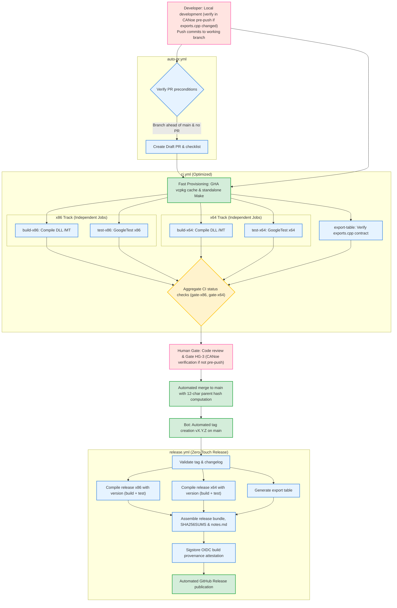
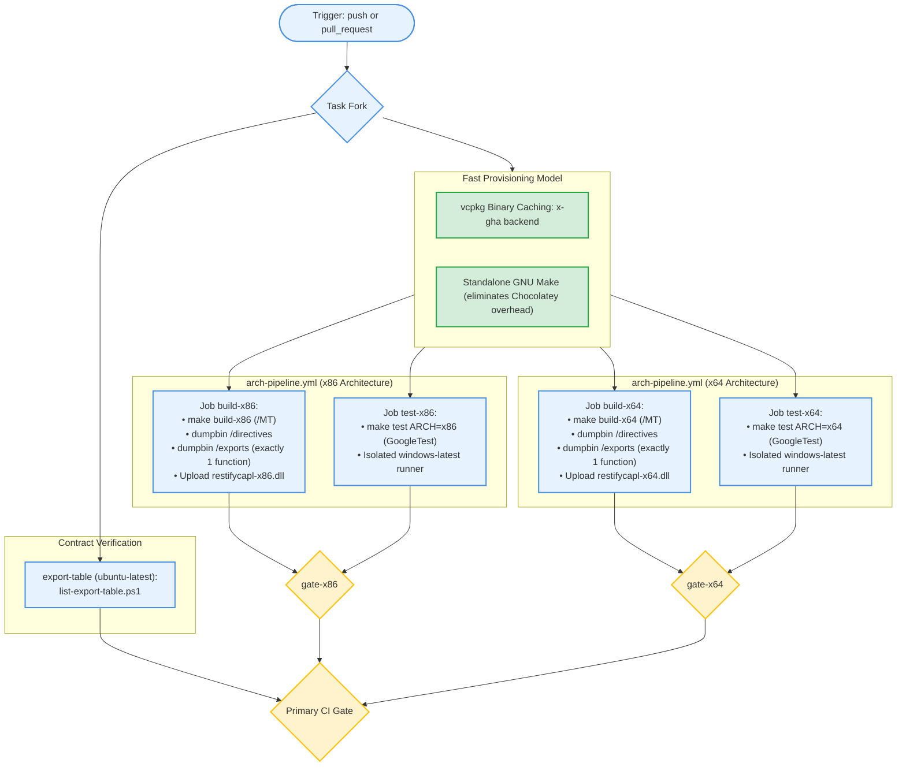
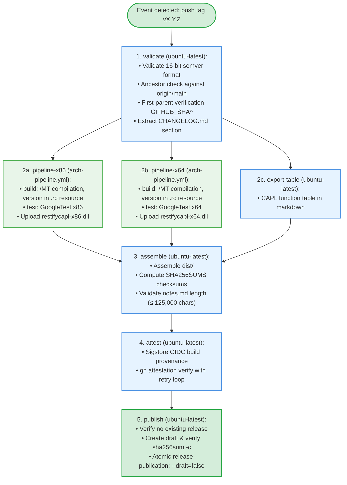

# Planning Report: Mermaid Syntax Analysis & CI/CD Optimization Plan (Zero-Touch & Parallel Arch Pipeline)

Planning and architectural documentation for GitHub Actions workflow optimization in the `restifycapl` project.

---

## 1. Analysis of Mermaid Syntax & Decoding Issues

### Sources of decision node decoding errors in Markdown preview:
1. **Unescaped special characters and relations inside node labels**:
   - Nodes such as `VAL --> PARALLEL{'Uruchomienie równoległe'}:::decision` in certain Mermaid engines (e.g. VS Code Markdown Preview) caused parse errors due to single quotes `'` and unescaped format inside curly brackets `{}`.
   - The presence of raw inequality characters `<` and `>` (e.g. `< 125,000 characters` or `make test ARCH=<arch>`) and arrow characters `->` inside node labels caused parsers to treat them as HTML tags or relation tokens, breaking the AST parser tree.
2. **Use of multi-node operator `&` in edge relations**:
   - Syntax like `RX86 & RX64 & RTAB --> ASM` or `FORK --> A & B & C` is a Mermaid extension that triggers `Parse error on line ...: Unexpected token &` in strict or older renderers.
3. **Remediation rules applied in updated diagrams**:
   - All node labels are enclosed in double quotes `""`.
   - Inequality characters are replaced with safe HTML entities (`&lt;`, `&gt;`, `&le;`, `&ge;`).
   - All graph connections are defined individually (line-by-line), eliminating the `&` operator.

---

## 2. Target CI/CD Model (Target Flow & Optimization Architecture)

### 2.1 Key Principles
- **Strict decoupling and parallelism of `build` and `test` in `arch-pipeline.yml`**: By design, compilation (`build`) and GoogleTest unit/integration testing (`test`) remain separate, parallel jobs on Windows runners for both architectures (x86 and x64). This guarantees environment isolation and immediate disambiguation between build failures and test failures.
- **Rigorous quality gates**: Vector CANoe verification is formalized as a conscious Human Gate (pre-push or during PR approval).
- **Automation of repetitive operations**: Eliminating manual changelog cutting and manual tagging while retaining strict cryptographic build provenance and security guarantees.

### 2.2 Optimization Pillars
1. **Accelerated Toolchain Provisioning**:
   - Replacing `choco install make` with standalone GNU Make (fetching single binary from GitHub Releases or `actions/cache`), dropping setup time from ~60s to <2s.
   - Native vcpkg binary caching in GitHub Actions: `VCPKG_BINARY_SOURCES: "clear;x-gha,readwrite"`. Prebuilt `/MT` static packages (`nlohmann-json`, `openssl`) are restored instantly from GHA cache.
2. **Automated 12-char Hash Calculation and CHANGELOG Cut (Eliminating HG-4)**:
   - A `prepare-release-changelog` script automatically retrieves `git rev-parse --short=12 origin/main`, promotes the `[Unreleased]` section to `[vX.Y.Z] - YYYY-MM-DD (hash)`, and updates diff links in `CHANGELOG.md` without manual developer intervention.
3. **Formalized Vector CANoe Verification Gate (Quality Gate HG-3)**:
   - Verification of libraries in CANoe remains an engineering responsibility (cannot run on cloud runners due to hardware Vector CANoe licensing).
   - Occurs at one of two explicit checkpoints:
     a) **Local pre-push:** developer verifies CAPL script compilation and DLL loading on a CANoe workstation prior to pushing changes touching `exports.cpp`.
     b) **During PR approval (PR Approval Gate):** reviewer/maintainer verifies downloaded DLLs in CANoe before formal approval of the PR.
4. **Automated Post-Merge Tagging and Zero-Touch Release in `release.yml` (Eliminating HG-6 & HG-7)**:
   - Helper workflow or release-driven tagging upon squash-merge into `main`.
   - Tag push triggers `release.yml`, executing validation, parallel versioned compilation (with separate build and test), export table generation, Sigstore OIDC provenance attestation, and direct release publication.

---

## 3. Syntactically Valid Mermaid Diagrams

### Diagram 1: Target End-to-End Architecture

### Diagram 2: Optimized `arch-pipeline.yml` (Decoupled Build & Test)

### Diagram 3: Target `release.yml` (Zero-Touch Release)

---

## 4. Human Gates Reduction Matrix

| Gate ID | Before Optimization ([docs/ci-flow.md](file:///C:/Workspace/restifycapl/docs/ci-flow.md)) | After Optimization | Reduction Status |
|---|---|---|---|
| **HG-1** | Manual branch creation & push | Unchanged (developer decision) | None (Natural start of work) |
| **HG-2** | Manual checklist review | Automated CI status checks & bot assertions | Partial (Substantive code review) |
| **HG-3** | **Library verification in CANoe** | **Strict quality gate: local pre-push verification by developer OR verification by maintainer during PR approval (PR Approval Gate)** | **Preserved as a conscious human gate** (cannot be automated on cloud runners due to Vector CANoe hardware licensing) |
| **HG-4** | **Manual 12-char hash entry & CHANGELOG cut** | **Automated script computing parent commit hash and formatting changelog section** | **Fully Automated (Eliminated)** |
| **HG-5** | Manual squash-merge | Bot auto-merge upon approved review (or single-click maintainer merge) | **Optimized** |
| **HG-6** | **Manual tag creation & push `vX.Y.Z`** | **Helper workflow or release-driven tag automation** | **Optimized** |
| **HG-7** | Manual release verification & publishing | Automated Sigstore attestation & 7-step atomic publish workflow | **Fully Automated (Zero-Touch)** |

---

## 5. Role Allocation and Implementation Stages

- **Stage 1**: Standardization & synchronization of process documentation (`ci-flow.md` and `ci-optimized-flow.md`) -> `plan-writer` / `build-pipeline-engineer`.
- **Stage 2**: CI provisioning optimization (standalone GNU make, vcpkg `x-gha` cache) strictly preserving parallel `build` and `test` jobs and `/MT` flags -> `build-pipeline-engineer`. Checkpoint: verify no `/MT` regressions.
- **Stage 3**: Automated 12-char hash calculation and `CHANGELOG.md` header formatting on `chore/` branches -> `build-pipeline-engineer` + `test-engineer`.
- **Stage 4**: Release automation and publication hardening (Zero-Touch Release) preserving all 7 atomic publishing safeguards in `publish` -> `build-pipeline-engineer`. Checkpoint: verify test release on staging environment.
